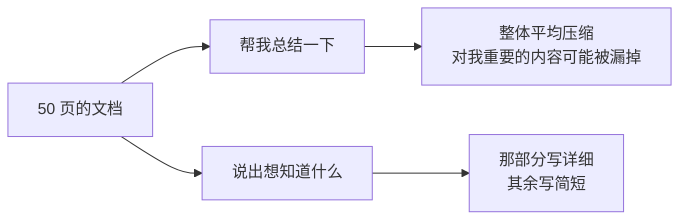
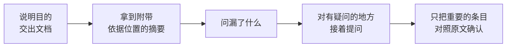

<dl class="facts">
  <div><dt>适合谁</dt><dd>所有人</dd></div>
  <div><dt>步骤</dt><dd>3<small>步</small></dd></div>
  <div><dt>例句</dt><dd>4<small>类</small></dd></div>
  <div><dt>关键</dt><dd>先提问题</dd></div>
</dl>

## “帮我总结一下”为什么不够

摘要是**决定丢掉什么的工作**。不知道目的，AI 就会把整篇文档平均地压缩。结果你要找的那一行，比如合同里的违约金条款，就被一句“另有其他条件”带过去了。



## 第 1 步：先说想知道什么

贴文档之前，先写清楚**我是谁，要用这份文档决定什么**。

| 不要这样 | 而是这样 |
|---|---|
| 帮我总结这份合同 | 我是租客。只挑出可能让我多付钱或者对我不利的条款 |
| 帮我总结这份报告 | 明天开会要决定是否赞成这个方案。请把赞成的依据和反对的依据分开列出 |
| 帮我总结这篇论文 | 我不是这个专业的。发现了什么、怎么验证的、局限是什么，写成三段 |

## 第 2 步：同时要到依据的位置

如果要确认摘要对不对，还得把原文从头再读一遍，那摘要就没有意义了。让它**给每一条都附上页码或条款编号，以及原文的句子**，就可以只去需要的地方核对。

```text
每一条都请原样引用作为依据的原文句子，
并附上页码或条款编号。
文档里没有的内容不要靠猜测来补。
```

## 第 3 步：反问漏了什么

拿到摘要后，再多问这一个问题。

```text
刚才的摘要里去掉的内容中，有没有以我的情况应该知道的？
重点看和例外条件、期限、金额有关的。
```

摘要不是一次就结束的事，更接近于**和文档对话**。看完摘要，对哪里有疑问就接着问。



## 可以直接用的例句

### 合同·条款

```text
我是这份合同的 [租客 / 自由职业者 / 买方]。
请把下面这份合同里的以下内容整理成表格。
1. 我要付的钱和期限
2. 我必须履行的义务
3. 解约条件和违约金
4. 对我不利或者不常见的条款
每一条都附上条款编号，含糊的表述请原样引用原文。
```

AI 的摘要是**读合同前的准备**，不是法律审查。金额大，或者有让人担心的条款，就拿给专业人士看。

### 工作报告

```text
我要在 1 分钟内向高管汇报这份报告。
- 一句话结论
- 3 个作为依据的数字（附页码）
- 需要做决定的事项
- 报告没有回答的问题
```

最后一项很有用。因为它指出的是报告里**没有的东西**。

### 论文·技术文档

```text
请当作是在给不了解这个领域的人讲解来整理。
1. 想解决什么问题
2. 怎么验证的（对象、规模、方法）
3. 结果是什么（包含数字）
4. 作者自己指出的局限
5. 为什么不能夸大地理解这个结果
```

### 会议记录·录音转写

```text
下面是会议的录音转写。请按以下格式整理。
- 已经决定的事
- 没有决定、留待以后的事
- 待办：负责人 / 内容 / 期限（表格）
转写里负责人或期限不明确的，请写“待定”。
```

如果不允许写“待定”，AI 可能会靠猜来填负责人。

## 常见问题

- **文档太长。**一次能放进去的篇幅是有上限的。按章节分开摘要，再让它把这些摘要合并起来。
- **是扫描的 PDF。**如果里面不是文字而是图片，表格和数字可能被读错。数字要和原文对照。
- **表格和图表。**它有时会把表格的行和列弄混。重要的表格，单独拿出来问。
- **公司文档。**先确认这份资料能不能贴进去。可以参考[不能输入 AI 的信息清单](/zh/posts/ai-privacy-checklist/)。

## 小结

- 摘要是决定丢掉什么的工作。**先说想知道什么。**
- 让每一条都带上**页码和原文引用**，确认起来就容易了。
- 拿到摘要后，再问一句“去掉的内容里有没有重要的？”。

### 推荐一起读

- [AI 自信地答错时：验证回答的方法](/zh/posts/ai-hallucination-check/)
- [让 AI 干活时，结果大不一样的 5 个提问方法](/zh/posts/ai-prompt-basics/)
- [用 AI 快速学习陌生领域的方法](/zh/posts/ai-learn-new-topic/)
