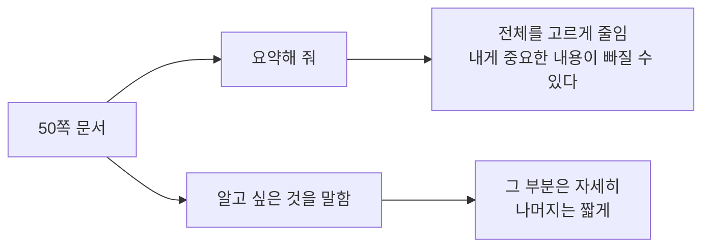
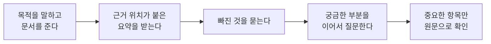

<dl class="facts">
  <div><dt>대상</dt><dd>누구나</dd></div>
  <div><dt>단계</dt><dd>3<small>단계</small></dd></div>
  <div><dt>예문</dt><dd>4<small>종류</small></dd></div>
  <div><dt>핵심</dt><dd>질문 먼저</dd></div>
</dl>

## "요약해 줘" 가 아쉬운 이유

요약은 **무엇을 버릴지 고르는 일**입니다. 목적을 모르면 AI 는 문서 전체를 고르게 줄입니다. 그러면 내가 찾던 한 줄, 예를 들어 계약서의 위약금 조항은 "기타 조건이 있습니다" 한마디로 뭉개집니다.



## 1단계: 알고 싶은 것을 먼저 말한다

문서를 붙이기 전에 **내가 누구이고, 이 문서로 무엇을 결정하려는지**를 적습니다.

| 이렇게 말고 | 이렇게 |
|---|---|
| 이 계약서 요약해 줘 | 나는 세입자다. 내가 돈을 더 내야 하거나 불리해질 수 있는 조항만 뽑아 줘 |
| 이 보고서 요약해 줘 | 내일 회의에서 이 안에 찬성할지 정해야 한다. 찬성 근거와 반대 근거를 나눠 줘 |
| 이 논문 요약해 줘 | 비전공자다. 무엇을 밝혔는지, 어떻게 확인했는지, 한계가 뭔지 세 문단으로 |

## 2단계: 근거 위치를 함께 받는다

요약이 맞는지 확인하려면 원문을 다시 다 읽어야 한다면 요약한 의미가 없습니다. **항목마다 쪽 번호나 조항 번호, 원문 문장**을 함께 받으면 필요한 곳만 찾아가 확인할 수 있습니다.

```text
항목마다 근거가 된 원문 문장을 그대로 인용하고,
쪽 번호나 조항 번호를 붙여 줘.
문서에 없는 내용은 추측해서 채우지 마.
```

## 3단계: 빠진 것을 되묻는다

요약을 받은 뒤 이 질문 하나를 더 던집니다.

```text
방금 요약에서 뺀 내용 중에, 내 상황에서 알아 둬야 할 것이 있어?
특히 예외 조건, 기한, 금액과 관련된 것 위주로.
```

요약은 한 번에 끝나는 일이 아니라 **문서와 대화하는 일**에 가깝습니다. 요약을 본 뒤 궁금한 부분을 이어서 물으면 됩니다.



## 바로 쓰는 예문

### 계약서·약관

```text
나는 이 계약의 [세입자 / 프리랜서 / 구매자] 다.
아래 계약서에서 다음을 표로 정리해 줘.
1. 내가 내야 하는 돈과 기한
2. 내가 지켜야 하는 의무
3. 해지 조건과 위약금
4. 나에게 불리하거나 흔치 않은 조항
항목마다 조항 번호를 붙이고, 애매한 표현은 원문 그대로 인용해 줘.
```

AI 요약은 **계약서를 읽을 준비**이지 법률 검토가 아닙니다. 금액이 크거나 걱정되는 조항이 있으면 전문가에게 보여 줍니다.

### 업무 보고서

```text
이 보고서를 임원에게 1분 안에 보고해야 한다.
- 결론 한 문장
- 근거가 되는 숫자 3개 (쪽 번호 포함)
- 결정이 필요한 사항
- 보고서가 답하지 않은 질문
```

마지막 항목이 쓸모가 큽니다. 보고서에 **없는 것**을 짚어 주기 때문입니다.

### 논문·기술 문서

```text
이 분야를 모르는 사람에게 설명한다고 생각하고 정리해 줘.
1. 어떤 문제를 풀려고 했나
2. 어떻게 확인했나 (대상, 규모, 방법)
3. 결과는 무엇인가 (숫자 포함)
4. 저자가 밝힌 한계
5. 결과를 과장해서 받아들이면 안 되는 이유
```

### 회의록·녹취

```text
아래는 회의 녹취다. 다음 형식으로 정리해 줘.
- 결정된 것
- 결정되지 않고 남은 것
- 할 일: 담당자 / 내용 / 기한 (표)
녹취에서 담당자나 기한이 분명하지 않으면 "미정" 으로 적어 줘.
```

"미정" 을 허락하지 않으면 AI 가 담당자를 추측해서 채울 수 있습니다.

## 자주 생기는 문제

- **문서가 너무 길다.** 한 번에 넣을 수 있는 분량에는 한도가 있습니다. 장 단위로 나눠 요약한 뒤 요약들을 다시 합쳐 달라고 합니다.
- **스캔한 PDF 다.** 글자가 아니라 그림으로 들어 있으면 표와 숫자를 잘못 읽을 수 있습니다. 숫자는 원문과 대조합니다.
- **표와 그래프.** 표의 행과 열을 헷갈리는 일이 있습니다. 중요한 표는 그 표만 따로 물어봅니다.
- **회사 문서.** 붙여 넣어도 되는 자료인지 먼저 확인합니다. [AI 에 넣으면 안 되는 정보 체크리스트](/posts/ai-privacy-checklist/)를 참고하세요.

## 정리

- 요약은 버릴 것을 고르는 일입니다. **무엇을 알고 싶은지 먼저** 말합니다.
- 항목마다 **쪽 번호와 원문 인용**을 받으면 확인이 쉬워집니다.
- 요약을 받은 뒤 "뺀 것 중에 중요한 게 있어?" 를 한 번 더 묻습니다.

### 같이 읽으면 좋은 글

- [AI 가 자신 있게 틀릴 때: 답을 검증하는 방법](/posts/ai-hallucination-check/)
- [AI 에게 일 시킬 때 결과가 달라지는 요청법 5가지](/posts/ai-prompt-basics/)
- [AI 로 낯선 분야를 빠르게 배우는 법](/posts/ai-learn-new-topic/)
