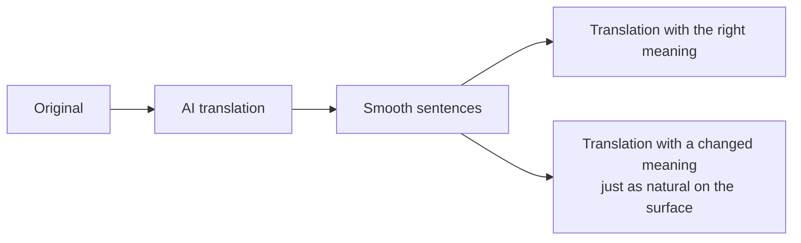
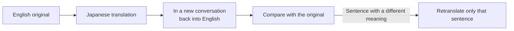

<dl class="facts">
  <div><dt>For</dt><dd>Anyone</dd></div>
  <div><dt>Things to tell it</dt><dd>4</dd></div>
  <div><dt>Ways to check</dt><dd>3</dd></div>
  <div><dt>Key</dt><dd>Purpose first</dd></div>
</dl>

## Natural does not mean correct

Older translation tools produced awkward sentences, so the wrong parts stood out. AI translation is **natural even when it's wrong.** Smooth sentences earn your trust, but inside them a number may have changed, a negative may have become a positive, or words that were never in the original may have been added.



So when you have something translated, do two things. **Ask in a way that gets a good result, and check what comes out.**

## Four things to tell it when you ask for a translation

With just "translate this into Spanish", the AI guesses the tone and the terminology.

### 1. The reader and the purpose

The same sentence comes out differently depending on whether it is an email to a client, the label on an app button, or a message to a friend.

```text
Translate the text below into Spanish.
- Reader: a purchasing manager at a client in Mexico, someone I am contacting for the first time
- Purpose: business email
- Tone: polite but brief. Mexican Spanish.
```

### 2. What must not change

```text
- Do not translate product names, people's names or company names. Leave them as in the original.
- Do not change numbers, dates or currency units.
- Do not translate code or commands.
```

### 3. A term list

If the same word is translated several ways within one document, the reader takes them for different things. For important terms, **decide in advance** and hand over the list.

```text
Use these terms consistently.
- delivery date → fecha de entrega
- quotation → cotización
- contact person → persona de contacto
```

### 4. Literal or free

```text
For the contract terms, stay faithful to the original so the meaning does not shift.
The greeting and the closing can be changed to whatever sounds natural in that country.
```

## Checking when you don't know the language

### 1. Back-translation

Put the translation into a **new conversation** and translate it back into English. In the same conversation the AI still remembers the original, so it isn't a real check.



It is not a perfect method. The back-translation can match the original and the tone can still be rude. But it catches most **sentences whose meaning changed**.

### 2. Ask where the translation was a judgment call

```text
If there were parts of that translation where the meaning of the original was hard to carry over, tell me.
For each one, explain in English why it was unclear and what choice you made.
```

This brings out the places where the AI guessed and moved on. If the original was ambiguous, fix the original first.

### 3. Have it read as a native speaker

```text
Read this Japanese email as an employee of the Japanese company receiving it.
If any wording would feel rude or awkward, tell me, with the reason.
```

Politeness carries a different weight in each language. Use this to catch cases where the meaning is right but the tone is too familiar or too stiff.

## A good original makes a good translation

When a translation comes out strange, the original is usually ambiguous. Before translating, clean up the original like this.

| Problem in the original | Fix |
|---|---|
| Unclear pronouns | "Once they confirm it, send it over" → "Once the client confirms the quote, please send the quote to me" |
| Long sentences | One idea per sentence |
| Idioms | "The ball is in your court" → "The next step is yours" |
| Abbreviations and slang | Spell out terms like "OOO" and "EOD" |

English leans on pronouns such as "it" and "they", and when the text moves into another language the AI has to guess what each one refers to. Just spelling out **who does what** cuts mistranslations sharply.

## Reading text in a foreign language

Don't ask only for a translation. **Ask questions along with it.**

```text
Translate the Japanese email below into English. Then list separately:
- what the sender is asking me to do
- whether there is a deadline
- whether the tone is friendly or closer to a complaint
```

You get the mood and the requests separately, which are easy to miss from the translated text alone.

## What not to hand over

- **Contracts, legal papers, medical documents**: use AI only for drafts and to help you understand. The final version should be reviewed by a professional translator or someone who knows the language.
- **Brand names, advertising copy**: check with a native speaker that it doesn't sound odd in the other language.
- **Material with sensitive content**: read [A checklist of what not to paste into AI](/en/posts/ai-privacy-checklist/) first.

## Summary

- AI translation is natural even when it's wrong. **Don't mistake smoothness for accuracy.**
- Tell it the reader, what must not change, the terms, and whether to translate literally.
- For a language you don't know, **back-translate in a new conversation** and ask where the AI was unsure.

### Related posts

- [Writing emails and reports with AI: how to keep your own voice](/en/posts/ai-writing-email-report/)
- [When AI is confidently wrong: how to verify its answers](/en/posts/ai-hallucination-check/)
- [Five ways to ask AI that change the result](/en/posts/ai-prompt-basics/)
