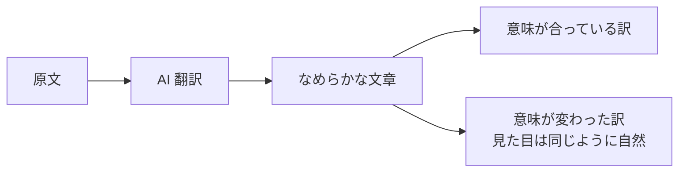
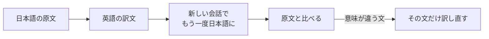

<dl class="facts">
  <div><dt>対象</dt><dd>だれでも</dd></div>
  <div><dt>伝えること</dt><dd>4<small>つ</small></dd></div>
  <div><dt>確認方法</dt><dd>3<small>つ</small></dd></div>
  <div><dt>要点</dt><dd>用途が先</dd></div>
</dl>

## 自然だからといって正しいとは限らない

昔の翻訳ツールは文章がぎこちなく、間違っている箇所が目につきました。AI 翻訳は**間違っていても自然です。** 文章がなめらかだと信じてしまいますが、その中で数字が変わっていたり、否定文が肯定文になっていたり、原文にない言葉が足されていたりすることがあります。



そこで、翻訳を頼むときは 2 つのことをします。**うまく訳せるように頼み、出てきたものを確かめます。**

## 翻訳を頼むときに伝えること 4 つ

「英語に翻訳して」だけでは、AI が文体や用語を推測することになります。

### 1. 読む人と用途

同じ文でも、取引先に送るメールなのか、アプリのボタンに入る文言なのか、友人に送るメッセージなのかで変わります。

```text
下の文章を英語に翻訳して。
- 読む人: アメリカの取引先の購買担当者。初めて連絡する相手
- 用途: 業務メール
- 文体: 丁寧に、ただし短く。アメリカ英語で。
```

### 2. 変えてはいけないもの

```text
- 製品名、人名、会社名は翻訳せず、原文のままにして。
- 数字、日付、金額の単位は変えないで。
- コードとコマンドは翻訳しないで。
```

### 3. 用語リスト

同じ言葉が文書の中で何通りにも訳されると、読む人は別のものだと誤解します。大事な用語は**あらかじめ決めて**渡します。

```text
用語は下のとおりに統一して。
- 納期 → delivery date
- 見積書 → quotation
- 担当者 → contact person
```

### 4. 直訳か意訳か

```text
契約条件の部分は、意味が変わらないように原文に忠実に。
冒頭のあいさつと結びの言葉は、その国で自然な表現に変えてよい。
```

## 自分の知らない言語のときの確かめ方

### 1. 逆翻訳

翻訳結果を**新しい会話**に入れ、もう一度日本語に翻訳します。同じ会話の中で行うと、原文を覚えているので確認になりません。



完璧な方法ではありません。逆翻訳が原文と同じでも、言い方が失礼になっていることはありえます。それでも、**意味が変わった文**はたいてい見つけられます。

### 2. 訳していて迷った箇所を聞く

```text
いまの翻訳で、原文の意味を移すのに迷った部分があれば教えて。
それぞれ、なぜ迷ったのか、どちらを選んだのかを日本語で説明して。
```

AI が推測で済ませた箇所が見えてきます。原文があいまいだったのなら、まず原文を直します。

### 3. ネイティブの立場で読ませる

```text
この英語のメールを、受け取るアメリカの会社の担当者の立場で読んで。
失礼に感じたり、不自然に感じたりしそうな表現があれば、理由と一緒に教えて。
```

丁寧さの重みは言語によって違います。意味は合っているのに、なれなれしすぎたり硬すぎたりするケースを見つけるのに使います。

## 原文がよくなければ翻訳もよくならない

翻訳がおかしいときは、たいてい原文があいまいです。翻訳する前に、原文を次のように手直しします。

| 原文の問題 | 直し方 |
|---|---|
| 主語がない | 「確認後ご連絡します」→「私が確認したうえでご連絡します」 |
| 文が長い | 1 文に内容を 1 つずつ |
| 慣用句 | 「尻に火がついた」→「締め切りが迫っている」 |
| 略語 | 「有休」「定時ダッシュ」のような言葉は略さずに書く |

日本語は主語をよく省きますが、ほかの言語に移すときに AI が主語を推測して補います。**だれがするのか**を明記するだけでも、誤訳は大きく減ります。

## 外国語の文章を読むとき

翻訳だけを頼むのではなく、**質問も一緒に**します。

```text
下の英語のメールを日本語に翻訳して。そのうえで、
- 相手がわたしに求めていることは何か
- 期限はあるか
- 口調は友好的か、苦情に近いか
を別にまとめて。
```

訳文だけでは見落としやすい雰囲気や要求事項を、別に受け取れます。

## 任せてはいけないもの

- **契約書、法的な書類、医療文書**: 下書きと理解の助けにとどめ、最終版は専門の翻訳者か、その言語が分かる人が確認します。
- **ブランド名、広告コピー**: ほかの言語で変な意味に聞こえないかを、ネイティブに確認します。
- **デリケートな内容を含む資料**: 先に [AI に入力してはいけない情報チェックリスト](/ja/posts/ai-privacy-checklist/)を見ます。

## まとめ

- AI 翻訳は間違っていても自然です。**なめらかさを正確さと取り違えないようにします。**
- 読む人、変えてはいけないもの、用語、直訳かどうかを伝えます。
- 知らない言語は**新しい会話で逆翻訳**し、AI が迷った箇所を聞きます。

### あわせて読みたい記事

- [AI でメール・報告書を書く：自分の文体を守る方法](/ja/posts/ai-writing-email-report/)
- [AI が自信満々に間違えるとき：答えを検証する方法](/ja/posts/ai-hallucination-check/)
- [AI に仕事を頼むとき、結果が変わる頼み方 5 つ](/ja/posts/ai-prompt-basics/)
