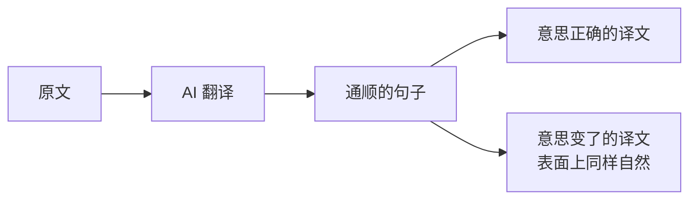
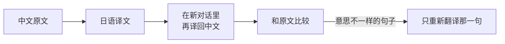

<dl class="facts">
  <div><dt>适合谁</dt><dd>所有人</dd></div>
  <div><dt>要告诉它的</dt><dd>4<small>样</small></dd></div>
  <div><dt>确认方法</dt><dd>3<small>种</small></dd></div>
  <div><dt>关键</dt><dd>先说用途</dd></div>
</dl>

## 自然不等于正确

以前的翻译软件句子别扭，错的地方很显眼。AI 翻译**错了也很自然。**句子通顺，人就容易相信，可是里面可能数字变了，否定句变成了肯定句，或者多出了原文没有的话。



所以让它翻译的时候要做两件事。**提出能翻好的请求，再检查翻出来的东西。**

## 让它翻译时要告诉它的 4 样东西

只说“翻译成英语”，AI 就得去猜语气和术语。

### 1. 读的人和用途

同一句话，是发给客户的邮件，是放在应用按钮上的文案，还是发给朋友的消息，译法都不一样。

```text
请把下面的文字翻译成英语。
- 读的人：美国客户的采购负责人，第一次联系
- 用途：工作邮件
- 语气：礼貌但简短。美式英语。
```

### 2. 不能改的东西

```text
- 产品名、人名、公司名不要翻译，保留原文。
- 数字、日期、金额单位不要改。
- 代码和命令不要翻译。
```

### 3. 术语表

同一个词在一份文档里有好几种译法，读的人会误以为是不同的东西。重要的术语要**事先定好**再给它。

```text
术语请按下面统一。
- 交货期 → delivery date
- 报价单 → quotation
- 联系人 → contact person
```

### 4. 直译还是意译

```text
合同条件部分要忠实于原文，意思不能变。
问候语和结束语可以换成当地自然的说法。
```

## 自己不懂那门语言时怎么确认

### 1. 回译

把翻译结果放进**新对话**，再翻译回中文。在同一个对话里做的话，它还记得原文，起不到确认的作用。



这不是完美的方法。回译和原文一致，语气也仍然可能不礼貌。但**意思变了的句子**大部分能抓出来。

### 2. 问它翻译时拿不准的地方

```text
刚才的翻译里，如果有原文的意思不好准确传达的地方，请告诉我。
请用中文分别说明为什么拿不准、你做了什么选择。
```

AI 靠猜带过去的地方会显露出来。如果是原文本身含糊，就先改原文。

### 3. 让它站在母语者的角度读

```text
请站在收到这封日语邮件的日本公司员工的角度来读。
如果有让人觉得失礼或别扭的表述，请连同理由一起告诉我。
```

每种语言里敬语的分量不同。这个方法用来抓意思没错、但过于随意或过于生硬的情况。

## 原文好，译文才好

译文奇怪，多半是因为原文含糊。翻译之前先这样修改原文。

| 原文的问题 | 修改 |
|---|---|
| 没有主语 | “确认后联系” → “我确认之后会联系您” |
| 句子太长 | 一句话只说一件事 |
| 惯用语 | “火烧眉毛了” → “截止时间很紧” |
| 缩略语 | “调休”“团建”这类说法和网络缩写，都展开来写 |

中文经常省略主语，翻译成其他语言时，AI 会靠猜把主语补上。只要写明**是谁做的**，误译就会少很多。

## 读外语文章的时候

不要只让它翻译，**同时提问题**。

```text
请把下面这封英语邮件翻译成中文。另外请单独整理：
- 对方要求我做什么
- 有没有期限
- 语气是友好的，还是接近投诉
```

只看译文容易漏掉的气氛和要求，可以这样单独拿到。

## 不能交给它的事

- **合同、法律文件、医疗文件**：只用来起草和帮助理解，定稿要由专业译者或懂那门语言的人来看。
- **品牌名称、广告语**：请母语者确认在另一种语言里听起来会不会有奇怪的意思。
- **含有敏感内容的资料**：先看[不能输入 AI 的信息清单](/zh/posts/ai-privacy-checklist/)。

## 小结

- AI 翻译错了也很自然。**不要把通顺当成准确。**
- 告诉它读的人、不能改的东西、术语，以及是否直译。
- 不懂的语言，**在新对话里回译**，并问 AI 哪里拿不准。

### 推荐一起读

- [用 AI 写邮件和报告：保住自己的语气](/zh/posts/ai-writing-email-report/)
- [AI 自信地答错时：验证回答的方法](/zh/posts/ai-hallucination-check/)
- [让 AI 干活时，结果大不一样的 5 个提问方法](/zh/posts/ai-prompt-basics/)
