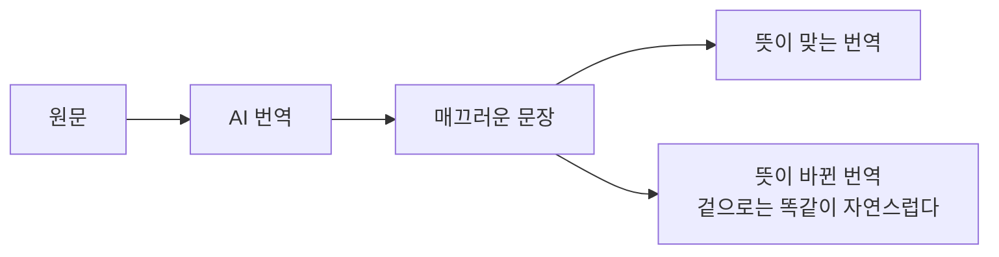
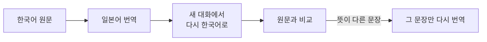

<dl class="facts">
  <div><dt>대상</dt><dd>누구나</dd></div>
  <div><dt>알려 줄 것</dt><dd>4<small>가지</small></dd></div>
  <div><dt>확인 방법</dt><dd>3<small>가지</small></dd></div>
  <div><dt>핵심</dt><dd>용도 먼저</dd></div>
</dl>

## 자연스럽다고 맞는 것은 아니다

예전 번역기는 문장이 어색해서 틀린 곳이 눈에 띄었습니다. AI 번역은 **틀려도 자연스럽습니다.** 문장이 매끄러우면 믿게 되는데, 그 안에서 숫자가 바뀌거나, 부정문이 긍정문이 되거나, 원문에 없는 말이 붙어 있을 수 있습니다.



그래서 번역을 시킬 때는 두 가지를 합니다. **잘 나오게 요청하고, 나온 것을 확인합니다.**

## 번역을 시킬 때 알려 줄 것 4가지

"영어로 번역해 줘" 만으로는 AI 가 말투와 용어를 추측합니다.

### 1. 읽는 사람과 용도

같은 문장도 거래처에 보내는 메일인지, 앱 버튼에 들어갈 문구인지, 친구에게 보내는 메시지인지에 따라 달라집니다.

```text
아래 글을 영어로 번역해 줘.
- 읽는 사람: 미국 거래처 구매 담당자, 처음 연락하는 사이
- 용도: 업무 메일
- 말투: 정중하지만 짧게. 미국식 영어.
```

### 2. 바꾸면 안 되는 것

```text
- 제품 이름, 사람 이름, 회사 이름은 번역하지 말고 원문 그대로 둬.
- 숫자, 날짜, 금액 단위는 바꾸지 마.
- 코드와 명령어는 번역하지 마.
```

### 3. 용어 목록

같은 낱말이 문서 안에서 여러 가지로 번역되면 읽는 사람이 다른 것으로 오해합니다. 중요한 용어는 **미리 정해서** 줍니다.

```text
용어는 아래대로 통일해 줘.
- 납기 → delivery date
- 견적서 → quotation
- 담당자 → contact person
```

### 4. 직역이냐 의역이냐

```text
계약 조건 부분은 뜻이 달라지지 않게 원문에 충실하게.
인사말과 맺음말은 그 나라에서 자연스러운 표현으로 바꿔도 돼.
```

## 내가 모르는 언어일 때 확인하는 법

### 1. 역번역

번역 결과를 **새 대화**에 넣고 다시 한국어로 번역합니다. 같은 대화에서 하면 원문을 기억하고 있어서 확인이 되지 않습니다.



완벽한 방법은 아닙니다. 역번역이 원문과 같아도 말투가 무례할 수는 있습니다. 하지만 **뜻이 바뀐 문장**은 대부분 잡아냅니다.

### 2. 번역하면서 고민한 곳을 묻는다

```text
방금 번역에서 원문의 뜻을 옮기기 애매했던 부분이 있으면 알려 줘.
각각 왜 애매했는지, 어떤 선택을 했는지 한국어로 설명해 줘.
```

AI 가 추측으로 넘긴 자리가 드러납니다. 원문이 애매했다면 원문부터 고칩니다.

### 3. 원어민 입장에서 읽게 한다

```text
이 일본어 메일을 받는 일본 회사 직원 입장에서 읽어 줘.
무례하거나 어색하게 느껴질 표현이 있으면 이유와 함께 알려 줘.
```

언어마다 높임 표현의 무게가 다릅니다. 뜻은 맞는데 지나치게 친근하거나 딱딱한 경우를 잡는 데 씁니다.

## 원문이 좋아야 번역이 좋다

번역이 이상하면 대개 원문이 애매합니다. 번역하기 전에 원문을 이렇게 손봅니다.

| 원문의 문제 | 고치기 |
|---|---|
| 주어가 없다 | "확인 후 연락드립니다" → "제가 확인한 뒤 연락드리겠습니다" |
| 문장이 길다 | 한 문장에 내용 하나씩 |
| 관용 표현 | "발등에 불이 떨어졌다" → "마감이 급하다" |
| 줄임말 | "연차", "칼퇴" 같은 말은 풀어서 |

한국어는 주어를 자주 생략하는데, 다른 언어로 옮길 때 AI 가 주어를 추측해서 채웁니다. **누가 하는지**만 밝혀 써도 오역이 크게 줄어듭니다.

## 외국어 글을 읽을 때

번역만 시키지 말고 **질문을 함께** 합니다.

```text
아래 영어 메일을 한국어로 번역해 줘. 그리고
- 상대가 나에게 요구하는 것이 무엇인지
- 기한이 있는지
- 말투가 우호적인지, 항의에 가까운지
를 따로 정리해 줘.
```

번역문만으로는 놓치기 쉬운 분위기와 요구 사항을 따로 받을 수 있습니다.

## 맡기면 안 되는 것

- **계약서, 법적 서류, 의료 문서**: 초안과 이해를 돕는 용도로만 쓰고, 최종본은 전문 번역가나 그 언어를 아는 사람이 봅니다.
- **브랜드 이름, 광고 문구**: 다른 언어에서 뜻이 이상하게 들리지 않는지 원어민에게 확인합니다.
- **민감한 내용이 담긴 자료**: [AI 에 넣으면 안 되는 정보 체크리스트](/posts/ai-privacy-checklist/)를 먼저 봅니다.

## 정리

- AI 번역은 틀려도 자연스럽습니다. **매끄러움을 정확함으로 착각하지 않습니다.**
- 읽는 사람, 바꾸면 안 되는 것, 용어, 직역 여부를 알려 줍니다.
- 모르는 언어는 **새 대화에서 역번역**하고, AI 가 애매했던 곳을 묻습니다.

### 같이 읽으면 좋은 글

- [AI 로 이메일·보고서 쓰기: 내 말투를 지키는 법](/posts/ai-writing-email-report/)
- [AI 가 자신 있게 틀릴 때: 답을 검증하는 방법](/posts/ai-hallucination-check/)
- [AI 에게 일 시킬 때 결과가 달라지는 요청법 5가지](/posts/ai-prompt-basics/)
