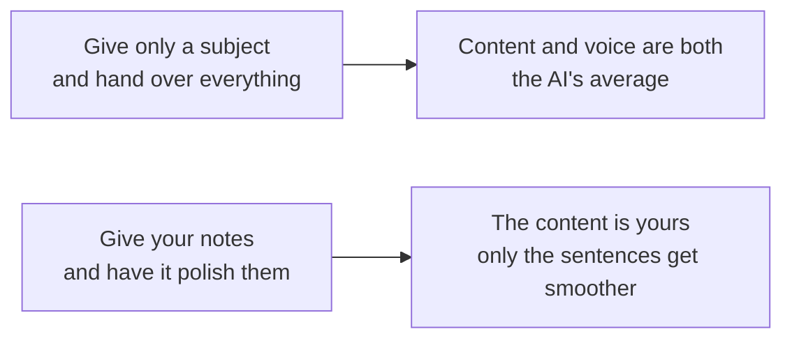
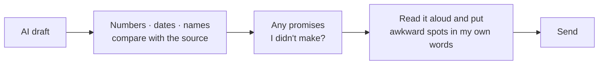

<dl class="facts">
  <div><dt>For</dt><dd>Office workers · anyone</dd></div>
  <div><dt>Methods</dt><dd>3</dd></div>
  <div><dt>Prompts</dt><dd>5</dd></div>
  <div><dt>Key</dt><dd>You own the content</dd></div>
</dl>

## What gives AI writing away?

The points where a reader thinks "this was written with AI" are mostly the same.

- A long greeting and background before the actual point
- A lot of emphasis words such as "sincerely", "very" and "once again"
- Every paragraph is about the same length, with one more summary tacked on at the end
- Expressions you never normally use

There is a single cause. **You handed both the content and the voice to the AI.** Decide the content yourself and leave only the polishing to the AI, and the result changes.



## Method 1: Write notes first, then have them polished

They don't have to be full sentences. Jot down what you want to say **in fragments** and hand that over.

```text
Write an email to a supplier from the notes below.
Do not add anything that is not in the notes.

- Got the quote, thanks
- Unit price is fine, but a 3-week lead time is too long
- Please check whether 2 weeks is possible
- If not, receiving half of the first batch early would also work
- Need an answer by Friday
```

**"Do not add anything that is not in the notes"** matters. Without that line the AI adds plausible sentences, and those sentences can become promises you never made.

## Method 2: Give your own writing as an example

A voice is hard to describe but easy to show. Paste two or three emails you sent in the past.

```text
Below are emails I normally write. Follow this tone, length and way of greeting exactly.
Ignore the content. Use only the voice.

[old email 1]
[old email 2]

Now write a new email with the content below.
[notes]
```

If you do this often, have the AI describe the features of your writing, save that description, and paste it in each time.

```text
Look at the emails above and describe my writing style in 5 lines.
(sentence length, how I greet, expressions I use often, expressions I don't use)
```

## Method 3: Finish by having it cut

Once you have a draft, have the AI **cut, not add**. Most of what gives AI writing away is padding.

```text
Shorten that text by these rules.
- The point comes in the first sentence
- Delete emphasis adverbs and repeated greetings
- Merge sentences that say the same thing twice into one
- Total length half or less
```

## Prompts by situation

### Declining

```text
Write an email declining a proposal.
- Reason: this year's budget is already fixed
- I want to keep the relationship. I'd like to talk again in Q1 next year
- Say sorry only once
- 6 lines or fewer
```

### Following up on something overdue

```text
I still haven't received the material I asked for last Tuesday.
Keep it from sounding pushy, but make it clear that I need it by Thursday.
End with a sentence asking "by when can you send it?" so it is easy to reply right away.
```

### Report draft

```text
Write a weekly report from the notes and numbers below.
- Order: conclusion, supporting numbers, next week's plan, where I need help
- Do not make up numbers that are not in the notes. If one is missing, mark it [needs checking]
- Short bullet points, not paragraphs
```

### Shortening long text

```text
Cut the text below to half its length.
Must keep: dates, amounts, names of the people responsible.
At the end, list what you removed while shortening.
```

### Review before sending

```text
Read this email from the recipient's point of view.
- Is it clear at once what I am asking them to do?
- Is there any wording that could be read as rude?
- Is any information missing? (date, place, attachment)
Do not rewrite it. Just point out the problems.
```

"Do not rewrite it, just point out the problems" is handy. It tells you what is wrong without replacing your whole text.

## What to check before sending



- **Numbers, dates and names** sometimes get changed slightly by the AI. Compare them with your source.
- Check that no **promises or firm commitments** were added. Phrases like "without fail" or "we will handle it immediately".
- You are the sender. **"The AI wrote it" is not an excuse.**

## Summary

- Decide the content yourself in notes, and leave the polishing to the AI.
- Don't describe your voice. **Show your own writing as an example.**
- Once you have a draft, have it **cut**, not add.

### Related posts

- [Five ways to ask AI that change the result](/en/posts/ai-prompt-basics/)
- [Using AI translation well: how to check the meaning hasn't changed](/en/posts/ai-translation-guide/)
- [A checklist of what not to paste into AI](/en/posts/ai-privacy-checklist/)
