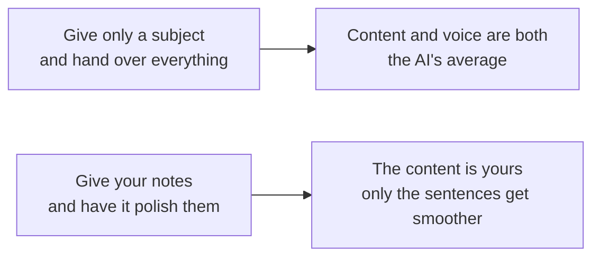
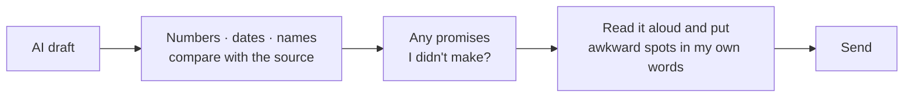

<dl class="facts">
  <div><dt>For</dt><dd>Office workers · anyone</dd></div>
  <div><dt>Methods</dt><dd>3</dd></div>
  <div><dt>Prompts</dt><dd>5</dd></div>
  <div><dt>Key</dt><dd>You own the content</dd></div>
</dl>

## What gives AI writing away?

The points where a reader thinks "this was written with AI" are mostly the same.

- A long greeting and background before the actual point
- A lot of emphasis words such as "sincerely", "very" and "once again"
- Every paragraph is about the same length, with one more summary tacked on at the end
- Expressions you never normally use

There is a single cause. **You handed both the content and the voice to the AI.** Decide the content yourself and leave only the polishing to the AI, and the result changes.



The prompts below come with **the results I actually got**. Each one is the answer Claude gave when I pasted the prompt in as it is, and I did not edit it. The wording changes a little every time you ask, even with the same prompt.

## Method 1: Write notes first, then have them polished

They don't have to be full sentences. Jot down what you want to say **in fragments** and hand that over.

```text
Write an email to a supplier from the notes below.
Do not add anything that is not in the notes.

- Got the quote, thanks
- Unit price is fine, but a 3-week lead time is too long
- Please check whether 2 weeks is possible
- If not, receiving half of the first batch early would also work
- Need an answer by Friday
```

**Result**

```text
Subject: Quote – lead time

Hi [Name],

Thank you for the quote. The unit price is fine, but a 3-week lead time is too long for us.

Could you check whether 2 weeks is possible? If not, receiving half of the first batch early would also work.

Please let me know by Friday.

Best regards,
[Your name]
```

The five lines of notes became sentences in the same order, and nothing else was added. Fill in the two names and it is ready to send.

**"Do not add anything that is not in the notes"** matters. Without that line the AI adds plausible sentences, and those sentences can become promises you never made.

### Asking in one line, without notes

I asked for the same email without giving any notes.

```text
Write an email asking a supplier to shorten the lead time on their quote.
```

**Result**

```text
Subject: Request to Shorten Lead Time – Quote [Quote Number]

Hi [Supplier Name],

Thank you for sending over the quote for [product/part name]. The pricing works for us, but the quoted lead time of [X weeks] is longer than our schedule allows.

We need the order delivered by [target date] to stay on track with our production timeline. Would you be able to shorten the lead time to [Y weeks]?

If the full quantity isn't possible in that timeframe, we're open to options such as:

- A partial shipment of [quantity] by [date], with the balance to follow
- Expedited production or shipping, if you can let us know the added cost
- Any adjustments on our side (earlier PO, forecast commitment) that would help you move faster

Could you let me know what's feasible by [response date]? We'd like to finalize the order as soon as we have a confirmed delivery date.

Thanks for your help.

Best regards,
[Your Name]
[Title]
[Company]
[Phone / Email]

If you tell me the current lead time, the date you need, and the order size, I can fill in the blanks and adjust the tone.
```

The sentences are fine. The difference is in the content.

| | One-line request | Request with notes |
|---|---|---|
| Dates | `[X weeks]`, `[Y weeks]`, `[target date]` and `[response date]` are blanks | 3 weeks, 2 weeks and Friday are filled in |
| Reason | "to stay on track with our production timeline" is a reason I never gave | No reason that is not in the notes |
| Alternatives | Three options, including paying for expediting, an earlier PO and a forecast commitment, none of which I offered | Only the one I wrote: half of the first batch early |
| Length | 5 body paragraphs, one of them a three-item list | 3 body paragraphs |

As the AI itself says in its last line, **the blanks are mine to fill in, and the invented reason and offers are mine to catch.** In the end I write what I would have put in the notes, only later.

## Method 2: Give your own writing as an example

A voice is hard to describe but easy to show. Paste two or three emails you sent in the past.

```text
Below are emails I normally write. Follow this tone, length and way of greeting exactly.
Ignore the content. Use only the voice.

[old email 1]
[old email 2]

Now write a new email with the content below.
[notes]
```

If you do this often, have the AI describe the features of your writing, save that description, and paste it in each time.

```text
Look at the emails above and describe my writing style in 5 lines.
(sentence length, how I greet, expressions I use often, expressions I don't use)
```

## Method 3: Finish by having it cut

Once you have a draft, have the AI **cut, not add**. Most of what gives AI writing away is padding.

```text
Shorten that text by these rules.
- The point comes in the first sentence
- Delete emphasis adverbs and repeated greetings
- Merge sentences that say the same thing twice into one
- Total length half or less
```

I sent this as a follow-up to the email from the one-line request above.

**Result**

```text
Subject: Request to Shorten Lead Time – Quote [Quote Number]

Hi [Supplier Name],

Can you shorten the lead time on your quote for [product/part name] from [X weeks] to [Y weeks]? The pricing works, but we need delivery by [target date].

If the full quantity isn't possible, a partial shipment of [quantity] by [date] or expedited production at added cost would also work.

Please let me know what's feasible by [response date].

Best regards,
[Your Name]
```

The request moved up to the first sentence, and the body went from five paragraphs to three. The production timeline reason and the offer of an earlier PO are gone, but the offer to pay for expediting stayed. The bracketed blanks are all still there too. **Cutting removes padding. It does not fill in content that was never there.**

## Prompts by situation

### Declining

```text
Write an email declining a proposal.
- Reason: this year's budget is already fixed
- I want to keep the relationship. I'd like to talk again in Q1 next year
- Say sorry only once
- 6 lines or fewer
```

**Result**

```text
Subject: Re: Your proposal

Hi [Name],

Thank you for sending the proposal. I'm sorry to say we can't take it on, as this year's budget is already fixed.
I'd like to stay in touch and pick this up again in Q1 next year, if you're open to it.

Best regards,
[Your name]
```

It is six lines if you count the subject and the sign-off, and the body is only two. "Sorry" appears once. This time no promise was added. The only things that were not in the request are the thanks at the start and "if you're open to it" at the end. That will not be true of every run, so it is still worth looking for a line like "I'll reach out first".

### Following up on something overdue

```text
I still haven't received the material I asked for last Tuesday.
Keep it from sounding pushy, but make it clear that I need it by Thursday.
End with a sentence asking "by when can you send it?" so it is easy to reply right away.
```

**Result**

```text
Subject: Material requested last Tuesday

Hi [Name],

I'm checking in on the material I asked for last Tuesday, as I haven't received it yet. I need it by Thursday to keep things on schedule.

By when can you send it?

Thanks,
[Your name]
```

The Thursday deadline is clear and the email ends with the question. The body is three sentences. One thing to check: "to keep things on schedule" is a reason that was not in the request. It is vague enough to be harmless, but if it is not the real reason, delete it or write the real one.

### Report draft

```text
Write a weekly report from the notes and numbers below.
- Order: conclusion, supporting numbers, next week's plan, where I need help
- Do not make up numbers that are not in the notes. If one is missing, mark it [needs checking]
- Short bullet points, not paragraphs
```

### Shortening long text

```text
Cut the text below to half its length.
Must keep: dates, amounts, names of the people responsible.
At the end, list what you removed while shortening.
```

### Review before sending

```text
Read this email from the recipient's point of view.
- Is it clear at once what I am asking them to do?
- Is there any wording that could be read as rude?
- Is any information missing? (date, place, attachment)
Do not rewrite it. Just point out the problems.
```

I pasted in the email from the one-line request above and asked.

**Result**

```text
Reading this as the supplier:

1. Is it clear at once what you are asking them to do?
- The subject line says it, so they know the topic before opening.
- In the body the actual request ("Would you be able to shorten the lead time to [Y weeks]?") only arrives at the end of the second paragraph, after the thanks, the pricing comment and your schedule.
- The three bulleted options blur the ask. It isn't clear which one you prefer, so the supplier may simply pick whichever is easiest for them.
- "We need the order delivered by [target date]" and "Would you be able to..." pull in different directions. One reads as a fixed deadline, the other as a question that is open to negotiation.

2. Is there any wording that could be read as rude?
- Nothing is rude.
- "We'd like to finalize the order as soon as we have a confirmed delivery date" can be read as mild pressure: the order depends on their answer. That may be what you intend, but be aware it reads that way.
- "Any adjustments on our side (earlier PO, forecast commitment)" isn't rude, but a supplier may take it as something you have already agreed to offer.

3. Is any information missing?
- Every bracket is still a placeholder: quote number, product, current and requested lead time, target date, partial quantity and date, response date. The email can't be sent as it is.
- Order quantity isn't stated anywhere, and the supplier needs it to judge whether a shorter lead time is possible.
- Place: there is no delivery location or shipping terms, which matters if expedited shipping is one of the options.
- Attachment: none is mentioned. If the quote number is filled in that is probably enough; otherwise attach the quote.
```

It caught the blank dates and the missing order quantity, and it noticed that "we need it by" and "would you be able to" do not match. It also flagged the earlier PO and forecast commitment as something the supplier could take as an offer. These are hard to see when you are the sender.

"Do not rewrite it, just point out the problems" is handy. It tells you what is wrong without replacing your whole text.

## What to check before sending



- **Numbers, dates and names** sometimes get changed slightly by the AI. Compare them with your source.
- Check that no **promises or firm commitments** were added. Phrases like "without fail" or "we will handle it immediately".
- You are the sender. **"The AI wrote it" is not an excuse.**

## Summary

- Decide the content yourself in notes, and leave the polishing to the AI.
- Don't describe your voice. **Show your own writing as an example.**
- Once you have a draft, have it **cut**, not add.

### Related posts

- [Five ways to ask AI that change the result](/en/posts/ai-prompt-basics/)
- [Using AI translation well: how to check the meaning hasn't changed](/en/posts/ai-translation-guide/)
- [A checklist of what not to paste into AI](/en/posts/ai-privacy-checklist/)
