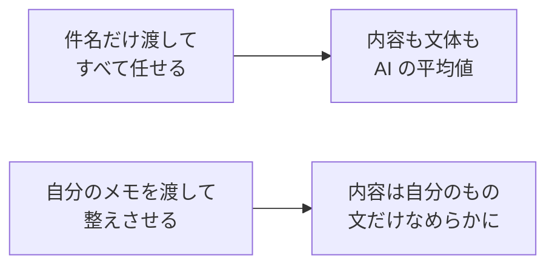
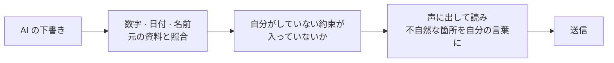

<dl class="facts">
  <div><dt>対象</dt><dd>会社員 · だれでも</dd></div>
  <div><dt>方法</dt><dd>3<small>つ</small></dd></div>
  <div><dt>例文</dt><dd>5<small>種類</small></dd></div>
  <div><dt>要点</dt><dd>内容は自分で</dd></div>
</dl>

## AI が書いたと分かるのはどこか

受け取った人が「AI で書いたな」と感じるポイントは、だいたい同じです。

- 本題の前のあいさつと背景説明が長い
- 「心より」「大変」「重ねて」のような強調が多い
- どの段落も同じくらいの長さで、最後にもう一度まとめが付いている
- 自分がふだん使わない表現が入っている

原因は 1 つです。**内容も文体もすべて AI に任せたから**です。内容は自分で決め、AI には整える作業だけを任せると変わります。



## 方法 1: 先にメモを書いて、整えさせる

文章になっていなくてかまいません。言いたいことを**箇条書きの断片で**渡します。

```text
下のメモをもとに、取引先へ送るメールを書いて。
メモにない内容は足さないで。

- 見積書は受け取った
- 単価は問題ないが、納期 3 週間は長すぎる
- 2 週間以内にできるか確認してほしい
- 無理なら、初回分の半分だけ先に受け取る方法でもよい
- 金曜日までに返事がほしい
```

**「メモにない内容は足さないで」**が大事です。この 1 行がないと、AI がもっともらしい文を付け足し、その文が自分のしていない約束になってしまうことがあります。

## 方法 2: 自分の文章を例として渡す

文体は説明しにくいものですが、見せるのは簡単です。以前自分が送ったメールを 2、3 通貼ります。

```text
下はわたしがふだん書いているメールだ。この文体、長さ、あいさつの仕方をそのまままねて。
内容は参考にせず、文体だけ。

[以前のメール 1]
[以前のメール 2]

では、下の内容で新しいメールを書いて。
[メモ]
```

よく使うなら、自分の文体の特徴を AI にまとめさせ、それを保存しておいて毎回貼り付けると便利です。

```text
上のメールを見て、わたしの書き方の特徴を 5 行でまとめて。
(文の長さ、あいさつの仕方、よく使う表現、使わない表現)
```

## 方法 3: 最後に削る作業をさせる

下書きができたら、**足すのではなく削らせます。** AI の文章らしさは、ほとんどが余分な言葉から生まれます。

```text
いまの文章を次の基準で短くして。
- 最初の文に用件が来るように
- 強調の副詞と繰り返しのあいさつは削除
- 同じことを二度言っている文は 1 つに
- 全体の長さは半分以下
```

## 場面別の例文

### 断りのメール

```text
提案を断るメールを書いて。
- 断る理由: 今年度の予算がすでに確定している
- 関係は続けたい。来年の第 1 四半期にあらためて話したい
- おわびの言葉は 1 回だけ
- 6 行以内
```

### 催促のメール

```text
先週の火曜日にお願いした資料がまだ届いていない。
せかす印象は抑えつつ、木曜日までに必要だという点ははっきり書いて。
相手がすぐ返事しやすいように、「いつまでなら可能か」を尋ねる文で終えて。
```

### 報告書の下書き

```text
下のメモと数字で週次報告を書いて。
- 順番: 結論、根拠の数字、来週の予定、助けが必要なこと
- メモにない数字は作らないで。空いているところは [要確認] と書く
- 段落ではなく、短い箇条書きで
```

### 長く書いた文章を縮める

```text
下の文章を半分の長さに縮めて。
削ってはいけないもの: 日付、金額、担当者の名前。
縮めるときに削った内容を、最後にリストで教えて。
```

### 送る前のチェック

```text
このメールを、受け取る人の立場で読んで。
- 何をしてほしいのかが一度で分かるか
- 気を悪くしそうな表現はあるか
- 抜けている情報はあるか (日付、場所、添付)
直さずに、指摘だけして。
```

「直さずに、指摘だけ」が役に立ちます。自分の文章を丸ごと書き換えずに、問題点だけを教えてくれます。

## 送る前に必ず見ること



- **数字、日付、名前**は、AI が少し変えて書いてしまうことがあります。元の資料と突き合わせます。
- **約束や確約**が足されていないかを見ます。「必ず」「至急対応いたします」のような表現です。
- 送るのは自分です。**AI が書いたというのは言い訳になりません。**

## まとめ

- 内容は自分がメモで決め、AI には整える作業を任せます。
- 文体は説明するのではなく、**自分の文章を例として**見せます。
- 下書きができたら、足すのではなく**削らせます。**

### あわせて読みたい記事

- [AI に仕事を頼むとき、結果が変わる頼み方 5 つ](/ja/posts/ai-prompt-basics/)
- [AI 翻訳を正しく使う：意味が変わらないように確かめる方法](/ja/posts/ai-translation-guide/)
- [AI に入力してはいけない情報チェックリスト](/ja/posts/ai-privacy-checklist/)
