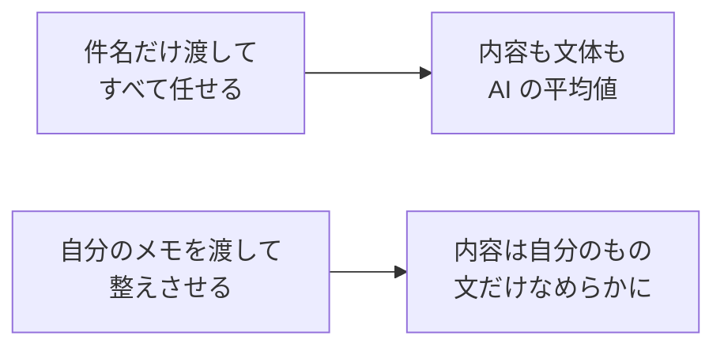
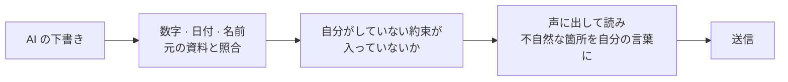

<dl class="facts">
  <div><dt>対象</dt><dd>会社員 · だれでも</dd></div>
  <div><dt>方法</dt><dd>3<small>つ</small></dd></div>
  <div><dt>例文</dt><dd>5<small>種類</small></dd></div>
  <div><dt>要点</dt><dd>内容は自分で</dd></div>
</dl>

## AI が書いたと分かるのはどこか

受け取った人が「AI で書いたな」と感じるポイントは、だいたい同じです。

- 本題の前のあいさつと背景説明が長い
- 「心より」「大変」「重ねて」のような強調が多い
- どの段落も同じくらいの長さで、最後にもう一度まとめが付いている
- 自分がふだん使わない表現が入っている

原因は 1 つです。**内容も文体もすべて AI に任せたから**です。内容は自分で決め、AI には整える作業だけを任せると変わります。



下の依頼文には、**実際に受け取った結果**もあわせて載せました。Claude に依頼文をそのまま入れて返ってきた答えで、手は加えていません。同じ依頼でも、文面は受け取るたびに少しずつ変わります。

## 方法 1: 先にメモを書いて、整えさせる

文章になっていなくてかまいません。言いたいことを**箇条書きの断片で**渡します。

```text
下のメモをもとに、取引先へ送るメールを書いて。
メモにない内容は足さないで。

- 見積書は受け取った
- 単価は問題ないが、納期 3 週間は長すぎる
- 2 週間以内にできるか確認してほしい
- 無理なら、初回分の半分だけ先に受け取る方法でもよい
- 金曜日までに返事がほしい
```

**実際の結果**

```text
件名：お見積書の納期について

〇〇様

お世話になっております。△△の□□です。

お見積書を受け取りました。ありがとうございます。

単価は問題ございません。ただ、納期の 3 週間は長すぎるため、2 週間以内に対応いただけるかご確認をお願いいたします。

難しい場合は、初回分の半分だけ先に納品いただく方法でも構いません。

金曜日までにお返事をいただけますと幸いです。

よろしくお願いいたします。
```

メモの 5 項目が順番どおりに文になりました。足されたのは冒頭と結びのあいさつ、それに「ありがとうございます」のひと言だけです。宛名と名前を埋めれば送れます。

**「メモにない内容は足さないで」**が大事です。この 1 行がないと、AI がもっともらしい文を付け足し、その文が自分のしていない約束になってしまうことがあります。

### メモなしで 1 行だけで頼むと

同じ用件を、メモなしで任せてみました。

```text
取引先に、見積書の納期を短くしてほしいというメールを書いて。
```

**実際の結果**

```text
件名：納期短縮のご相談（お見積書の件）

株式会社〇〇
〇〇様

いつもお世話になっております。
株式会社△△の□□です。

先日はお見積書をお送りいただき、誠にありがとうございました。
内容を拝見し、社内で検討を進めております。

一点、納期についてご相談がございます。
お見積書では納期が〇月〇日となっておりますが、弊社の都合により、〇月〇日までに納品いただくことは可能でしょうか。

ご無理を申し上げ大変恐縮ですが、プロジェクトのスケジュール上、少しでも早く納品いただけますと大変助かります。
全量の前倒しが難しい場合は、一部を先行して納品いただく形でも構いませんので、ご検討いただけますと幸いです。

お忙しいところ恐れ入りますが、〇月〇日までにご回答いただけますでしょうか。

何卒よろしくお願い申し上げます。

――――――――――
株式会社△△
□□ □□
TEL：
Email：
――――――――――

納期や日付の部分は、実際の状況に合わせて書き換えてください。短縮を希望する理由を具体的に書くと、相手も調整しやすくなります。
```

文章そのものに問題はありません。ただ、中身を比べると違いが出ます。

| | 1 行の依頼 | メモを渡した依頼 |
|---|---|---|
| 日付 | 現在の納期、希望の納期、回答期限がすべて「〇月〇日」の空欄 | 3 週間、2 週間、金曜日が入っている |
| 理由 | 「弊社の都合により」「プロジェクトのスケジュール上」は自分が言っていない事情 | メモにない理由はない |
| 代案 | 「一部を先行して納品」とぼかしている | 「初回分の半分」と具体的 |
| 長さ | 本文 10 行 | 本文 6 行 |

AI 自身が最後に書いているとおり、**空欄は自分で埋めなければならず、作られた事情は自分で取り除かなければなりません。** 「社内で検討を進めております」のように、頼んでいない一文も入っています。結局、メモに書くはずだった内容をあとから書くことになります。

## 方法 2: 自分の文章を例として渡す

文体は説明しにくいものですが、見せるのは簡単です。以前自分が送ったメールを 2、3 通貼ります。

```text
下はわたしがふだん書いているメールだ。この文体、長さ、あいさつの仕方をそのまままねて。
内容は参考にせず、文体だけ。

[以前のメール 1]
[以前のメール 2]

では、下の内容で新しいメールを書いて。
[メモ]
```

よく使うなら、自分の文体の特徴を AI にまとめさせ、それを保存しておいて毎回貼り付けると便利です。

```text
上のメールを見て、わたしの書き方の特徴を 5 行でまとめて。
(文の長さ、あいさつの仕方、よく使う表現、使わない表現)
```

## 方法 3: 最後に削る作業をさせる

下書きができたら、**足すのではなく削らせます。** AI の文章らしさは、ほとんどが余分な言葉から生まれます。

```text
いまの文章を次の基準で短くして。
- 最初の文に用件が来るように
- 強調の副詞と繰り返しのあいさつは削除
- 同じことを二度言っている文は 1 つに
- 全体の長さは半分以下
```

上の 1 行の依頼で受け取ったメールに、続けてこの依頼を入れました。

**実際の結果**

```text
件名：納期短縮のご相談（お見積書の件）

〇〇様

お世話になっております。△△の□□です。

お見積書の納期を、〇月〇日から〇月〇日に前倒しいただくことは可能でしょうか。
全量が難しい場合は、一部の先行納品でも構いません。

〇月〇日までにご回答をお願いいたします。
```

本文は 10 行から 4 行になり、お礼、「大変」、作られた理由、署名欄が消えました。ただし、あいさつの 1 行は残っていて、用件は厳密には最初の文ではなく、その次に来ています。日付の空欄もそのままです。**削る作業は余分な言葉を減らしてくれるだけで、ない内容を埋めてはくれません。**

## 場面別の例文

### 断りのメール

```text
提案を断るメールを書いて。
- 断る理由: 今年度の予算がすでに確定している
- 関係は続けたい。来年の第 1 四半期にあらためて話したい
- おわびの言葉は 1 回だけ
- 6 行以内
```

**実際の結果**

```text
件名：ご提案の件

〇〇様

お世話になっております。△△の□□です。
先日はご提案をいただき、ありがとうございました。
申し訳ございませんが、今年度の予算がすでに確定しているため、今回は見送らせていただきます。
今後もお付き合いを続けたいと考えておりますので、来年の第 1 四半期にあらためてお話しできれば幸いです。
引き続きよろしくお願いいたします。
```

おわびは「申し訳ございませんが」の 1 回です。行数は、本文だけなら 5 行ですが、件名と宛名まで数えると 7 行になります。「6 行以内」をどこから数えるかは AI 任せになるので、気になるなら「件名と宛名を含めて」と書き添えます。依頼にない約束は足されていませんが、「先日は」という時期は AI が補ったものです。事実と合っているかを確かめます。

### 催促のメール

```text
先週の火曜日にお願いした資料がまだ届いていない。
せかす印象は抑えつつ、木曜日までに必要だという点ははっきり書いて。
相手がすぐ返事しやすいように、「いつまでなら可能か」を尋ねる文で終えて。
```

**実際の結果**

```text
件名：先週お願いした資料の件

〇〇様

お世話になっております。△△の□□です。

先週の火曜日にお願いした資料について、まだ届いていないようでしたのでご連絡しました。
お忙しいところ恐縮ですが、こちらの作業の都合で、木曜日までに資料が必要です。

木曜日が難しい場合、いつまでであればお送りいただけそうでしょうか。
```

木曜日という期限がはっきり書かれ、最後は質問で終わっています。一方、「こちらの作業の都合で」は依頼にない理由です。実際の事情と違うなら、消すか自分の言葉に直します。

### 報告書の下書き

```text
下のメモと数字で週次報告を書いて。
- 順番: 結論、根拠の数字、来週の予定、助けが必要なこと
- メモにない数字は作らないで。空いているところは [要確認] と書く
- 段落ではなく、短い箇条書きで
```

### 長く書いた文章を縮める

```text
下の文章を半分の長さに縮めて。
削ってはいけないもの: 日付、金額、担当者の名前。
縮めるときに削った内容を、最後にリストで教えて。
```

### 送る前のチェック

```text
このメールを、受け取る人の立場で読んで。
- 何をしてほしいのかが一度で分かるか
- 気を悪くしそうな表現はあるか
- 抜けている情報はあるか (日付、場所、添付)
直さずに、指摘だけして。
```

先ほど 1 行の依頼で受け取ったメールを貼り付けて、尋ねました。

**実際の結果**（一部）

```text
1. 何をしてほしいのかが一度で分かるか
- 用件（納期を早めてほしい）は、件名と「一点、納期についてご相談がございます」の段落で分かります。ただし、肝心の日付がすべて「〇月〇日」のままなので、いつまでに短縮してほしいのかが分かりません。このままでは相手は検討を始められません。
- 本題に入るまでに、あいさつとお礼で 4 行あります。急ぎの依頼であれば、用件がもう少し前にあるほうが伝わりやすいです。

2. 気を悪くしそうな表現はあるか
- 失礼な表現は見当たりません。
- 「弊社の都合により」と「プロジェクトのスケジュール上」は理由として抽象的です。相手からすると、こちらの事情だけで無理を求められている印象になる可能性があります。
- 「大変恐縮ですが」「大変助かります」と「大変」が同じ文で続いています。

3. 抜けている情報はあるか
- 日付: 現在の納期、希望の納期、回答期限のすべてが空欄です。
- どの見積書か: 見積番号、発行日、品名など、対象を特定する情報がありません。
- 納期短縮にともなう条件: 追加費用が発生する場合に受け入れられるかどうかに触れていません。相手が最初に確認したくなる点です。
```

空欄のままの日付、どの見積書か分からないこと、追加費用に触れていないことを指摘しました。抽象的な理由や「大変」の重なりも拾っています。送る側の目にはなかなか入らない点です。

「直さずに、指摘だけ」が役に立ちます。自分の文章を丸ごと書き換えずに、問題点だけを教えてくれます。

## 送る前に必ず見ること



- **数字、日付、名前**は、AI が少し変えて書いてしまうことがあります。元の資料と突き合わせます。
- **約束や確約**が足されていないかを見ます。「必ず」「至急対応いたします」のような表現です。
- 送るのは自分です。**AI が書いたというのは言い訳になりません。**

## まとめ

- 内容は自分がメモで決め、AI には整える作業を任せます。
- 文体は説明するのではなく、**自分の文章を例として**見せます。
- 下書きができたら、足すのではなく**削らせます。**

### あわせて読みたい記事

- [AI に仕事を頼むとき、結果が変わる頼み方 5 つ](/ja/posts/ai-prompt-basics/)
- [AI 翻訳を正しく使う：意味が変わらないように確かめる方法](/ja/posts/ai-translation-guide/)
- [AI に入力してはいけない情報チェックリスト](/ja/posts/ai-privacy-checklist/)
