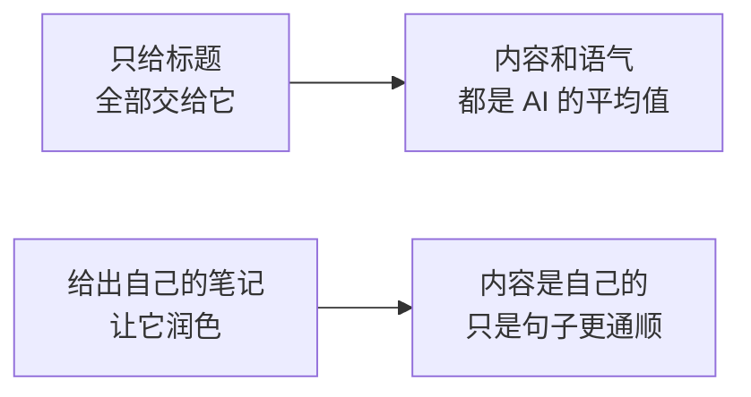
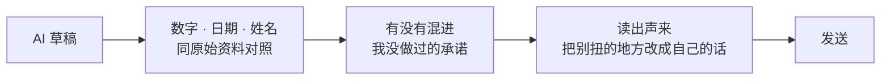

<dl class="facts">
  <div><dt>适合谁</dt><dd>上班族 · 所有人</dd></div>
  <div><dt>方法</dt><dd>3<small>种</small></dd></div>
  <div><dt>例句</dt><dd>5<small>类</small></dd></div>
  <div><dt>关键</dt><dd>内容自己定</dd></div>
</dl>

## AI 写的痕迹出在哪里

收件人觉得“这是用 AI 写的吧”的地方，大体是一样的。

- 进入正题之前，问候和背景说明很长
- “衷心”“非常”“再次”这类强调的词很多
- 每一段长度差不多，结尾还要再总结一遍
- 里面有自己平时不用的说法

原因只有一个。**内容和语气都交给了 AI。**内容由自己定，只把润色交给 AI，情况就不一样了。



## 方法 1：先写笔记，再让它润色

不用写成完整的句子。把想说的话**一条条零散地写下来**交给它。

```text
请用下面的笔记写一封发给供应商的邮件。
笔记里没有的内容不要加。

- 报价单已收到
- 单价可以，但交货期 3 周太长
- 请确认 2 周内是否可行
- 不行的话，也可以先收第一批货的一半
- 周五前需要答复
```

**“笔记里没有的内容不要加”**很重要。没有这一行，AI 会添上看似合理的句子，而那些句子可能变成你没有做过的承诺。

## 方法 2：把自己写的文字给它当示例

语气很难描述，但很容易展示。贴上两三封自己以前发过的邮件。

```text
下面是我平时写的邮件。请照这个语气、长度和问候方式来写。
内容不要参考，只参考语气。

[以前的邮件 1]
[以前的邮件 2]

现在请用下面的内容写一封新邮件。
[笔记]
```

如果经常用，可以先让 AI 把你语气的特点整理出来，存下这份整理，每次贴上去用，会方便很多。

```text
请看上面这些邮件，用 5 行整理出我的写作特点。
（句子长度、问候方式、常用的说法、不用的说法）
```

## 方法 3：最后让它做删减

草稿出来以后，**不要让它加，让它减。**AI 文字的痕迹大多出在多余的话上。

```text
请按以下标准把刚才的文字缩短。
- 第一句就说正事
- 删掉强调的副词和重复的问候
- 同一个意思说了两遍的句子合成一句
- 总长度不超过原来的一半
```

## 按场景的例句

### 拒绝的邮件

```text
请写一封拒绝对方提案的邮件。
- 拒绝的理由：今年的预算已经确定
- 想保持关系。希望明年第一季度再谈
- 抱歉的话只说一次
- 6 行以内
```

### 催促的邮件

```text
上周二请对方提供的资料还没收到。
请减轻催促的感觉，但要写明周四之前需要。
结尾用一句问“最晚什么时候可以”的话，方便对方马上回复。
```

### 报告草稿

```text
请用下面的笔记和数字写一份周报。
- 顺序：结论、作为依据的数字、下周计划、需要协助的事
- 笔记里没有的数字不要编。空着的地方标上 [待确认]
- 不要写成段落，用简短的条目
```

### 缩短写得太长的文字

```text
请把下面的文字缩到一半长度。
不能去掉的：日期、金额、负责人姓名。
最后用列表告诉我缩短时去掉了哪些内容。
```

### 发送前的检查

```text
请站在收件人的角度读这封邮件。
- 是否一眼就能看出要对方做什么
- 有没有可能让人读了不舒服的表述
- 有没有遗漏的信息（日期、地点、附件）
不要改，只指出问题。
```

“不要改，只指出问题”很实用。它不会把你的文字整个换掉，只告诉你问题在哪。

## 发送前一定要看的



- **数字、日期、姓名**，AI 有时会悄悄写得不一样。要同原始资料核对。
- 看看有没有多出**承诺和肯定的答复**。比如“一定”“会立即处理”这类说法。
- 发件人是你。**“是 AI 写的”不能当作理由。**

## 小结

- 内容由自己用笔记定下来，把润色交给 AI。
- 语气不要描述，**用自己写的文字当示例**展示给它。
- 草稿出来以后，不要让它加，**让它减**。

### 推荐一起读

- [让 AI 干活时，结果大不一样的 5 个提问方法](/zh/posts/ai-prompt-basics/)
- [用好 AI 翻译：怎样确认意思没有变](/zh/posts/ai-translation-guide/)
- [不能输入 AI 的信息清单](/zh/posts/ai-privacy-checklist/)
