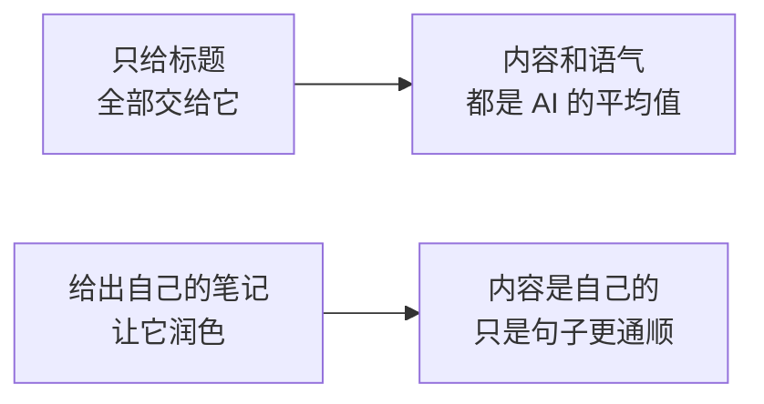
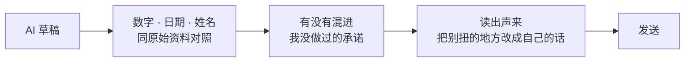

<dl class="facts">
  <div><dt>适合谁</dt><dd>上班族 · 所有人</dd></div>
  <div><dt>方法</dt><dd>3<small>种</small></dd></div>
  <div><dt>例句</dt><dd>5<small>类</small></dd></div>
  <div><dt>关键</dt><dd>内容自己定</dd></div>
</dl>

## AI 写的痕迹出在哪里

收件人觉得“这是用 AI 写的吧”的地方，大体是一样的。

- 进入正题之前，问候和背景说明很长
- “衷心”“非常”“再次”这类强调的词很多
- 每一段长度差不多，结尾还要再总结一遍
- 里面有自己平时不用的说法

原因只有一个。**内容和语气都交给了 AI。**内容由自己定，只把润色交给 AI，情况就不一样了。



下面的请求语后面都附上了**实际收到的结果**。是把请求语原样输入 Claude 得到的回答，没有改动。同样的请求，每次得到的句子都会有些不同。

## 方法 1：先写笔记，再让它润色

不用写成完整的句子。把想说的话**一条条零散地写下来**交给它。

```text
请用下面的笔记写一封发给供应商的邮件。
笔记里没有的内容不要加。

- 报价单已收到
- 单价可以，但交货期 3 周太长
- 请确认 2 周内是否可行
- 不行的话，也可以先收第一批货的一半
- 周五前需要答复
```

**实际结果**

```text
主题：关于报价单及交货期的确认

您好：

报价单已收到，谢谢。

单价方面没有问题，但 3 周的交货期对我们来说太长。请确认能否在 2 周内交货。

如果 2 周内无法全部交货，也可以先交付第一批货的一半。

请在周五前答复，谢谢。

[你的姓名]
```

笔记里的五条按顺序变成了句子，多出来的只有两处“谢谢”和一个署名的空位。3 周、2 周、周五都原样写进去了，填上姓名就能发。

**“笔记里没有的内容不要加”**很重要。没有这一行，AI 会添上看似合理的句子，而那些句子可能变成你没有做过的承诺。

### 不给笔记，只用一句话交代

同一件事，这次不给笔记，直接交给它。

```text
帮我给供应商写一封邮件，请他们缩短报价单上的交期。
```

**实际结果**

```text
好的，下面是一封可以直接使用的邮件，括号里的内容请按实际情况替换：

主题：关于报价单交期的协商

尊敬的[供应商联系人姓名]：

您好！

感谢贵司发来的报价单（编号：[报价单编号]）。我们已仔细审阅，对产品规格和价格条款基本认可。

不过，报价单中注明的交期为[原交期]，与我方的项目进度安排存在一定差距。由于[简要说明原因，如：客户订单提前／生产排期紧张]，我们希望贵司能将交期缩短至[期望交期]。

如果全部缩短存在困难，也想请您评估以下方案是否可行：
1. 分批交货，优先交付首批[数量]；
2. 调整生产排期，优先安排我方订单；
3. 如需加急费用，请告知具体金额，我方可以协商。

烦请于[日期]前回复能否调整。如有任何问题，欢迎随时与我联系。

期待您的回复，谢谢！

此致
敬礼

[您的姓名]
[公司名称]
[联系电话]

如果您能告诉我具体的交期、期望时间和原因，我可以帮您把邮件改得更有针对性。
```

句子没有毛病。但看内容，差别就出来了。

| | 一句话的请求 | 给了笔记的请求 |
|---|---|---|
| 日期 | `[原交期]`、`[期望交期]`、`[日期]` 都是空位 | 写进了 3 周、2 周、周五 |
| 理由 | 连理由也是空位，只给了“客户订单提前／生产排期紧张”这样的示例 | 没有笔记以外的理由 |
| 立场和让步 | “价格条款基本认可”“加急费用我方可以协商”，都是我没说过的话 | 只有笔记里的“单价可以”和“先收第一批货的一半” |
| 长度 | 正文 5 段，外加 3 条备选方案 | 正文 4 段 |

方括号一共有 10 处。正如 AI 自己在开头和结尾说的，**空位要我来填，它替我表的态要我来筛。**到头来，本该写在笔记里的内容还是得事后补上。

## 方法 2：把自己写的文字给它当示例

语气很难描述，但很容易展示。贴上两三封自己以前发过的邮件。

```text
下面是我平时写的邮件。请照这个语气、长度和问候方式来写。
内容不要参考，只参考语气。

[以前的邮件 1]
[以前的邮件 2]

现在请用下面的内容写一封新邮件。
[笔记]
```

如果经常用，可以先让 AI 把你语气的特点整理出来，存下这份整理，每次贴上去用，会方便很多。

```text
请看上面这些邮件，用 5 行整理出我的写作特点。
（句子长度、问候方式、常用的说法、不用的说法）
```

## 方法 3：最后让它做删减

草稿出来以后，**不要让它加，让它减。**AI 文字的痕迹大多出在多余的话上。

```text
请按以下标准把刚才的文字缩短。
- 第一句就说正事
- 删掉强调的副词和重复的问候
- 同一个意思说了两遍的句子合成一句
- 总长度不超过原来的一半
```

我把这段请求接在上面那封一句话请求得到的邮件后面。

**实际结果**

```text
主题：请求缩短报价单交期

[供应商联系人姓名]，您好：

报价单（编号：[报价单编号]）中的交期为[原交期]，希望贵司能缩短至[期望交期]。

如全部缩短有困难，请评估能否分批交货或优先排产；如需加急费用，请告知金额。

请于[日期]前回复，谢谢。

[您的姓名]
[公司名称]
```

正事提到了第一句，正文从 5 段加 3 条方案缩成了 3 段，“价格条款基本认可”和“我方可以协商”也一并删掉了。不过方括号的空位还在，“加急费用”这个话头也留着。**删减只能去掉多余的话，补不上原本没有的内容。**

## 按场景的例句

### 拒绝的邮件

```text
请写一封拒绝对方提案的邮件。
- 拒绝的理由：今年的预算已经确定
- 想保持关系。希望明年第一季度再谈
- 抱歉的话只说一次
- 6 行以内
```

**实际结果**

```text
主题：关于贵司提案的回复

您好：

感谢您发来的提案，我们已认真看过。
很抱歉，今年的预算已经确定，这次无法推进。
我们很看重与贵司的合作关系，希望明年第一季度能再谈一次。
届时我会主动与您联系。
祝工作顺利。

[您的姓名]
```

“很抱歉”只出现了一次。行数要看怎么数：正文是 5 行，把主题、称呼和署名算上就是 8 行。如果要的是整封邮件 6 行以内，就得再说明一次。还有一处要留意，**“届时我会主动与您联系”**是请求里没有的承诺。不打算兑现的话就删掉。

### 催促的邮件

```text
上周二请对方提供的资料还没收到。
请减轻催促的感觉，但要写明周四之前需要。
结尾用一句问“最晚什么时候可以”的话，方便对方马上回复。
```

**实际结果**

```text
主题：关于上周二所需资料的确认

您好：

上周二拜托您提供的资料，我这边还没有收到，想跟您确认一下进展。

因为后续工作安排的关系，这份资料我需要在周四之前拿到。如果手头事情较多，先发已整理好的部分也可以。

最晚什么时候可以发给我呢？

谢谢！

[您的姓名]
```

周四这个期限写得很清楚，正文最后一句是提问，只是后面还跟了一句“谢谢！”。有两处是请求里没有的：“因为后续工作安排的关系”这个理由，以及“先发已整理好的部分也可以”这个提议。如果资料只拿到一部分没有用，就把这句删掉。

### 报告草稿

```text
请用下面的笔记和数字写一份周报。
- 顺序：结论、作为依据的数字、下周计划、需要协助的事
- 笔记里没有的数字不要编。空着的地方标上 [待确认]
- 不要写成段落，用简短的条目
```

### 缩短写得太长的文字

```text
请把下面的文字缩到一半长度。
不能去掉的：日期、金额、负责人姓名。
最后用列表告诉我缩短时去掉了哪些内容。
```

### 发送前的检查

```text
请站在收件人的角度读这封邮件。
- 是否一眼就能看出要对方做什么
- 有没有可能让人读了不舒服的表述
- 有没有遗漏的信息（日期、地点、附件）
不要改，只指出问题。
```

我把前面一句话请求得到的那封邮件贴上去问了。

**实际结果**

```text
站在收件人（供应商）的角度读下来，有以下几个问题：

1. 要对方做什么，基本能看出来，但不够靠前
主题和第三段都写了希望缩短交期，请求本身是清楚的。不过正文前两段是问候和对报价单的认可，真正的请求在第三段才出现。另外最后同时提出了三个备选方案，对方可能不确定该先回答哪一个。

2. 可能让人读了不舒服的表述
- “对产品规格和价格条款基本认可”：“基本”二字比较含糊，对方可能会理解为价格还要再谈。
- “调整生产排期，优先安排我方订单”：这等于要求对方把其他客户往后排，说得比较直接，容易让人觉得强势。
- 整体语气是客气的，没有明显失礼的地方。

3. 遗漏的信息
- 所有方括号里的内容都还没填：联系人姓名、报价单编号、原交期、期望交期、原因、首批数量、回复期限、署名。这样发出去对方无法判断。
- 没有说明订单数量或涉及的产品，对方不好评估能否缩短。
- 邮件提到报价单但没有说明是否附上，建议确认是否需要附件。
- 交货地点没有提，如果分批交货，可能需要写明。

另外提醒一点：“如需加急费用……我方可以协商”是一个主动让步，发送前请确认这是否是您想表达的。
```

它指出了没填的方括号、“基本认可”可能被理解成价格还要谈、“优先安排我方订单”显得强势，最后还提醒“加急费用可以协商”是一个主动让步。这些都是发件人自己不容易看到的地方。它没有动手改写邮件，只在附件那一条带了一句建议。

“不要改，只指出问题”很实用。它不会把你的文字整个换掉，只告诉你问题在哪。

## 发送前一定要看的



- **数字、日期、姓名**，AI 有时会悄悄写得不一样。要同原始资料核对。
- 看看有没有多出**承诺和肯定的答复**。比如“一定”“会立即处理”这类说法。
- 发件人是你。**“是 AI 写的”不能当作理由。**

## 小结

- 内容由自己用笔记定下来，把润色交给 AI。
- 语气不要描述，**用自己写的文字当示例**展示给它。
- 草稿出来以后，不要让它加，**让它减**。

### 推荐一起读

- [让 AI 干活时，结果大不一样的 5 个提问方法](/zh/posts/ai-prompt-basics/)
- [用好 AI 翻译：怎样确认意思没有变](/zh/posts/ai-translation-guide/)
- [不能输入 AI 的信息清单](/zh/posts/ai-privacy-checklist/)
