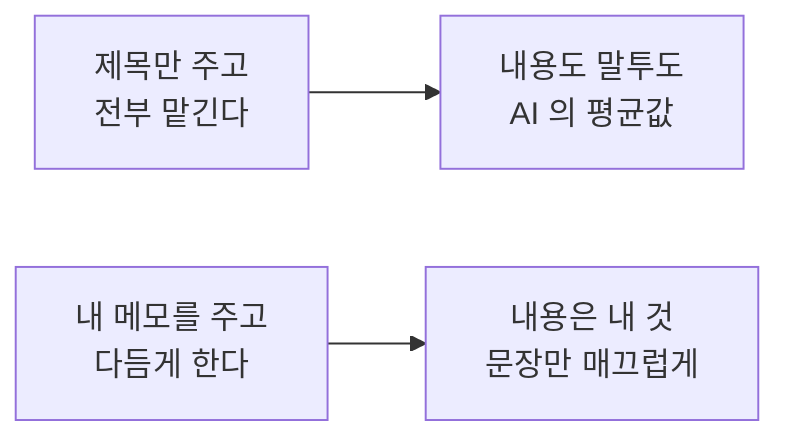
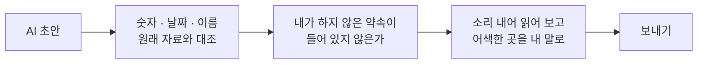

<dl class="facts">
  <div><dt>대상</dt><dd>직장인 · 누구나</dd></div>
  <div><dt>방법</dt><dd>3<small>가지</small></dd></div>
  <div><dt>예문</dt><dd>5<small>종류</small></dd></div>
  <div><dt>핵심</dt><dd>내용은 내가</dd></div>
</dl>

## AI 가 쓴 티는 어디서 날까

받는 사람이 "AI 로 썼네" 라고 느끼는 지점은 대체로 같습니다.

- 본론 전에 인사와 배경 설명이 길다
- "진심으로", "매우", "다시 한번" 같은 강조가 많다
- 모든 문단이 비슷한 길이이고 끝에 요약이 한 번 더 붙는다
- 내가 평소에 쓰지 않는 표현이 들어 있다

원인은 하나입니다. **내용과 말투를 모두 AI 에게 맡겼기 때문**입니다. 내용은 내가 정하고, AI 에게는 다듬는 일만 맡기면 달라집니다.



## 방법 1: 메모를 먼저 쓰고 다듬게 한다

문장으로 쓰지 않아도 됩니다. 하고 싶은 말을 **토막으로 적어서** 줍니다.

```text
아래 메모로 거래처에 보낼 메일을 써 줘.
메모에 없는 내용은 더하지 마.

- 견적서 잘 받았음
- 단가는 괜찮은데 납기가 3주는 너무 김
- 2주 안에 가능한지 확인 부탁
- 안 되면 1차 물량 절반만 먼저 받는 방법도 가능
- 금요일까지 답 필요
```

**"메모에 없는 내용은 더하지 마"** 가 중요합니다. 이 줄이 없으면 AI 가 그럴듯한 문장을 덧붙이고, 그 문장이 내가 하지 않은 약속이 될 수 있습니다.

## 방법 2: 내 글을 예시로 준다

말투를 설명하기는 어렵지만 보여 주기는 쉽습니다. 예전에 내가 보낸 메일 두세 통을 붙입니다.

```text
아래는 내가 평소에 쓰는 메일이다. 이 말투, 길이, 인사 방식을 그대로 따라 줘.
내용은 참고하지 말고 말투만.

[예전 메일 1]
[예전 메일 2]

이제 아래 내용으로 새 메일을 써 줘.
[메모]
```

자주 쓴다면 내 말투의 특징을 AI 에게 정리하게 한 뒤, 그 정리를 저장해 두고 매번 붙여 쓰면 편합니다.

```text
위 메일들을 보고 내 글쓰기 특징을 5줄로 정리해 줘.
(문장 길이, 인사 방식, 자주 쓰는 표현, 쓰지 않는 표현)
```

## 방법 3: 마지막에 빼는 작업을 시킨다

초안이 나오면 **더하지 말고 빼게** 합니다. AI 글의 티는 대부분 군더더기에서 납니다.

```text
방금 글을 다음 기준으로 줄여 줘.
- 첫 문장에 용건이 오게
- 강조하는 부사와 반복되는 인사는 삭제
- 같은 말을 두 번 하는 문장은 하나로
- 전체 길이는 절반 이하
```

## 상황별 예문

### 거절하는 메일

```text
제안을 거절하는 메일을 써 줘.
- 거절 이유: 올해 예산이 이미 확정됨
- 관계는 유지하고 싶음. 내년 1분기에 다시 이야기하고 싶음
- 미안하다는 말은 한 번만
- 6줄 이내
```

### 독촉하는 메일

```text
지난주 화요일에 요청한 자료를 아직 못 받았다.
재촉하는 느낌은 줄이되, 목요일까지 필요하다는 점은 분명하게 써 줘.
상대가 바로 답하기 쉽게 "언제까지 가능한지" 를 묻는 문장으로 끝내 줘.
```

### 보고서 초안

```text
아래 메모와 숫자로 주간 보고를 써 줘.
- 순서: 결론, 근거 숫자, 다음 주 계획, 도움이 필요한 것
- 메모에 없는 숫자는 만들지 마. 비어 있으면 [확인 필요] 로 표시
- 문단이 아니라 짧은 항목으로
```

### 길게 쓴 글 줄이기

```text
아래 글을 절반 길이로 줄여 줘.
빼면 안 되는 것: 날짜, 금액, 담당자 이름.
줄이면서 뺀 내용이 뭔지 마지막에 목록으로 알려 줘.
```

### 보내기 전 검토

```text
이 메일을 받는 사람 입장에서 읽어 줘.
- 무엇을 해 달라는 건지 한 번에 알 수 있는가
- 기분 나쁘게 읽힐 수 있는 표현이 있는가
- 빠진 정보가 있는가 (날짜, 장소, 첨부)
고치지는 말고 지적만 해 줘.
```

"고치지는 말고 지적만" 이 요긴합니다. 내 글을 통째로 바꾸지 않고 문제만 알려 줍니다.

## 보내기 전에 꼭 볼 것



- **숫자, 날짜, 이름**은 AI 가 살짝 바꿔 쓰는 일이 있습니다. 원래 자료와 맞춰 봅니다.
- **약속과 확답**이 추가되지 않았는지 봅니다. "반드시", "즉시 처리하겠습니다" 같은 표현입니다.
- 보내는 사람은 나입니다. **AI 가 썼다는 것은 변명이 되지 않습니다.**

## 정리

- 내용은 내가 메모로 정하고, AI 에게는 다듬는 일을 맡깁니다.
- 말투는 설명하지 말고 **내 글을 예시로** 보여 줍니다.
- 초안이 나오면 더하지 말고 **줄이게** 합니다.

### 같이 읽으면 좋은 글

- [AI 에게 일 시킬 때 결과가 달라지는 요청법 5가지](/posts/ai-prompt-basics/)
- [AI 번역 제대로 쓰기: 뜻이 바뀌지 않게 확인하는 법](/posts/ai-translation-guide/)
- [AI 에 넣으면 안 되는 정보 체크리스트](/posts/ai-privacy-checklist/)
