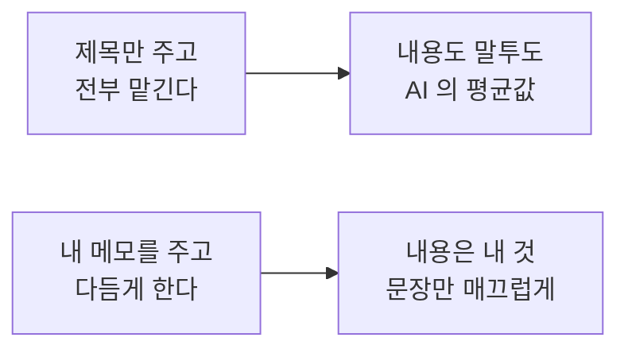
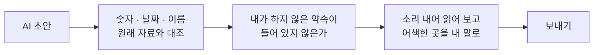

<dl class="facts">
  <div><dt>대상</dt><dd>직장인 · 누구나</dd></div>
  <div><dt>방법</dt><dd>3<small>가지</small></dd></div>
  <div><dt>예문</dt><dd>5<small>종류</small></dd></div>
  <div><dt>핵심</dt><dd>내용은 내가</dd></div>
</dl>

## AI 가 쓴 티는 어디서 날까

받는 사람이 "AI 로 썼네" 라고 느끼는 지점은 대체로 같습니다.

- 본론 전에 인사와 배경 설명이 길다
- "진심으로", "매우", "다시 한번" 같은 강조가 많다
- 모든 문단이 비슷한 길이이고 끝에 요약이 한 번 더 붙는다
- 내가 평소에 쓰지 않는 표현이 들어 있다

원인은 하나입니다. **내용과 말투를 모두 AI 에게 맡겼기 때문**입니다. 내용은 내가 정하고, AI 에게는 다듬는 일만 맡기면 달라집니다.



아래 요청문에는 **실제로 받은 결과**를 함께 실었습니다. Claude 에 요청문을 그대로 넣어 받은 답이고, 고치지 않았습니다. 같은 요청이라도 받을 때마다 문장은 조금씩 달라집니다.

## 방법 1: 메모를 먼저 쓰고 다듬게 한다

문장으로 쓰지 않아도 됩니다. 하고 싶은 말을 **토막으로 적어서** 줍니다.

```text
아래 메모로 거래처에 보낼 메일을 써 줘.
메모에 없는 내용은 더하지 마.

- 견적서 잘 받았음
- 단가는 괜찮은데 납기가 3주는 너무 김
- 2주 안에 가능한지 확인 부탁
- 안 되면 1차 물량 절반만 먼저 받는 방법도 가능
- 금요일까지 답 필요
```

**받은 결과**

```text
제목: 견적서 납기 확인 부탁드립니다

안녕하세요.

보내 주신 견적서 잘 받았습니다. 단가는 괜찮습니다. 다만 납기 3주는 저희에게 너무 깁니다.

2주 안에 납품이 가능한지 확인 부탁드립니다. 어렵다면 1차 물량의 절반만 먼저 받는 방법도 가능합니다.

금요일까지 답변 부탁드립니다.

감사합니다.
```

메모의 다섯 줄이 순서대로 문장이 됐고, 그 밖의 내용은 없습니다. 이름과 회사만 채워서 보내면 됩니다.

**"메모에 없는 내용은 더하지 마"** 가 중요합니다. 이 줄이 없으면 AI 가 그럴듯한 문장을 덧붙이고, 그 문장이 내가 하지 않은 약속이 될 수 있습니다.

### 메모 없이 한 줄로 시키면

같은 용건을 메모 없이 맡겨 봤습니다.

```text
거래처에 견적서 납기를 줄여 달라는 메일 써 줘.
```

**받은 결과**

```text
제목: 견적서 납기 단축 요청드립니다

안녕하세요, ○○○ 담당자님.
△△사 □□□입니다.

보내 주신 견적서 잘 받았습니다. 검토해 보니 단가와 조건은 저희 쪽에서 진행하기에 문제가 없습니다. 다만 납기를 조금 앞당길 수 있는지 문의드립니다.

견적서에는 납기가 [현재 납기]로 되어 있는데, 저희 생산 일정상 [희망 납기]까지는 물품을 받아야 합니다. 이 일정에 맞출 수 있는지 확인 부탁드립니다.

전량을 맞추기 어렵다면 일부 물량만 먼저 받고 나머지는 원래 일정대로 받는 방법도 괜찮습니다. 가능한 일정과 조건을 [회신 기한]까지 알려 주시면 내부 일정을 확정하겠습니다.

감사합니다.
□□□ 드림

대괄호 안의 현재 납기, 희망 납기, 회신 기한은 실제 날짜로 바꿔서 보내시면 됩니다. 납기를 줄여야 하는 사정이 생산 일정이 아니라면 그 부분도 알려 주세요. 맞춰서 고치겠습니다.
```

문장은 멀쩡합니다. 그런데 내용을 보면 차이가 납니다.

| | 한 줄 요청 | 메모를 준 요청 |
|---|---|---|
| 날짜 | `[현재 납기]`, `[희망 납기]`, `[회신 기한]` 이 빈칸 | 3주, 2주, 금요일이 들어감 |
| 이유 | "저희 생산 일정상" 은 내가 말한 적 없는 사정 | 메모에 없는 이유는 없음 |
| 대안 | "일부 물량만 먼저" 로 뭉뚱그림 | "1차 물량의 절반" 으로 구체적 |

AI 가 스스로 밝혔듯이 **빈칸은 내가 채워야 하고, 지어낸 사정은 내가 걸러야 합니다.** 결국 메모에 적었을 내용을 나중에 쓰는 셈입니다.

## 방법 2: 내 글을 예시로 준다

말투를 설명하기는 어렵지만 보여 주기는 쉽습니다. 예전에 내가 보낸 메일 두세 통을 붙입니다.

```text
아래는 내가 평소에 쓰는 메일이다. 이 말투, 길이, 인사 방식을 그대로 따라 줘.
내용은 참고하지 말고 말투만.

[예전 메일 1]
[예전 메일 2]

이제 아래 내용으로 새 메일을 써 줘.
[메모]
```

자주 쓴다면 내 말투의 특징을 AI 에게 정리하게 한 뒤, 그 정리를 저장해 두고 매번 붙여 쓰면 편합니다.

```text
위 메일들을 보고 내 글쓰기 특징을 5줄로 정리해 줘.
(문장 길이, 인사 방식, 자주 쓰는 표현, 쓰지 않는 표현)
```

## 방법 3: 마지막에 빼는 작업을 시킨다

초안이 나오면 **더하지 말고 빼게** 합니다. AI 글의 티는 대부분 군더더기에서 납니다.

```text
방금 글을 다음 기준으로 줄여 줘.
- 첫 문장에 용건이 오게
- 강조하는 부사와 반복되는 인사는 삭제
- 같은 말을 두 번 하는 문장은 하나로
- 전체 길이는 절반 이하
```

위의 한 줄 요청으로 받은 메일에 이 요청을 이어서 넣었습니다.

**받은 결과**

```text
제목: 견적서 납기 단축 요청

○○○ 담당자님, 견적서의 납기를 [현재 납기]에서 [희망 납기]로 앞당길 수 있는지 확인 부탁드립니다.

단가와 조건은 그대로 진행할 수 있습니다. 전량이 어렵다면 일부 물량만 먼저 받아도 됩니다. [회신 기한]까지 답변 주시면 일정을 확정하겠습니다.

△△사 □□□ 드림
```

용건이 첫 문장으로 올라왔고 인사와 맺음말이 빠지고 본문이 세 문단에서 두 문단으로 줄었습니다. 다만 대괄호 빈칸은 그대로입니다. **줄이기는 군더더기를 덜어 줄 뿐, 없는 내용을 채워 주지는 않습니다.**

## 상황별 예문

### 거절하는 메일

```text
제안을 거절하는 메일을 써 줘.
- 거절 이유: 올해 예산이 이미 확정됨
- 관계는 유지하고 싶음. 내년 1분기에 다시 이야기하고 싶음
- 미안하다는 말은 한 번만
- 6줄 이내
```

**받은 결과**

```text
제목: 제안 검토 결과 말씀드립니다
안녕하세요, ○○○ 님.
보내 주신 제안은 이번에는 진행하지 못하게 되었습니다. 죄송합니다.
올해 예산이 이미 확정되어 새로 반영할 수 없습니다.
내년 1분기에 다시 이야기 나눌 수 있으면 좋겠습니다. 그때 제가 먼저 연락드리겠습니다.
□□□ 드림
```

여섯 줄이고 "죄송합니다" 는 한 번입니다. 한 가지는 봐야 합니다. **"그때 제가 먼저 연락드리겠습니다"** 는 요청에 없던 약속입니다. 지킬 생각이 없다면 지웁니다.

### 독촉하는 메일

```text
지난주 화요일에 요청한 자료를 아직 못 받았다.
재촉하는 느낌은 줄이되, 목요일까지 필요하다는 점은 분명하게 써 줘.
상대가 바로 답하기 쉽게 "언제까지 가능한지" 를 묻는 문장으로 끝내 줘.
```

**받은 결과**

```text
제목: 지난주 요청드린 자료 일정 확인

안녕하세요, ○○○ 님.

지난주 화요일에 요청드린 자료를 아직 받지 못해 진행 상황을 여쭙니다. 바쁘신 중에 준비하고 계실 것으로 압니다.

저희 쪽 일정상 이 자료는 목요일까지 필요합니다. 전체가 어렵다면 준비된 부분부터 먼저 보내 주셔도 됩니다.

언제까지 보내 주실 수 있을까요?

□□□ 드림
```

목요일이라는 기한이 분명하고 마지막이 질문으로 끝납니다. "준비된 부분부터 먼저 보내 주셔도 됩니다" 는 요청에 없던 제안입니다. 일부만 받아서는 소용없는 자료라면 이 문장은 뺍니다.

### 보고서 초안

```text
아래 메모와 숫자로 주간 보고를 써 줘.
- 순서: 결론, 근거 숫자, 다음 주 계획, 도움이 필요한 것
- 메모에 없는 숫자는 만들지 마. 비어 있으면 [확인 필요] 로 표시
- 문단이 아니라 짧은 항목으로
```

### 길게 쓴 글 줄이기

```text
아래 글을 절반 길이로 줄여 줘.
빼면 안 되는 것: 날짜, 금액, 담당자 이름.
줄이면서 뺀 내용이 뭔지 마지막에 목록으로 알려 줘.
```

### 보내기 전 검토

```text
이 메일을 받는 사람 입장에서 읽어 줘.
- 무엇을 해 달라는 건지 한 번에 알 수 있는가
- 기분 나쁘게 읽힐 수 있는 표현이 있는가
- 빠진 정보가 있는가 (날짜, 장소, 첨부)
고치지는 말고 지적만 해 줘.
```

앞에서 한 줄 요청으로 받은 메일을 붙여서 물었습니다.

**받은 결과** (일부)

```text
1. 무엇을 해 달라는 건지 한 번에 알 수 있는가
- 제목만 봐도 납기 단축 요청인 것은 알 수 있습니다.
- 본문에서는 요청이 셋째 문장에야 나옵니다. 견적서 수령 확인과 단가 이야기를 먼저 읽어야 합니다.
- "조금 앞당길 수 있는지"와 "[희망 납기]까지는 받아야 합니다"가 서로 다른 강도로 읽힙니다. 협의 가능한 문의인지, 정해진 기한인지 헷갈립니다.

2. 기분 나쁘게 읽힐 수 있는 표현이 있는가
- 크게 거슬리는 표현은 없습니다.
- "저희 생산 일정상 ~까지는 물품을 받아야 합니다"는 우리 사정만 내세운 통보로 읽힐 수 있습니다. 상대의 생산 여건은 언급이 없습니다.
- "내부 일정을 확정하겠습니다"는 회신이 늦으면 불이익이 있다는 압박으로 받아들일 여지가 있습니다.

3. 빠진 정보가 있는가
- 날짜: 현재 납기, 희망 납기, 회신 기한이 모두 대괄호로 비어 있습니다. 이대로 보내면 상대는 답을 할 수 없습니다.
- 견적서 식별 정보: 견적 번호, 발행일, 품목, 수량이 없습니다. 여러 건을 주고받는 거래처라면 어느 견적인지 찾아야 합니다.
- 분할 물량: "일부 물량"이 얼마인지 없습니다. 상대가 가능 여부를 따지려면 수량이 필요합니다.
```

빈칸으로 남은 날짜, 어느 견적인지 알 수 없다는 점, "일부 물량" 이 얼마인지 없다는 점을 짚었습니다. 보내는 사람 눈에는 잘 보이지 않는 것들입니다.

"고치지는 말고 지적만" 이 요긴합니다. 내 글을 통째로 바꾸지 않고 문제만 알려 줍니다.

## 보내기 전에 꼭 볼 것



- **숫자, 날짜, 이름**은 AI 가 살짝 바꿔 쓰는 일이 있습니다. 원래 자료와 맞춰 봅니다.
- **약속과 확답**이 추가되지 않았는지 봅니다. "반드시", "즉시 처리하겠습니다" 같은 표현입니다.
- 보내는 사람은 나입니다. **AI 가 썼다는 것은 변명이 되지 않습니다.**

## 정리

- 내용은 내가 메모로 정하고, AI 에게는 다듬는 일을 맡깁니다.
- 말투는 설명하지 말고 **내 글을 예시로** 보여 줍니다.
- 초안이 나오면 더하지 말고 **줄이게** 합니다.

### 같이 읽으면 좋은 글

- [AI 에게 일 시킬 때 결과가 달라지는 요청법 5가지](/posts/ai-prompt-basics/)
- [AI 번역 제대로 쓰기: 뜻이 바뀌지 않게 확인하는 법](/posts/ai-translation-guide/)
- [AI 에 넣으면 안 되는 정보 체크리스트](/posts/ai-privacy-checklist/)
