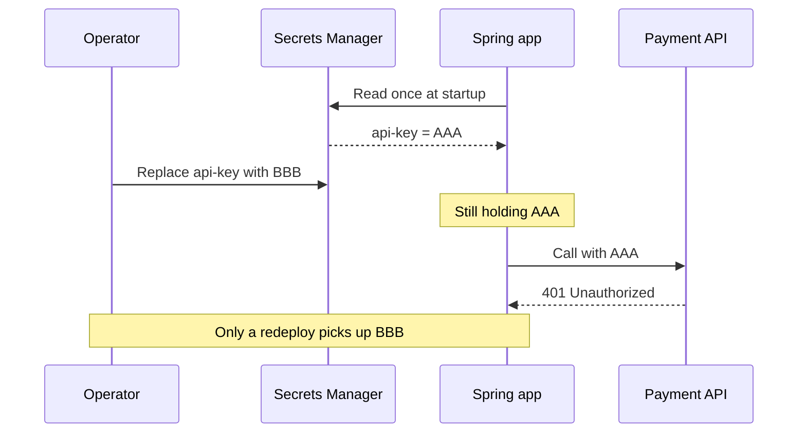
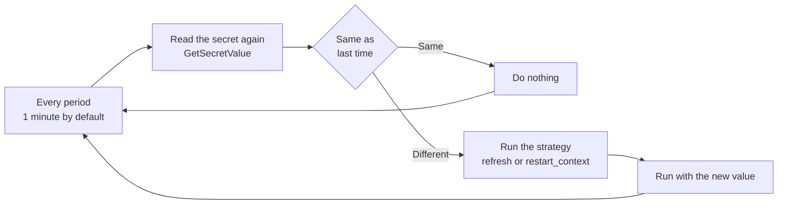
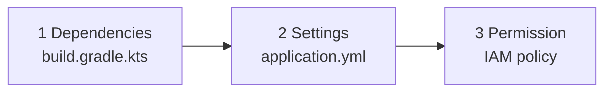
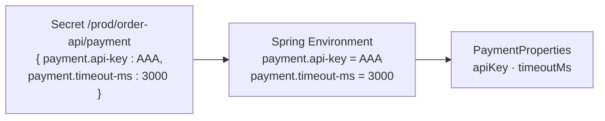
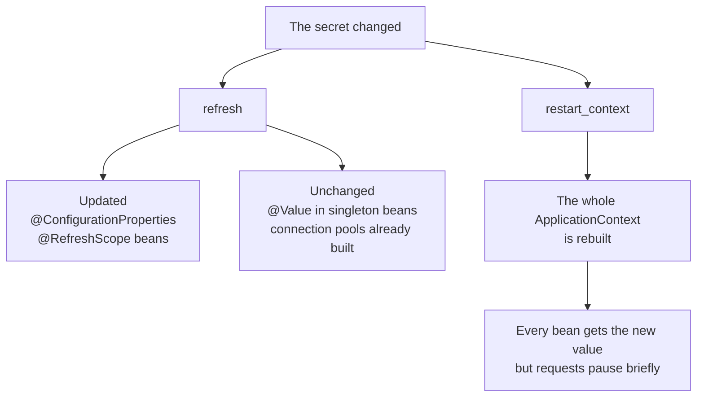
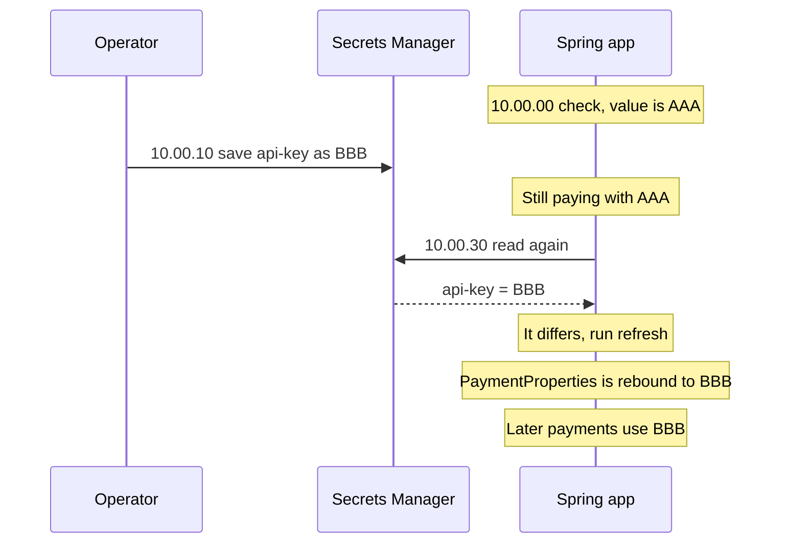
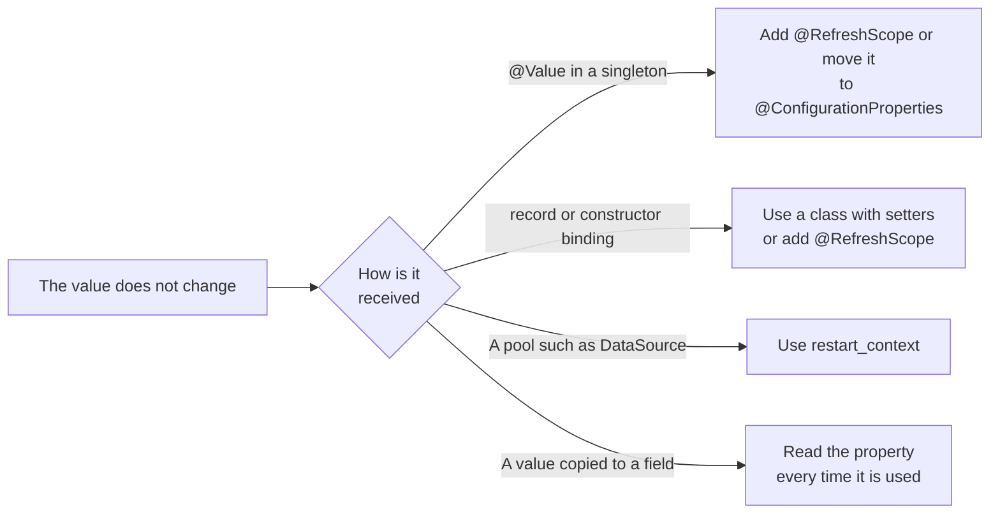
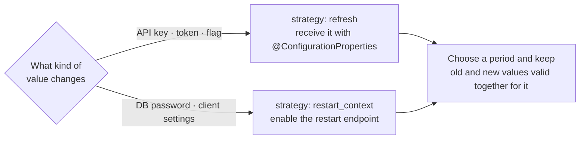

<dl class="facts">
  <div><dt>Spring Cloud AWS</dt><dd>4.2.2</dd></div>
  <div><dt>Spring Boot</dt><dd>4<small>.x</small></dd></div>
  <div><dt>Default period</dt><dd>1<small>min</small></dd></div>
  <div><dt>Strategies</dt><dd>2</dd></div>
</dl>

## You changed the value, the app has no idea

A Spring app reads its secrets **once, at startup**. Change the value in Secrets Manager afterwards and the value inside the app stays the same.



Every key replacement needs a redeploy, and requests fail in between. Reloading closes that gap.

## What happens once reload is on

On a fixed period the app reads the secret again and acts **only when it differs from last time**.



- If nothing changed, it is one API call and that is all. No bean is touched.
- The first check runs **one period after** the app starts.
- A manual edit in the console and an automatic rotation by Secrets Manager are detected the same way.

## Three places to configure



### 1. Dependencies

```kotlin
dependencies {
    implementation(platform("io.awspring.cloud:spring-cloud-aws-dependencies:4.2.2"))
    implementation("io.awspring.cloud:spring-cloud-aws-starter-secrets-manager")

    // the three that reload needs
    implementation("org.springframework.boot:spring-boot-starter-actuator")
    implementation("org.springframework.cloud:spring-cloud-commons")
    implementation("org.springframework.cloud:spring-cloud-context")
}
```

Without the last three, reload does not work. Take the versions of `spring-cloud-commons` and `spring-cloud-context` from the Spring Cloud release BOM you already use.

### 2. application.yml

```yaml
spring:
  config:
    import: "aws-secretsmanager:/prod/order-api/payment"
  cloud:
    aws:
      region:
        static: ap-northeast-2
      secretsmanager:
        reload:
          strategy: refresh   # without this line reload is off
          period: 30s         # default is 1 minute
```

| Property | Default | Meaning |
|---|---|---|
| `…reload.strategy` | none (off) | `refresh` or `restart_context` |
| `…reload.period` | `1m` | How often the secret is read again |
| `…reload.max-wait-for-restart` | `2s` | With `restart_context`, the longest random wait before restarting |

The leading `…` stands for `spring.cloud.aws.secretsmanager`.

When the secret is JSON, **its top-level keys become property names as they are**.



Join several secrets with `;`. Prefix a secret with `optional:` when the app should still start without it.

```yaml
spring:
  config:
    import: "optional:aws-secretsmanager:/prod/order-api/payment;/prod/order-api/mail"
```

### 3. IAM permission

One read permission is enough. A secret encrypted with a customer managed KMS key also needs `kms:Decrypt`.

```json
{
  "Effect": "Allow",
  "Action": "secretsmanager:GetSecretValue",
  "Resource": "arn:aws:secretsmanager:ap-northeast-2:123456789012:secret:/prod/order-api/*"
}
```

## Pick one of two strategies

The difference is **how much gets rebuilt** once a change is noticed.



| | `refresh` | `restart_context` |
|---|---|---|
| What changes | `@ConfigurationProperties` and `@RefreshScope` beans | Every bean |
| Interruption | None | While the context comes back up |
| Extra setup | None | Enable the restart endpoint |
| Good for | API keys, tokens, feature flags | Values that need a new pool or client, such as a DB password |

`restart_context` needs the restart endpoint enabled and exposed.

```yaml
management:
  endpoint:
    restart:
      enabled: true
  endpoints:
    web:
      exposure:
        include: restart
```

## Changing a value for real

Receive the values in a plain `@ConfigurationProperties` class with setters.

```java
@Component
@ConfigurationProperties(prefix = "payment")
public class PaymentProperties {
    private String apiKey;
    private int timeoutMs;
    // getters / setters
}
```

```java
@Service
public class PaymentClient {
    private final PaymentProperties props;

    public PaymentClient(PaymentProperties props) {
        this.props = props;
    }

    public void pay(Order order) {
        String key = props.getApiKey();   // read it on every call
        // call the payment API with key
    }
}
```

Start the app with `period: 30s` and `strategy: refresh`, replace the key in the console, and this is the sequence.



- It takes **up to one period** (30 seconds here) for a change to land.
- The old value is used during that time, so the old and new keys have to be **valid together for a moment** to avoid failures. With automatic rotation, do not revoke the previous version straight away.
- `Polling configurations change detector activated` in the startup log means reload is on.

## What trips you up in practice



- **`@Value` stays as it was.** A singleton bean gets its value injected once, when it is created. With `@RefreshScope` on the class, the bean is rebuilt the first time it is used after a refresh.
- **Connection pools are not changed by refresh.** Even when `spring.datasource.password` changes, the HikariCP pool that already exists keeps opening connections with the old password. For a DB password rotation, `restart_context` is the right one.
- **Do not copy the value in a constructor.** With `this.key = props.getApiKey()`, the field keeps the old value after the property changes.
- **Each instance checks on its own.** With 10 instances, each reads on its own schedule, so for up to one period old and new values coexist.
- **The period is your call count.** Ten instances reading three secrets every minute is about 1.3 million calls a month. At the API call price (0.05 USD per 10,000 calls) that is about 6.5 USD, and four times that with a 15 second period.
- **The docs disagree on the default.** The reference text says 1 minute and its table says 15 seconds. The default in the 4.2.2 source is 1 minute. Writing `period` out explicitly avoids the confusion.

## Summary



- Three dependencies (actuator, spring-cloud-commons, spring-cloud-context) and one `reload.strategy` line are all it takes.
- Use `refresh` with `@ConfigurationProperties` for values that should change without interruption, and `restart_context` for values that need a new pool.
- A change lands **up to one period later**, not instantly. The old value has to stay alive that long.
