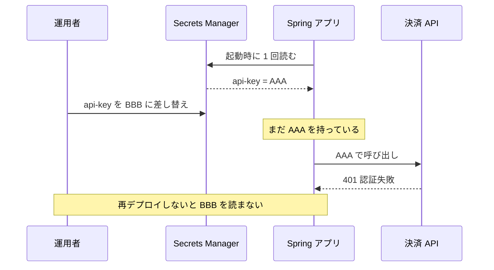
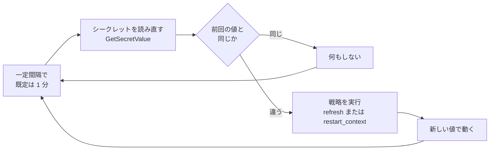
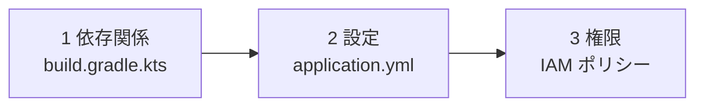
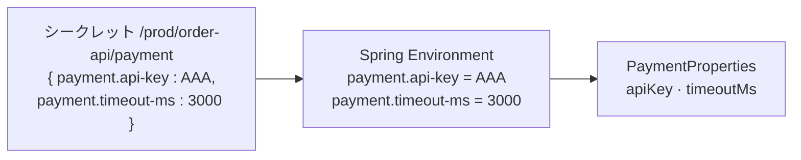
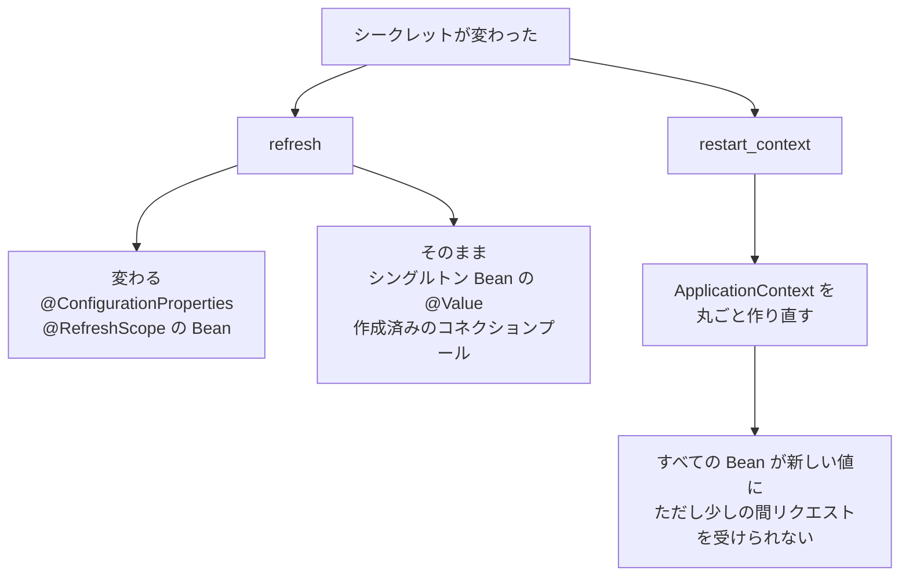
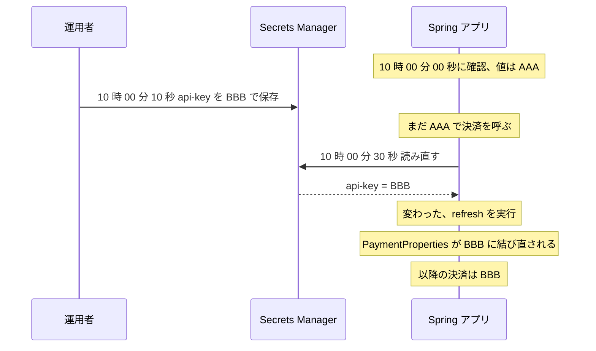
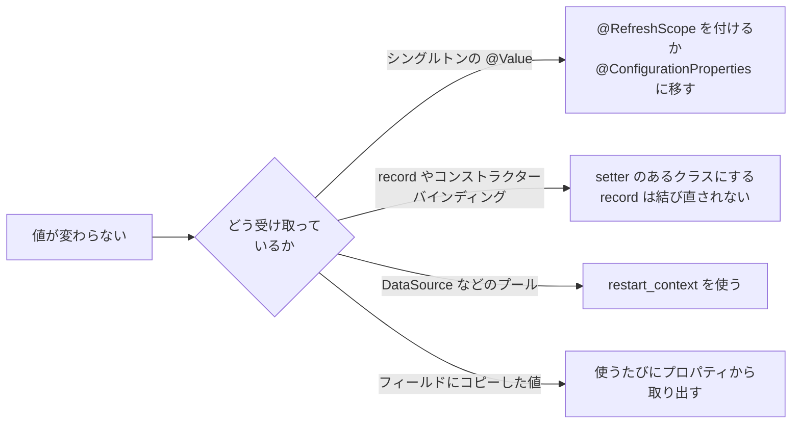
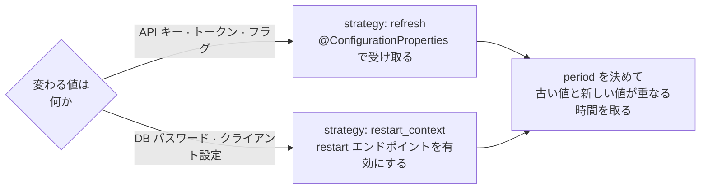

<dl class="facts">
  <div><dt>Spring Cloud AWS</dt><dd>4.2.2</dd></div>
  <div><dt>Spring Boot</dt><dd>4<small>.x</small></dd></div>
  <div><dt>既定の確認間隔</dt><dd>1<small>分</small></dd></div>
  <div><dt>戦略</dt><dd>2<small>種類</small></dd></div>
</dl>

## 値を変えたのに、アプリは知らない

Spring アプリはシークレットを**起動時に 1 回だけ**読みます。そのあと Secrets Manager で値を変えても、アプリの中の値はそのままです。



キーを差し替えるたびに再デプロイが必要で、その間は障害になります。リロードはこのすき間をなくす機能です。

## リロードを有効にするとこう動く

アプリが決まった間隔でシークレットを読み直し、**前回と違うときだけ**動きます。



- 値が同じなら API を 1 回呼んで終わりです。Bean には触れません。
- 最初の確認は、アプリが起動して**1 間隔たってから**始まります。
- コンソールで手で変えた場合も、Secrets Manager の自動ローテーションで変わった場合も同じように検出されます。

## 設定は 3 か所



### 1. 依存関係

```kotlin
dependencies {
    implementation(platform("io.awspring.cloud:spring-cloud-aws-dependencies:4.2.2"))
    implementation("io.awspring.cloud:spring-cloud-aws-starter-secrets-manager")

    // リロードに必要な 3 つ
    implementation("org.springframework.boot:spring-boot-starter-actuator")
    implementation("org.springframework.cloud:spring-cloud-commons")
    implementation("org.springframework.cloud:spring-cloud-context")
}
```

下の 3 つがないとリロードは動きません。`spring-cloud-commons`・`spring-cloud-context` のバージョンは、使っている Spring Cloud のリリース BOM に合わせます。

### 2. application.yml

```yaml
spring:
  config:
    import: "aws-secretsmanager:/prod/order-api/payment"
  cloud:
    aws:
      region:
        static: ap-northeast-2
      secretsmanager:
        reload:
          strategy: refresh   # この行がなければリロードは無効
          period: 30s         # 既定値は 1 分
```

| プロパティ | 既定値 | 意味 |
|---|---|---|
| `…reload.strategy` | なし（無効） | `refresh` または `restart_context` |
| `…reload.period` | `1m` | シークレットを読み直す間隔 |
| `…reload.max-wait-for-restart` | `2s` | `restart_context` のとき、再起動前にランダムに待つ最大時間 |

先頭の `…` は `spring.cloud.aws.secretsmanager` です。

シークレットが JSON なら、**最上位のキーがそのままプロパティ名**になります。



複数のシークレットを読むときは `;` でつなぎます。なくてもアプリを起動させたいシークレットには、先頭に `optional:` を付けます。

```yaml
spring:
  config:
    import: "optional:aws-secretsmanager:/prod/order-api/payment;/prod/order-api/mail"
```

### 3. IAM 権限

読み取り権限が 1 つあれば足ります。カスタマー管理の KMS キーで暗号化したシークレットなら `kms:Decrypt` も必要です。

```json
{
  "Effect": "Allow",
  "Action": "secretsmanager:GetSecretValue",
  "Resource": "arn:aws:secretsmanager:ap-northeast-2:123456789012:secret:/prod/order-api/*"
}
```

## 戦略は 2 つのうちどちらか

値が変わったと分かったときに、**どこまで作り直すか**の違いです。



| | `refresh` | `restart_context` |
|---|---|---|
| 変わる範囲 | `@ConfigurationProperties`、`@RefreshScope` の Bean | すべての Bean |
| 中断 | なし | コンテキストが立ち上がり直す間あり |
| 追加の設定 | なし | restart エンドポイントを有効にする |
| 向いている値 | API キー、トークン、機能フラグ | DB パスワードのように、プールやクライアントを作り直す必要がある値 |

`restart_context` を使うには、restart エンドポイントを有効にして公開する必要があります。

```yaml
management:
  endpoint:
    restart:
      access: unrestricted
  endpoints:
    web:
      exposure:
        include: restart
```

restart エンドポイントは既定のアクセスレベルが `none` なので、明示的に開く必要があります。Spring Cloud AWS のドキュメントには `enabled: true` と書かれていますが、Spring Boot 3.4 以降は `access` が現行のプロパティで、`enabled` は非推奨の扱いです。

## 実際に値を変えてみると

値を受け取る側は、setter のある普通の `@ConfigurationProperties` クラスにします。

```java
@Component
@ConfigurationProperties(prefix = "payment")
public class PaymentProperties {
    private String apiKey;
    private int timeoutMs;
    // getter / setter
}
```

```java
@Service
public class PaymentClient {
    private final PaymentProperties props;

    public PaymentClient(PaymentProperties props) {
        this.props = props;
    }

    public void pay(Order order) {
        String key = props.getApiKey();   // 呼ぶたびに取り出す
        // key で決済 API を呼ぶ
    }
}
```

`period: 30s`、`strategy: refresh` で起動しておき、コンソールでキーを変えると次のように進みます。



- 変更してから反映まで、**最大で 1 間隔**（ここでは 30 秒）かかります。
- その間は古い値が使われるので、古いキーと新しいキーが**少しの間どちらも有効**でないと中断が起きます。自動ローテーションを使う場合は、前のバージョンをすぐに失効させないようにします。
- 起動ログに `Polling configurations change detector activated` が出ていれば、リロードは有効です。

## 使ってみて引っかかるところ



- **`@Value` はそのままです。** シングルトン Bean は作られるときに 1 回だけ値が注入されます。クラスに `@RefreshScope` を付けると、refresh のあと最初に使われるときに作り直されます。
- **record とコンストラクターバインディングは結び直されません。** Spring Cloud のドキュメントに「コンストラクターバインディングを使うオブジェクトと record は refresh できない」と書かれている制約です。変わる必要のある設定は setter のあるクラスで受け取ります。
- **コネクションプールは refresh では変わりません。** Spring Cloud が `HikariDataSource` を結び直さない対象（`spring.cloud.refresh.never-refreshable` の既定値）にしているためです。 `spring.datasource.password` が変わっても、作成済みの HikariCP プールは古いパスワードで接続を開きます。DB パスワードの差し替えには `restart_context` が合っています。
- **コンストラクターで値をコピーしないようにします。** `this.key = props.getApiKey()` のようにフィールドへ入れておくと、プロパティが変わってもそのフィールドは古い値のままです。
- **インスタンスごとに別々に確認します。** 10 台動いていれば 10 台がそれぞれの間隔で読むので、最大 1 間隔は古い値と新しい値が混在します。
- **間隔はそのまま呼び出し回数になります。** 3 つのシークレットを 10 台が 1 分ごとに読むと、1 か月で約 130 万回です。API 呼び出しの料金（1 万回あたり 0.05 ドル）で 6.5 ドルほどになり、間隔を 15 秒にすると 4 倍になります。
- **ドキュメントの既定値の表記が食い違っています。** リファレンスの本文は 1 分、表は 15 秒と書かれていますが、4.2.2 のソースの既定値は 1 分です。迷わないよう `period` を明示しておくほうが安全です。

## まとめ



- 依存関係 3 つ（actuator、spring-cloud-commons、spring-cloud-context）と `reload.strategy` の 1 行で足ります。
- 中断なく変えたい値は `refresh` と `@ConfigurationProperties`、プールを作り直す必要がある値は `restart_context` です。
- 反映はすぐではなく、**最大で 1 間隔あと**です。その時間だけ古い値が生きている必要があります。
