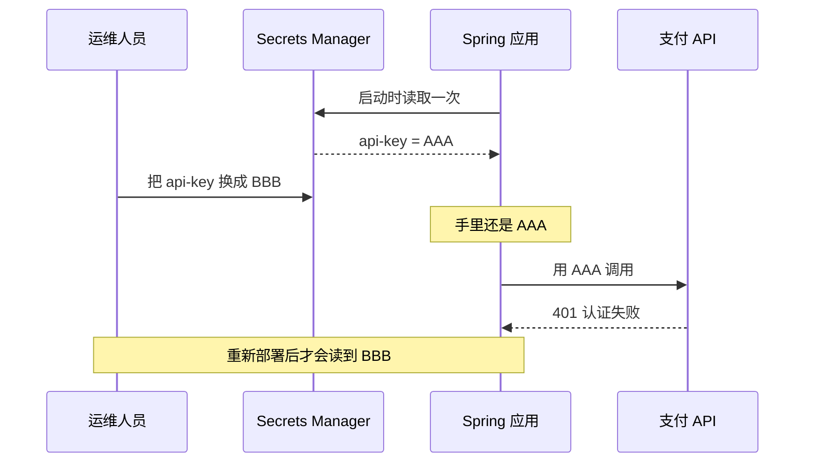
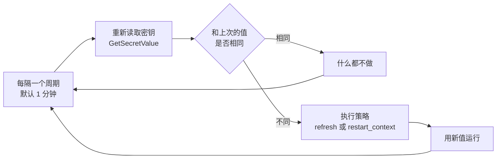
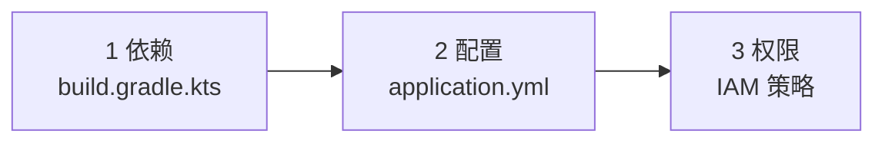
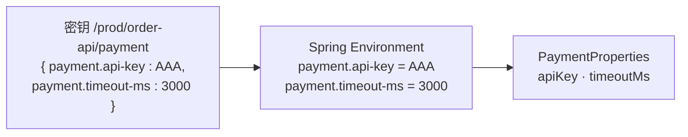
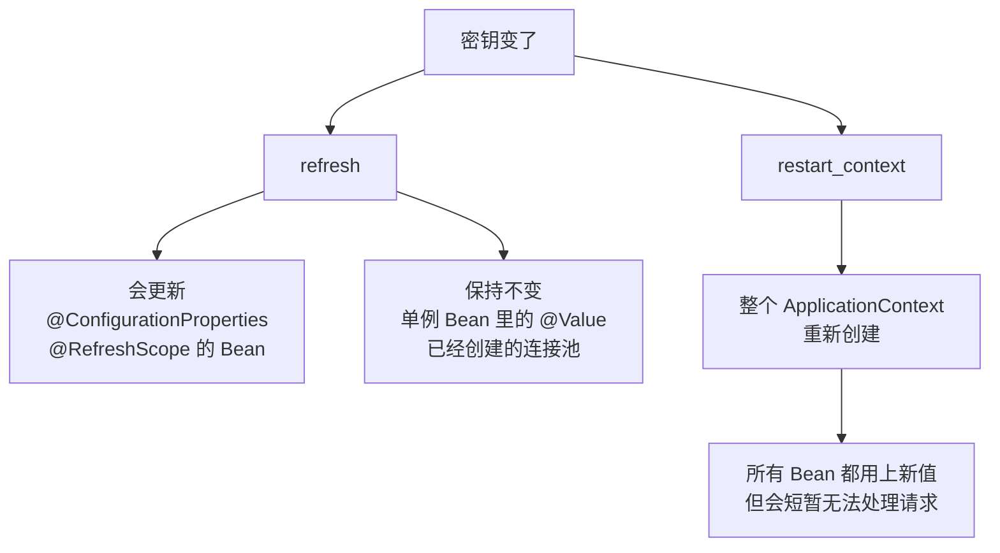
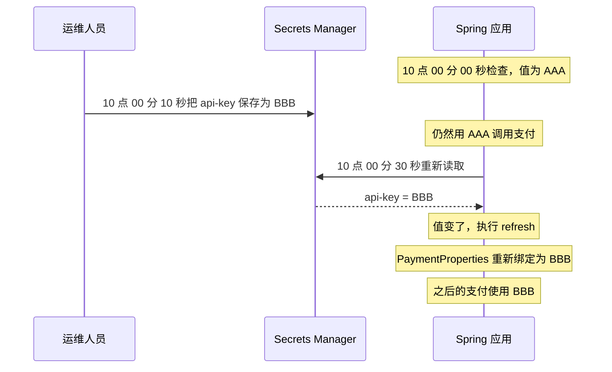
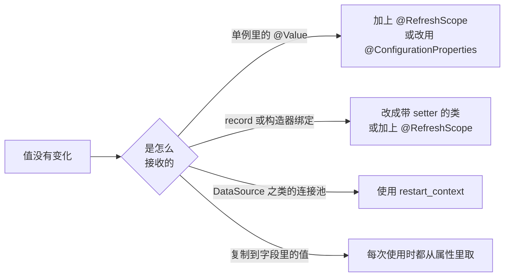
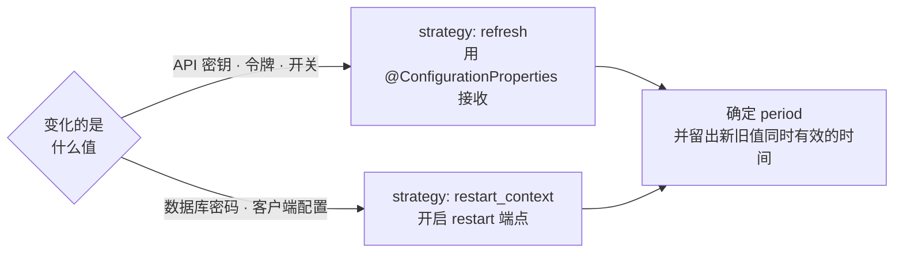

<dl class="facts">
  <div><dt>Spring Cloud AWS</dt><dd>4.2.2</dd></div>
  <div><dt>Spring Boot</dt><dd>4<small>.x</small></dd></div>
  <div><dt>默认检查间隔</dt><dd>1<small>分钟</small></dd></div>
  <div><dt>策略</dt><dd>2<small>种</small></dd></div>
</dl>

## 值改了，应用却不知道

Spring 应用只在**启动时读取一次**密钥。之后在 Secrets Manager 里改了值，应用里的值也不会变。



每次更换密钥都要重新部署，其间请求会失败。重新加载就是用来消除这个空档的。

## 开启重新加载之后

应用按固定间隔重新读取密钥，**只有和上次不同时**才会有动作。



- 值没变时，只调用一次 API 就结束，不会动任何 Bean。
- 第一次检查在应用启动**一个周期之后**才开始。
- 无论是在控制台手动修改，还是 Secrets Manager 的自动轮换，都会以同样的方式被检测到。

## 需要配置三处



### 1. 依赖

```kotlin
dependencies {
    implementation(platform("io.awspring.cloud:spring-cloud-aws-dependencies:4.2.2"))
    implementation("io.awspring.cloud:spring-cloud-aws-starter-secrets-manager")

    // 重新加载需要的三个依赖
    implementation("org.springframework.boot:spring-boot-starter-actuator")
    implementation("org.springframework.cloud:spring-cloud-commons")
    implementation("org.springframework.cloud:spring-cloud-context")
}
```

缺少后面三个，重新加载就不会工作。`spring-cloud-commons` 和 `spring-cloud-context` 的版本跟随你正在使用的 Spring Cloud 发布 BOM。

### 2. application.yml

```yaml
spring:
  config:
    import: "aws-secretsmanager:/prod/order-api/payment"
  cloud:
    aws:
      region:
        static: ap-northeast-2
      secretsmanager:
        reload:
          strategy: refresh   # 没有这一行，重新加载就是关闭的
          period: 30s         # 默认值为 1 分钟
```

| 属性 | 默认值 | 含义 |
|---|---|---|
| `…reload.strategy` | 无（关闭） | `refresh` 或 `restart_context` |
| `…reload.period` | `1m` | 重新读取密钥的间隔 |
| `…reload.max-wait-for-restart` | `2s` | 使用 `restart_context` 时，重启前随机等待的最长时间 |

开头的 `…` 代表 `spring.cloud.aws.secretsmanager`。

密钥是 JSON 时，**顶层的键会原样成为属性名**。



读取多个密钥时用 `;` 连接。对于不存在也要让应用启动的密钥，在前面加上 `optional:`。

```yaml
spring:
  config:
    import: "optional:aws-secretsmanager:/prod/order-api/payment;/prod/order-api/mail"
```

### 3. IAM 权限

只需要一个读取权限。如果密钥使用客户托管的 KMS 密钥加密，还需要 `kms:Decrypt`。

```json
{
  "Effect": "Allow",
  "Action": "secretsmanager:GetSecretValue",
  "Resource": "arn:aws:secretsmanager:ap-northeast-2:123456789012:secret:/prod/order-api/*"
}
```

## 两种策略选一种

区别在于发现值变化之后，**要重建到什么程度**。



| | `refresh` | `restart_context` |
|---|---|---|
| 更新范围 | `@ConfigurationProperties`、`@RefreshScope` 的 Bean | 所有 Bean |
| 中断 | 没有 | 上下文重新启动期间会有 |
| 额外配置 | 没有 | 开启 restart 端点 |
| 适合的值 | API 密钥、令牌、功能开关 | 像数据库密码这样需要重建连接池或客户端的值 |

使用 `restart_context` 需要开启并暴露 restart 端点。

```yaml
management:
  endpoint:
    restart:
      enabled: true
  endpoints:
    web:
      exposure:
        include: restart
```

## 实际改一次值

接收值的一方使用带 setter 的普通 `@ConfigurationProperties` 类。

```java
@Component
@ConfigurationProperties(prefix = "payment")
public class PaymentProperties {
    private String apiKey;
    private int timeoutMs;
    // getter / setter
}
```

```java
@Service
public class PaymentClient {
    private final PaymentProperties props;

    public PaymentClient(PaymentProperties props) {
        this.props = props;
    }

    public void pay(Order order) {
        String key = props.getApiKey();   // 每次调用时都取一次
        // 用 key 调用支付 API
    }
}
```

以 `period: 30s`、`strategy: refresh` 启动应用，然后在控制台更换密钥，过程如下。



- 从修改到生效**最多需要一个周期**（这里是 30 秒）。
- 这段时间里用的还是旧值，所以旧密钥和新密钥必须**短时间内同时有效**，才不会出现中断。使用自动轮换时，不要立刻废弃上一个版本。
- 启动日志中出现 `Polling configurations change detector activated`，就说明重新加载已经开启。

## 实际使用时容易踩的坑



- **`@Value` 不会变。** 单例 Bean 只在创建时注入一次值。在类上加 `@RefreshScope` 后，refresh 之后第一次使用时会重新创建。
- **连接池不会被 refresh 更新。** 即使 `spring.datasource.password` 变了，已经创建的 HikariCP 连接池仍然用旧密码建立连接。更换数据库密码应该用 `restart_context`。
- **不要在构造器里复制值。** 像 `this.key = props.getApiKey()` 这样存进字段后，属性变了，这个字段还是旧值。
- **每个实例各自检查。** 有 10 个实例时，它们各自按自己的周期读取，所以最多一个周期内新旧值会同时存在。
- **周期就是调用次数。** 10 个实例每分钟读取 3 个密钥，一个月大约 130 万次。按 API 调用费用（每 1 万次 0.05 美元）计算约为 6.5 美元，把周期缩短到 15 秒就是四倍。
- **文档里的默认值写法不一致。** 参考文档的正文写的是 1 分钟，表格里写的是 15 秒，而 4.2.2 源码中的默认值是 1 分钟。为了避免混淆，最好把 `period` 明确写出来。

## 总结



- 三个依赖（actuator、spring-cloud-commons、spring-cloud-context）加上一行 `reload.strategy` 就够了。
- 想不中断地更换的值用 `refresh` 加 `@ConfigurationProperties`，需要重建连接池的值用 `restart_context`。
- 生效不是立刻，而是**最多一个周期之后**。旧值需要在这段时间里保持有效。
