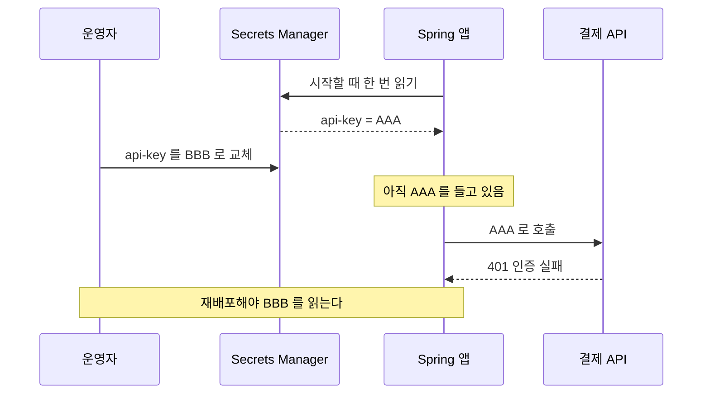
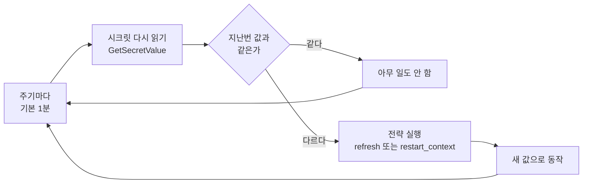
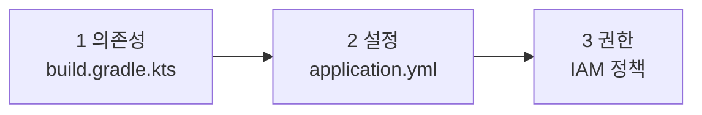
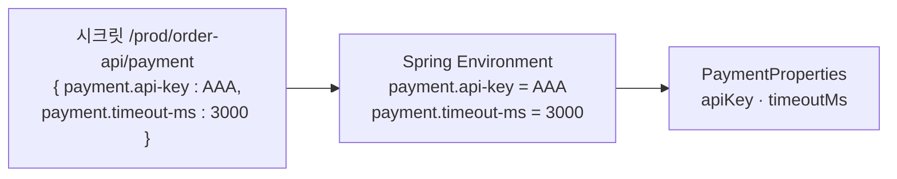
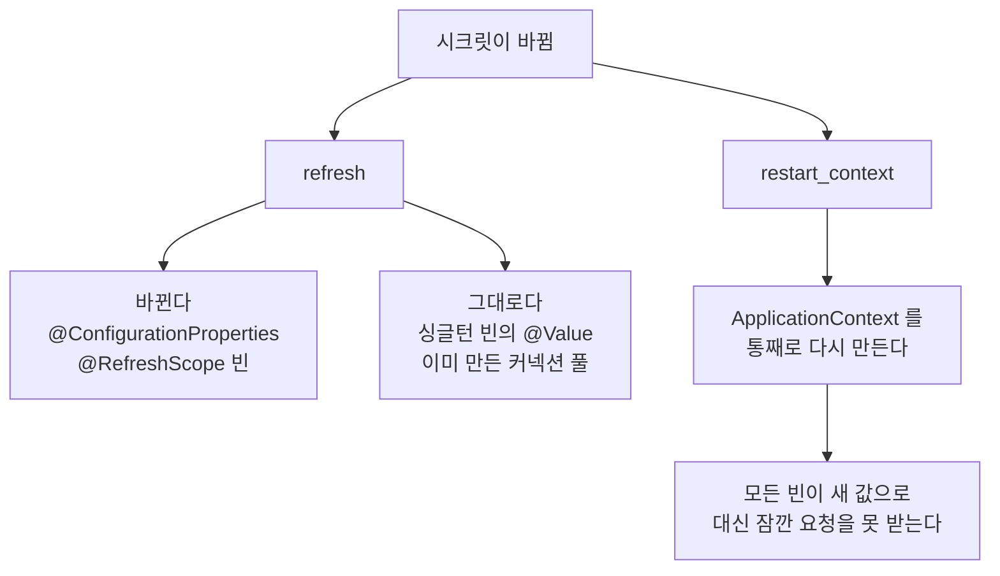
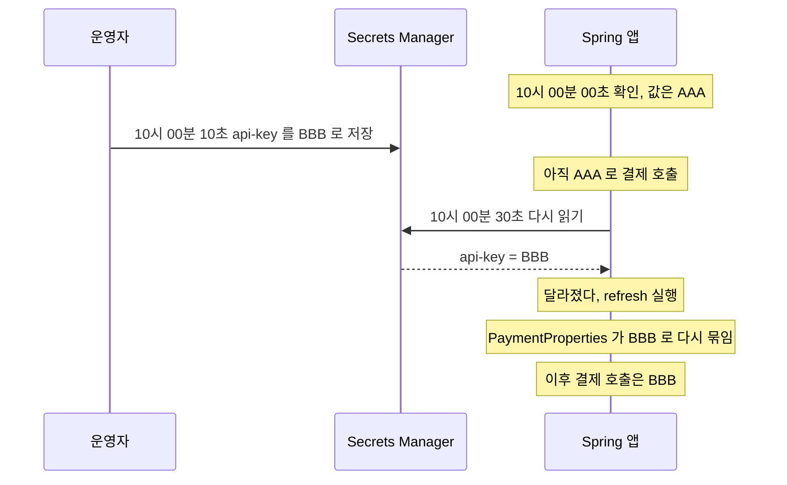
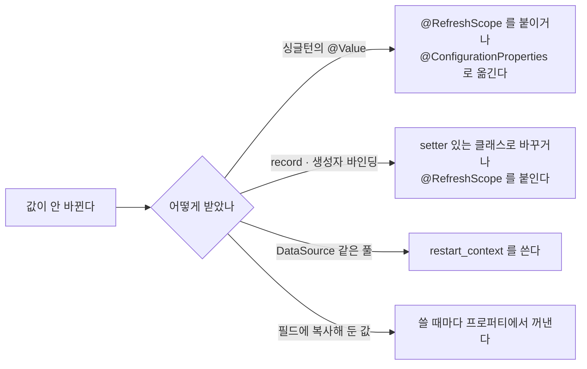
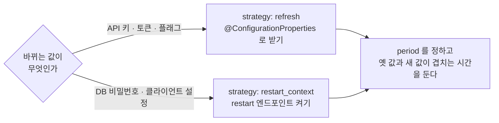

<dl class="facts">
  <div><dt>Spring Cloud AWS</dt><dd>4.2.2</dd></div>
  <div><dt>Spring Boot</dt><dd>4<small>.x</small></dd></div>
  <div><dt>기본 확인 주기</dt><dd>1<small>분</small></dd></div>
  <div><dt>전략</dt><dd>2<small>가지</small></dd></div>
</dl>

## 값을 바꿨는데 앱은 모른다

Spring 앱은 시크릿을 **시작할 때 딱 한 번** 읽습니다. 그 뒤에 Secrets Manager 에서 값을 바꿔도 앱 안의 값은 그대로입니다.



키를 교체할 때마다 재배포를 해야 하고, 그 사이에는 장애가 납니다. 리로드는 이 틈을 없애는 기능입니다.

## 리로드를 켜면 이렇게 돈다

앱이 정해진 주기마다 시크릿을 다시 읽어 보고, **지난번과 다를 때만** 움직입니다.



- 값이 그대로면 API 한 번 부르고 끝입니다. 빈은 건드리지 않습니다.
- 첫 확인은 앱이 뜨고 **한 주기가 지난 뒤**에 시작합니다.
- 콘솔에서 손으로 바꾸든, Secrets Manager 의 자동 교체(rotation)가 바꾸든 똑같이 잡힙니다.

## 설정은 세 군데



### 1. 의존성

```kotlin
dependencies {
    implementation(platform("io.awspring.cloud:spring-cloud-aws-dependencies:4.2.2"))
    implementation("io.awspring.cloud:spring-cloud-aws-starter-secrets-manager")

    // 리로드에 필요한 세 가지
    implementation("org.springframework.boot:spring-boot-starter-actuator")
    implementation("org.springframework.cloud:spring-cloud-commons")
    implementation("org.springframework.cloud:spring-cloud-context")
}
```

아래 세 개가 빠지면 리로드가 동작하지 않습니다. `spring-cloud-commons`·`spring-cloud-context` 버전은 쓰고 있는 Spring Cloud 릴리스 BOM 에 맞춥니다.

### 2. application.yml

```yaml
spring:
  config:
    import: "aws-secretsmanager:/prod/order-api/payment"
  cloud:
    aws:
      region:
        static: ap-northeast-2
      secretsmanager:
        reload:
          strategy: refresh   # 이 줄이 없으면 리로드는 꺼져 있다
          period: 30s         # 기본값 1분
```

| 프로퍼티 | 기본값 | 뜻 |
|---|---|---|
| `…reload.strategy` | 없음 (꺼짐) | `refresh` 또는 `restart_context` |
| `…reload.period` | `1m` | 시크릿을 다시 읽어 보는 주기 |
| `…reload.max-wait-for-restart` | `2s` | `restart_context` 일 때, 재시작 전 무작위로 기다리는 최대 시간 |

앞의 `…` 은 `spring.cloud.aws.secretsmanager` 입니다.

시크릿이 JSON 이면 **맨 위 키가 그대로 프로퍼티 이름**이 됩니다.



시크릿을 여러 개 읽을 때는 `;` 로 잇습니다. 없어도 앱이 떠야 하는 시크릿은 앞에 `optional:` 을 붙입니다.

```yaml
spring:
  config:
    import: "optional:aws-secretsmanager:/prod/order-api/payment;/prod/order-api/mail"
```

### 3. IAM 권한

읽기 권한 하나면 됩니다. 고객 관리형 KMS 키로 암호화한 시크릿이면 `kms:Decrypt` 도 필요합니다.

```json
{
  "Effect": "Allow",
  "Action": "secretsmanager:GetSecretValue",
  "Resource": "arn:aws:secretsmanager:ap-northeast-2:123456789012:secret:/prod/order-api/*"
}
```

## 전략은 둘 중 하나

값이 바뀐 걸 알았을 때 **얼마나 크게 갈아엎느냐**의 차이입니다.



| | `refresh` | `restart_context` |
|---|---|---|
| 바뀌는 범위 | `@ConfigurationProperties`, `@RefreshScope` 빈 | 모든 빈 |
| 끊김 | 없음 | 컨텍스트가 다시 뜨는 동안 있음 |
| 추가 설정 | 없음 | restart 엔드포인트 켜기 |
| 어울리는 값 | API 키, 토큰, 기능 플래그 | DB 비밀번호처럼 풀·클라이언트를 새로 만들어야 하는 값 |

`restart_context` 를 쓰려면 restart 엔드포인트를 켜고 노출해야 합니다.

```yaml
management:
  endpoint:
    restart:
      enabled: true
  endpoints:
    web:
      exposure:
        include: restart
```

## 실제로 값을 바꿔 보면

값을 받는 쪽은 setter 가 있는 평범한 `@ConfigurationProperties` 클래스로 둡니다.

```java
@Component
@ConfigurationProperties(prefix = "payment")
public class PaymentProperties {
    private String apiKey;
    private int timeoutMs;
    // getter / setter
}
```

```java
@Service
public class PaymentClient {
    private final PaymentProperties props;

    public PaymentClient(PaymentProperties props) {
        this.props = props;
    }

    public void pay(Order order) {
        String key = props.getApiKey();   // 부를 때마다 꺼내 쓴다
        // key 로 결제 API 호출
    }
}
```

`period: 30s`, `strategy: refresh` 로 띄워 두고 콘솔에서 키를 바꾸면 이렇게 흘러갑니다.



- 바꾼 뒤 반영까지 **최대 한 주기**(여기서는 30초)가 걸립니다.
- 그 사이에는 옛 값이 쓰이므로, 옛 키와 새 키가 **잠깐 함께 유효**해야 끊김이 없습니다. 자동 교체를 쓴다면 이전 버전을 바로 폐기하지 않도록 둡니다.
- 앱이 뜰 때 로그에 `Polling configurations change detector activated` 가 보이면 리로드가 켜진 것입니다.

## 써 보면 걸리는 것들



- **`@Value` 는 그대로입니다.** 싱글턴 빈은 만들어질 때 값이 한 번 주입되고 끝입니다. 클래스에 `@RefreshScope` 를 붙이면 refresh 뒤 처음 쓰일 때 새로 만들어집니다.
- **커넥션 풀은 refresh 로 안 바뀝니다.** `spring.datasource.password` 가 바뀌어도 이미 만들어진 HikariCP 풀은 옛 비밀번호로 연결을 엽니다. DB 비밀번호 교체는 `restart_context` 가 맞습니다.
- **생성자에서 값을 복사해 두지 않습니다.** `this.key = props.getApiKey()` 처럼 필드에 담아 두면 프로퍼티가 바뀌어도 그 필드는 옛 값입니다.
- **인스턴스마다 따로 확인합니다.** 10대가 떠 있으면 10대가 각자 주기대로 읽으므로, 최대 한 주기 동안은 옛 값과 새 값이 섞여 있습니다.
- **주기는 곧 호출 횟수입니다.** 시크릿 3개를 인스턴스 10대가 1분마다 읽으면 한 달에 약 130만 번입니다. API 호출 요금(1만 건당 0.05달러 기준)으로 6.5달러쯤이고, 주기를 15초로 줄이면 네 배가 됩니다.
- **문서의 기본값 표기가 엇갈립니다.** 레퍼런스 본문은 1분, 표는 15초라고 적혀 있는데 4.2.2 소스의 기본값은 1분입니다. 헷갈리지 않게 `period` 를 직접 적어 두는 편이 낫습니다.

## 정리



- 의존성 세 개(actuator, spring-cloud-commons, spring-cloud-context)와 `reload.strategy` 한 줄이 전부입니다.
- 끊김 없이 바꾸고 싶은 값은 `refresh` + `@ConfigurationProperties`, 풀을 새로 만들어야 하는 값은 `restart_context` 입니다.
- 반영은 즉시가 아니라 **최대 한 주기 뒤**입니다. 그 시간만큼 옛 값이 살아 있어야 합니다.
