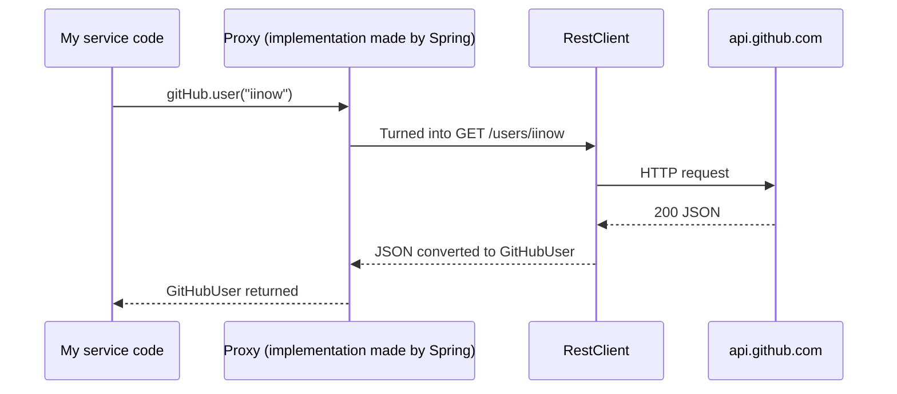
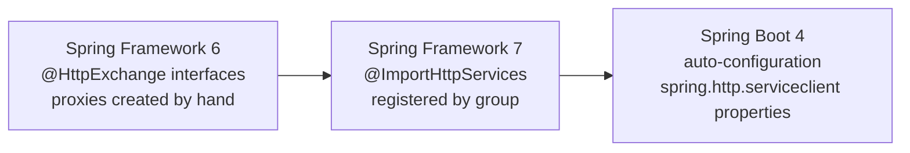
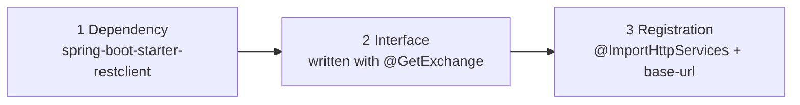
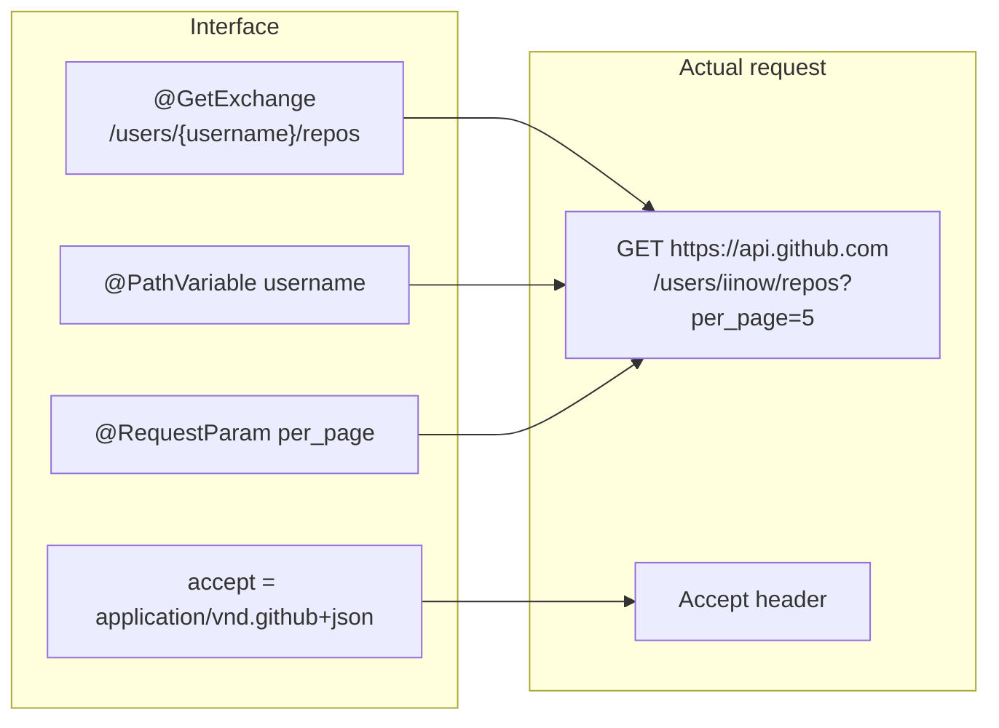
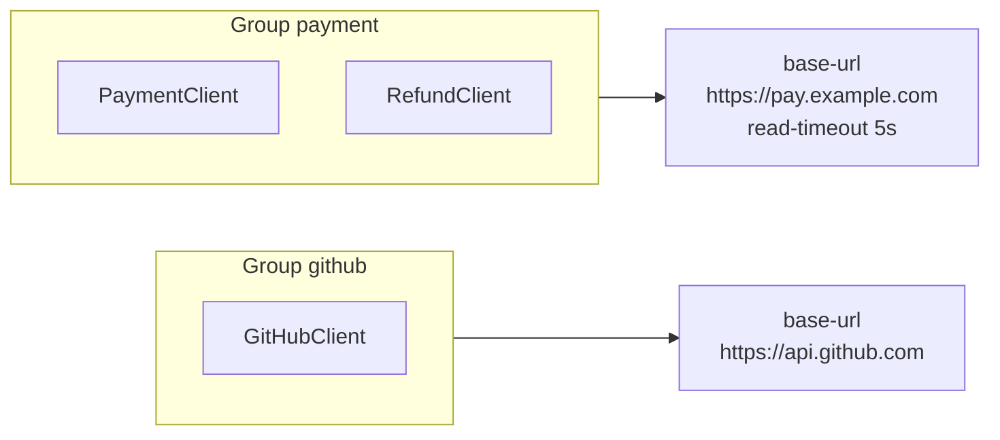
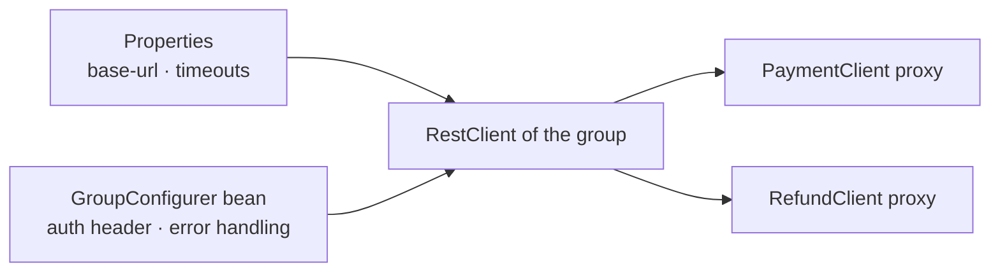
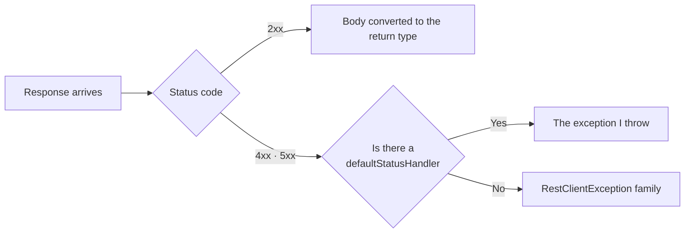
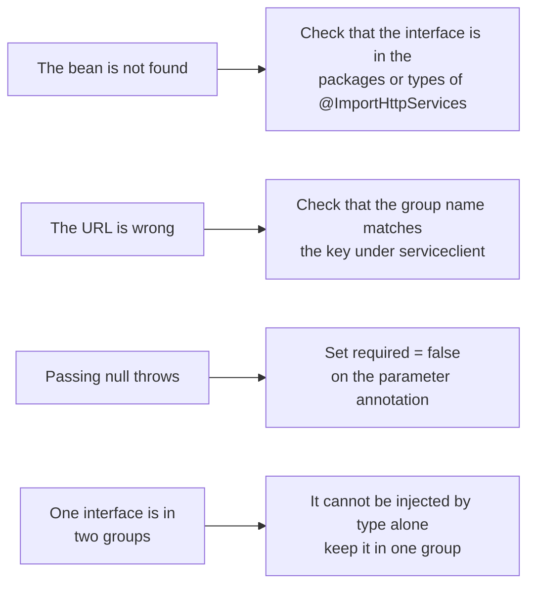

<dl class="facts">
  <div><dt>Spring Boot</dt><dd>4.2.0</dd></div>
  <div><dt>Spring Framework</dt><dd>7.1</dd></div>
  <div><dt>Extra libraries</dt><dd>0</dd></div>
  <div><dt>Steps to wire up</dt><dd>3</dd></div>
</dl>

## Write the interface, Spring writes the implementation

Instead of assembling URLs and converting responses with `RestClient` every time you call another server, you **describe the calls you want as an interface**. If you have used OpenFeign, it is the same idea. The difference is that this one ships with Spring.



My code just calls a method. Building the URL, the headers and the JSON conversion belong to the proxy and `RestClient`.

## Is this new?

Half right. Defining a client as an interface has been possible for a while, and **Boot 4 made the setup easy.**



| | Up to Boot 3 | From Boot 4 |
|---|---|---|
| Interface | `@HttpExchange` | Same |
| Bean registration | One `@Bean` per interface that creates the proxy | One `@ImportHttpServices` line |
| URL and timeouts | Assemble the `RestClient` in code | Properties in `application.yml` |

## Three steps



### 1. Dependency

Boot 4 is split into small modules, so `RestClient` has its own starter.

```kotlin
dependencies {
    implementation("org.springframework.boot:spring-boot-starter-webmvc")
    implementation("org.springframework.boot:spring-boot-starter-restclient")
}
```

### 2. Interface

The GitHub API is the example. Responses are received as records.

```java
package com.example.clients.github;

public record GitHubUser(String login, String name, String company) {}

public record GitHubRepo(String name, String language, boolean fork) {}
```

```java
package com.example.clients.github;

@HttpExchange(accept = "application/vnd.github+json")
public interface GitHubClient {

    @GetExchange("/users/{username}")
    GitHubUser user(@PathVariable String username);

    @GetExchange("/users/{username}/repos")
    List<GitHubRepo> repos(@PathVariable String username,
                           @RequestParam("per_page") int perPage);
}
```

There is no host in the URLs. The host comes from a property in the next step.

### 3. Registration

```java
@SpringBootApplication
@ImportHttpServices(group = "github", basePackages = "com.example.clients.github")
public class Application {
    public static void main(String[] args) {
        SpringApplication.run(Application.class, args);
    }
}
```

```yaml
spring:
  http:
    serviceclient:
      github:
        base-url: "https://api.github.com"
```

Now inject it like any other bean.

```java
@Service
public class ProfileService {
    private final GitHubClient gitHub;

    public ProfileService(GitHubClient gitHub) {
        this.gitHub = gitHub;
    }

    public String summary(String username) {
        GitHubUser user = gitHub.user(username);
        List<GitHubRepo> repos = gitHub.repos(username, 5);
        return user.name() + " · " + repos.size() + " repositories";
    }
}
```

## One method becomes one request

Once you see where each annotation and parameter lands in the HTTP request, the rest is variation.



The method annotations are `@GetExchange`, `@PostExchange`, `@PutExchange`, `@PatchExchange` and `@DeleteExchange`, all shortcuts for `@HttpExchange`. It is the same relationship as `@GetMapping` and `@RequestMapping` in Spring MVC.

| Parameter | Where it goes in the request |
|---|---|
| `@PathVariable` | The `{name}` slot in the URL |
| `@RequestParam` | Query string, or the body for form posts (`application/x-www-form-urlencoded`) |
| `@RequestHeader` | Request header |
| `@RequestBody` | Request body (objects are converted to JSON) |
| `@CookieValue` | Cookie |
| `@RequestPart`, `MultipartFile` | Multipart files and fields |
| `URI` | Replaces the whole URL at call time |

| Return type | What you get |
|---|---|
| `void` | Just run it, no body |
| `GitHubUser`, `List<GitHubRepo>` | The body converted to an object |
| `ResponseEntity<T>` | Status code, headers and body |
| `HttpHeaders` | Response headers only |

A POST looks like this.

```java
@HttpExchange("/v1/payments")
public interface PaymentClient {

    @PostExchange
    PaymentResult pay(@RequestBody PaymentRequest request,
                      @RequestHeader("Idempotency-Key") String key);

    @GetExchange("/{id}")
    ResponseEntity<PaymentResult> find(@PathVariable String id);

    @DeleteExchange("/{id}")
    void cancel(@PathVariable String id);
}
```

## Several API servers, several groups

A group is **a set of interfaces that call the same server**. Each group gets its own URL and timeouts.



```java
@SpringBootApplication
@ImportHttpServices(group = "github", basePackages = "com.example.clients.github")
@ImportHttpServices(group = "payment", types = {PaymentClient.class, RefundClient.class})
public class Application { }
```

```yaml
spring:
  http:
    clients:
      connect-timeout: 1s          # shared by every HTTP client
    serviceclient:
      github:
        base-url: "https://api.github.com"
        read-timeout: 2s
      payment:
        base-url: "https://pay.example.com"
        connect-timeout: 2s
        read-timeout: 5s
        default-header:
          X-Client: order-api
```

| `spring.http.serviceclient.<group>.` | Meaning |
|---|---|
| `base-url` | Base URL of the group |
| `connect-timeout`, `read-timeout` | Connection and response timeouts |
| `default-header.<name>` | Header added to every request |
| `apiversion.*` | How the API version is inserted (header, query and so on) |
| `redirects`, `cookie-handling` | Redirect and cookie handling |
| `ssl.bundle` | SSL bundle to use |

An interface registered without a group goes into the `default` group.

## Auth headers and error handling in one place

What properties cannot express (computing a token for every request, turning errors into your own exception) goes into one `RestClientHttpServiceGroupConfigurer` bean. Boot finds the bean and applies it while building the group's `RestClient`.



```java
@Configuration
public class HttpClientConfig {

    @Bean
    RestClientHttpServiceGroupConfigurer paymentGroupConfigurer(TokenProvider tokens) {
        return groups -> groups.filterByName("payment").forEachClient((group, builder) -> builder
            // put a fresh token on every request
            .requestInterceptor((request, body, execution) -> {
                request.getHeaders().setBearerAuth(tokens.current());
                return execution.execute(request, body);
            })
            // turn 4xx and 5xx into my own exception
            .defaultStatusHandler(HttpStatusCode::isError, (request, response) -> {
                throw new PaymentApiException(response.getStatusCode().value());
            }));
    }
}
```

Without your own handler, a 4xx or 5xx response throws an exception from the `RestClientException` family.



## Next to the Boot 3 way and OpenFeign

In Boot 3 you created a proxy per interface yourself. That still works, and for one or two clients without groups it is enough.

```java
@Bean
GitHubClient gitHubClient(RestClient.Builder builder) {
    RestClient restClient = builder.baseUrl("https://api.github.com").build();
    RestClientAdapter adapter = RestClientAdapter.create(restClient);
    HttpServiceProxyFactory factory = HttpServiceProxyFactory.builderFor(adapter).build();
    return factory.createClient(GitHubClient.class);
}
```

| | OpenFeign | HTTP service clients |
|---|---|---|
| Dependency | `spring-cloud-starter-openfeign` | Part of Spring |
| Marking the interface | `@FeignClient(name = "github")` | Nothing on the interface. Registered with `@ImportHttpServices(group = "github")` |
| Methods | `@GetMapping`, `@PostMapping` | `@GetExchange`, `@PostExchange` |
| URL | `url` attribute or a property | `spring.http.serviceclient.<group>.base-url` |
| Switching it on | `@EnableFeignClients` | `@ImportHttpServices` |
| Transport | Feign client | `RestClient` (or `WebClient`) |

The parameter annotations (`@PathVariable`, `@RequestParam`, `@RequestBody`) are the same, so migrating means changing the method annotation names and the registration. Spring Cloud OpenFeign no longer receives new features, so a new project is better off starting here.

## Test against a fake server

Bind a `MockRestServiceServer` to a `RestClient.Builder` and create the proxy from that builder, and you can verify the interface without a network.

```java
class GitHubClientTest {

    @Test
    void user() {
        RestClient.Builder builder = RestClient.builder().baseUrl("https://api.github.com");
        MockRestServiceServer server = MockRestServiceServer.bindTo(builder).build();
        GitHubClient client = HttpServiceProxyFactory
            .builderFor(RestClientAdapter.create(builder.build()))
            .build()
            .createClient(GitHubClient.class);

        server.expect(requestTo("https://api.github.com/users/iinow"))
              .andExpect(header("Accept", "application/vnd.github+json"))
              .andRespond(withSuccess("{\"login\":\"iinow\",\"name\":\"Joonha\"}", MediaType.APPLICATION_JSON));

        assertThat(client.user("iinow").name()).isEqualTo("Joonha");
        server.verify();
    }
}
```

## What trips you up in practice



- **No registration, no bean.** `@HttpExchange` alone is not scanned. List the package or the types in `@ImportHttpServices`.
- **The group name is the property key.** With `group = "github"` the key is `spring.http.serviceclient.github`. A typo leaves `base-url` empty and the call fails on a relative URL.
- **Passing null as a parameter throws.** Declare an optional query parameter as `@RequestParam(required = false)`.
- **The default is `RestClient`, which is synchronous.** To return `Mono` or `Flux`, choose `WebClient` with `@ImportHttpServices(clientType = HttpServiceGroup.ClientType.WEB_CLIENT)` and add the webclient starter.
- **`RestTemplate` is deprecated as of Framework 7.** Build new clients on `RestClient`.

## Summary


- The interface style has existed since Framework 6, and **Boot 4 reduced registration and configuration to a line each.**
- One server is one group. URLs and timeouts go into properties, authentication and error handling into a `RestClientHttpServiceGroupConfigurer`.
- Coming from OpenFeign, only the method annotation names and the registration change.
