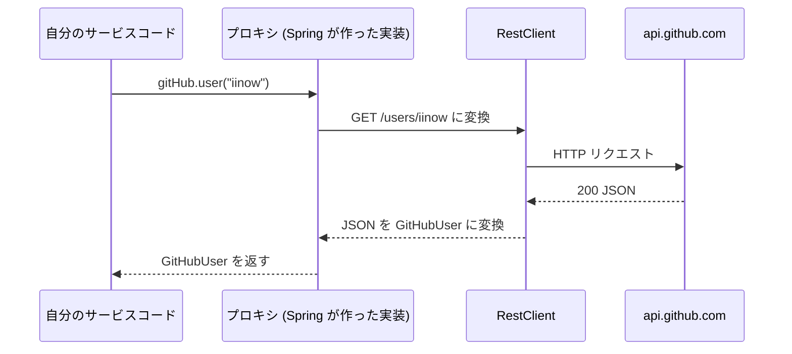
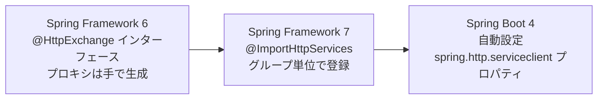
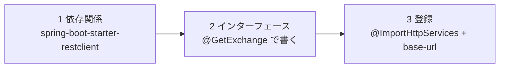
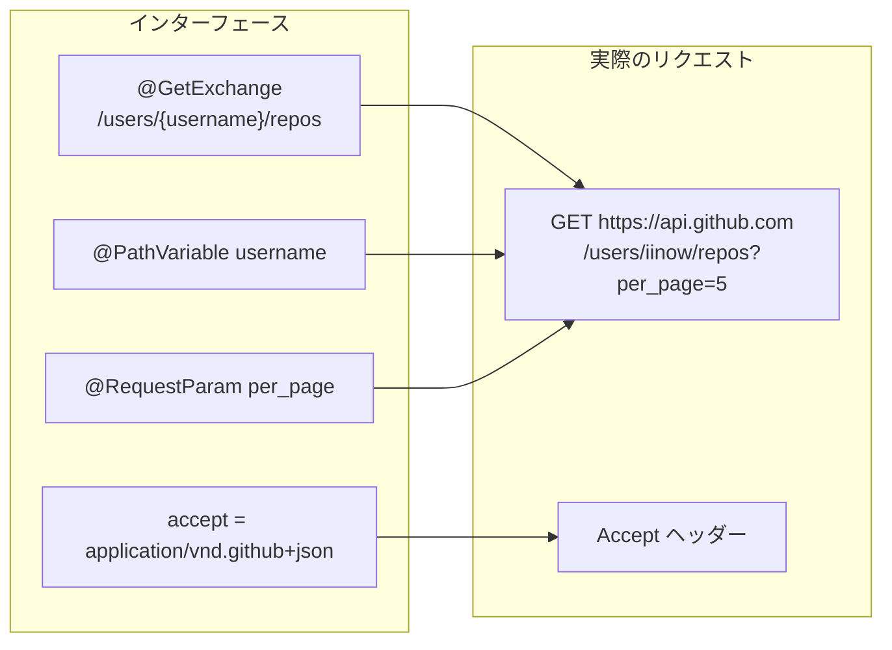
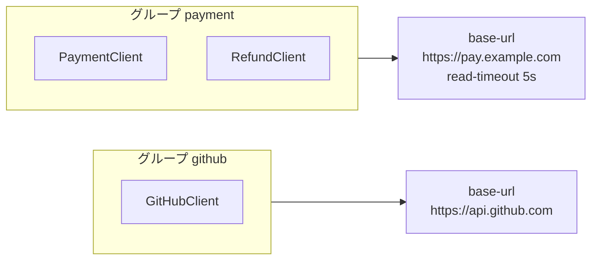
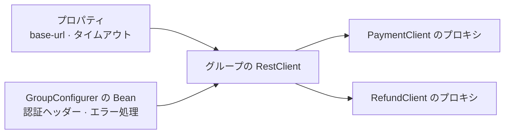
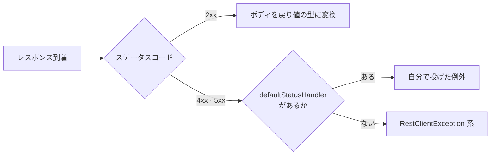
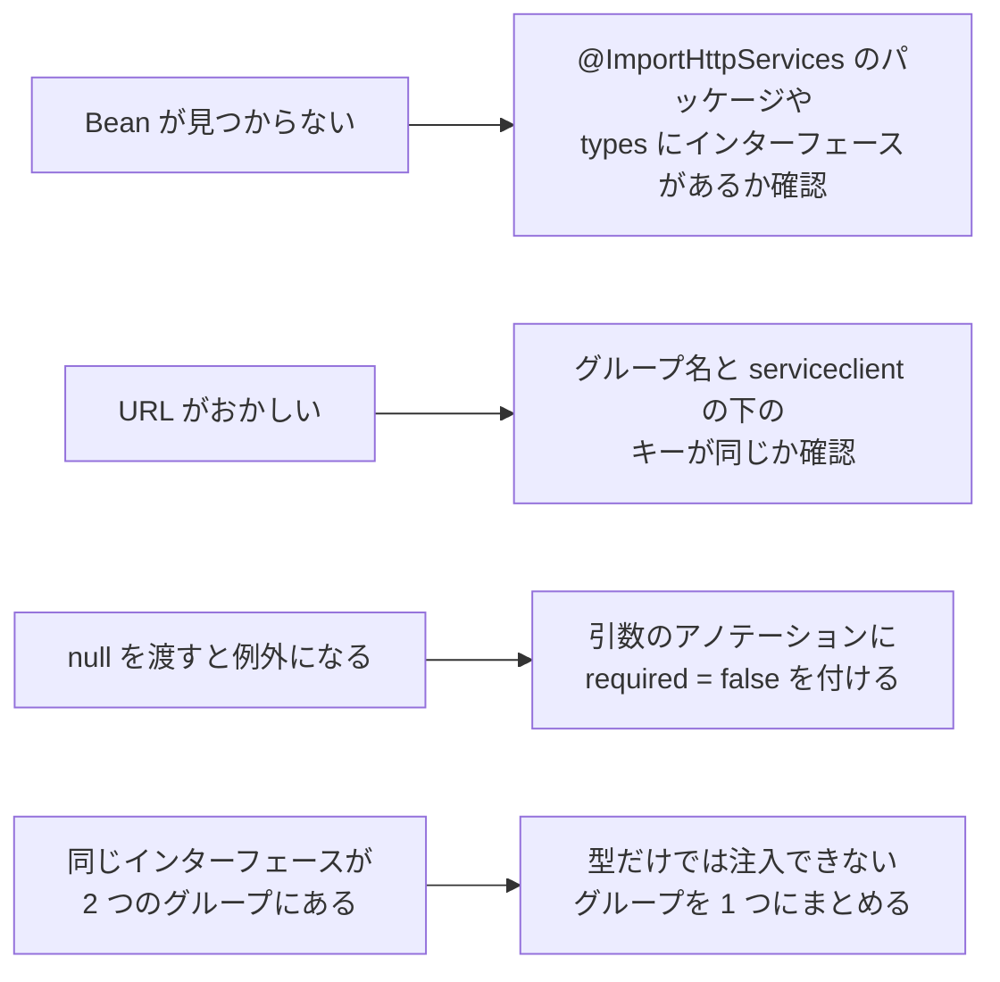
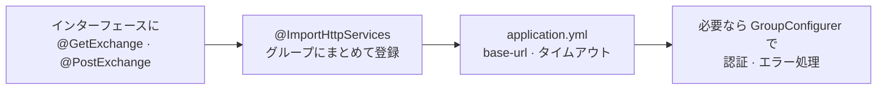

<dl class="facts">
  <div><dt>Spring Boot</dt><dd>4.2.0</dd></div>
  <div><dt>Spring Framework</dt><dd>7.1</dd></div>
  <div><dt>追加ライブラリ</dt><dd>0<small>個</small></dd></div>
  <div><dt>導入の手順</dt><dd>3<small>ステップ</small></dd></div>
</dl>

## インターフェースを書けば、実装は Spring が作る

ほかのサーバーの API を呼ぶたびに `RestClient` で URL を組み立ててレスポンスを変換するコードを書く代わりに、**呼びたい形をインターフェースとして書いておく**方式です。OpenFeign を使ったことがあれば同じ発想です。違いは、Spring に標準で入っていることです。



自分のコードはメソッドを呼ぶだけです。URL の組み立て、ヘッダー、JSON の変換はプロキシと `RestClient` が担当します。

## 今回出た機能なのか

半分だけ正解です。インターフェースでクライアントを作る機能は以前からあり、**Boot 4 で設定が簡単になりました。**



| | Boot 3 まで | Boot 4 から |
|---|---|---|
| インターフェース | `@HttpExchange` | 同じ |
| Bean の登録 | インターフェースごとに `@Bean` でプロキシを生成 | `@ImportHttpServices` の 1 行 |
| URL・タイムアウト | コードで `RestClient` を組み立てる | `application.yml` のプロパティ |

## 3 ステップで導入する



### 1. 依存関係

Boot 4 はモジュールが細かく分かれており、`RestClient` は別のスターターになっています。

```kotlin
dependencies {
    implementation("org.springframework.boot:spring-boot-starter-webmvc")
    implementation("org.springframework.boot:spring-boot-starter-restclient")
}
```

### 2. インターフェース

GitHub API を例にします。レスポンスは record で受け取ります。

```java
package com.example.clients.github;

public record GitHubUser(String login, String name, String company) {}

public record GitHubRepo(String name, String language, boolean fork) {}
```

```java
package com.example.clients.github;

@HttpExchange(accept = "application/vnd.github+json")
public interface GitHubClient {

    @GetExchange("/users/{username}")
    GitHubUser user(@PathVariable String username);

    @GetExchange("/users/{username}/repos")
    List<GitHubRepo> repos(@PathVariable String username,
                           @RequestParam("per_page") int perPage);
}
```

URL にホストは書いていません。ホストは次のステップでプロパティから渡します。

### 3. 登録

```java
@SpringBootApplication
@ImportHttpServices(group = "github", basePackages = "com.example.clients.github")
public class Application {
    public static void main(String[] args) {
        SpringApplication.run(Application.class, args);
    }
}
```

```yaml
spring:
  http:
    serviceclient:
      github:
        base-url: "https://api.github.com"
```

あとはほかの Bean と同じように注入して使います。

```java
@Service
public class ProfileService {
    private final GitHubClient gitHub;

    public ProfileService(GitHubClient gitHub) {
        this.gitHub = gitHub;
    }

    public String summary(String username) {
        GitHubUser user = gitHub.user(username);
        List<GitHubRepo> repos = gitHub.repos(username, 5);
        return user.name() + " · リポジトリ " + repos.size() + " 件";
    }
}
```

## メソッド 1 つがリクエスト 1 つになる

アノテーションと引数が HTTP リクエストのどこに入るかが分かれば、あとは応用です。



メソッド用のアノテーションは `@GetExchange`、`@PostExchange`、`@PutExchange`、`@PatchExchange`、`@DeleteExchange` で、すべて `@HttpExchange` の省略形です。Spring MVC の `@GetMapping` と `@RequestMapping` の関係と同じです。

| 引数 | リクエストのどこに入るか |
|---|---|
| `@PathVariable` | URL の `{名前}` の位置 |
| `@RequestParam` | クエリ文字列。フォーム送信（`application/x-www-form-urlencoded`）ならボディ |
| `@RequestHeader` | リクエストヘッダー |
| `@RequestBody` | リクエストボディ（オブジェクトは JSON に変換） |
| `@CookieValue` | クッキー |
| `@RequestPart`、`MultipartFile` | マルチパートのファイルやフィールド |
| `URI` | 呼び出し時に URL 全体を差し替える |

| 戻り値の型 | 受け取るもの |
|---|---|
| `void` | ボディなしで実行だけ |
| `GitHubUser`、`List<GitHubRepo>` | ボディをオブジェクトに変換した値 |
| `ResponseEntity<T>` | ステータスコード・ヘッダー・ボディのすべて |
| `HttpHeaders` | レスポンスヘッダーだけ |

POST はこう書きます。

```java
@HttpExchange("/v1/payments")
public interface PaymentClient {

    @PostExchange
    PaymentResult pay(@RequestBody PaymentRequest request,
                      @RequestHeader("Idempotency-Key") String key);

    @GetExchange("/{id}")
    ResponseEntity<PaymentResult> find(@PathVariable String id);

    @DeleteExchange("/{id}")
    void cancel(@PathVariable String id);
}
```

## API サーバーが複数あるならグループに分ける

グループは**同じサーバーを呼ぶインターフェースのまとまり**です。グループごとに URL とタイムアウトを別々に指定します。



```java
@SpringBootApplication
@ImportHttpServices(group = "github", basePackages = "com.example.clients.github")
@ImportHttpServices(group = "payment", types = {PaymentClient.class, RefundClient.class})
public class Application { }
```

```yaml
spring:
  http:
    clients:
      connect-timeout: 1s          # すべての HTTP クライアントに共通
    serviceclient:
      github:
        base-url: "https://api.github.com"
        read-timeout: 2s
      payment:
        base-url: "https://pay.example.com"
        connect-timeout: 2s
        read-timeout: 5s
        default-header:
          X-Client: order-api
```

| `spring.http.serviceclient.<グループ>.` | 意味 |
|---|---|
| `base-url` | グループの基本 URL |
| `connect-timeout`、`read-timeout` | 接続とレスポンス待ちの時間 |
| `default-header.<名前>` | すべてのリクエストに付けるヘッダー |
| `apiversion.*` | API バージョンをヘッダーやクエリなどに入れる設定 |
| `redirects`、`cookie-handling` | リダイレクトとクッキーの扱い |
| `ssl.bundle` | 使用する SSL バンドル |

グループを指定しなければ `default` グループに入ります。

## 認証ヘッダーとエラー処理は 1 か所に

プロパティでは書けないこと（毎回トークンを計算して入れる、エラーを自前の例外に変える）は、`RestClientHttpServiceGroupConfigurer` の Bean 1 つにまとめます。Boot がこの Bean を見つけて、グループの `RestClient` を作るときに適用します。



```java
@Configuration
public class HttpClientConfig {

    @Bean
    RestClientHttpServiceGroupConfigurer paymentGroupConfigurer(TokenProvider tokens) {
        return groups -> groups.filterByName("payment").forEachClient((group, builder) -> builder
            // リクエストごとに新しいトークンを入れる
            .requestInterceptor((request, body, execution) -> {
                request.getHeaders().setBearerAuth(tokens.current());
                return execution.execute(request, body);
            })
            // 4xx・5xx を自前の例外に変える
            .defaultStatusHandler(HttpStatusCode::isError, (request, response) -> {
                throw new PaymentApiException(response.getStatusCode().value());
            }));
    }
}
```

エラー処理を用意しない場合、4xx・5xx のレスポンスでは `RestClientException` 系の例外が投げられます。



## Boot 3 の書き方、OpenFeign と並べると

Boot 3 ではインターフェースごとにプロキシを自分で作っていました。今でも動きますし、グループなしで 1〜2 個だけ使うならこの方法で十分です。

```java
@Bean
GitHubClient gitHubClient(RestClient.Builder builder) {
    RestClient restClient = builder.baseUrl("https://api.github.com").build();
    RestClientAdapter adapter = RestClientAdapter.create(restClient);
    HttpServiceProxyFactory factory = HttpServiceProxyFactory.builderFor(adapter).build();
    return factory.createClient(GitHubClient.class);
}
```

| | OpenFeign | HTTP サービスクライアント |
|---|---|---|
| 依存関係 | `spring-cloud-starter-openfeign` | Spring に標準で含まれる |
| インターフェースの印 | `@FeignClient(name = "github")` | インターフェースには何も付けない。`@ImportHttpServices(group = "github")` で登録 |
| メソッド | `@GetMapping`、`@PostMapping` | `@GetExchange`、`@PostExchange` |
| URL | `url` 属性またはプロパティ | `spring.http.serviceclient.<グループ>.base-url` |
| 有効化 | `@EnableFeignClients` | `@ImportHttpServices` |
| 実際の通信 | Feign クライアント | `RestClient`（または `WebClient`） |

引数のアノテーション（`@PathVariable`、`@RequestParam`、`@RequestBody`）はそのままなので、移行ではメソッドのアノテーション名と登録方法だけを変えれば済みます。Spring Cloud OpenFeign は機能追加を止めているため、新しいプロジェクトならこちらで始めるほうがよいでしょう。

## テストは偽のサーバーをつないで

`MockRestServiceServer` を `RestClient.Builder` に結び付け、そのビルダーでプロキシを作れば、ネットワークなしでインターフェースを検証できます。

```java
class GitHubClientTest {

    @Test
    void user() {
        RestClient.Builder builder = RestClient.builder().baseUrl("https://api.github.com");
        MockRestServiceServer server = MockRestServiceServer.bindTo(builder).build();
        GitHubClient client = HttpServiceProxyFactory
            .builderFor(RestClientAdapter.create(builder.build()))
            .build()
            .createClient(GitHubClient.class);

        server.expect(requestTo("https://api.github.com/users/iinow"))
              .andExpect(header("Accept", "application/vnd.github+json"))
              .andRespond(withSuccess("{\"login\":\"iinow\",\"name\":\"Joonha\"}", MediaType.APPLICATION_JSON));

        assertThat(client.user("iinow").name()).isEqualTo("Joonha");
        server.verify();
    }
}
```

## 使ってみて引っかかるところ



- **登録しなければ Bean はできません。** `@HttpExchange` を付けただけではスキャンされません。`@ImportHttpServices` にパッケージか型を書く必要があります。
- **グループ名がそのままプロパティのキーです。** `group = "github"` なら `spring.http.serviceclient.github` です。打ち間違えると `base-url` が空になり、相対 URL で呼ぼうとして失敗します。
- **引数に null を渡すと例外になります。** 省略できるクエリパラメーターは `@RequestParam(required = false)` にします。
- **既定は `RestClient` で、同期方式です。** `Mono` や `Flux` を返したい場合は `@ImportHttpServices(clientType = HttpServiceGroup.ClientType.WEB_CLIENT)` で `WebClient` を選び、webclient のスターターを追加します。
- **`RestTemplate` は Framework 7 で非推奨になりました。** 新しく作るクライアントは `RestClient` をベースにします。

## まとめ



- インターフェース方式は Framework 6 からあり、**Boot 4 で登録と設定がそれぞれ 1 行になりました。**
- サーバー 1 つがグループ 1 つです。URL とタイムアウトはプロパティに、認証とエラー処理は `RestClientHttpServiceGroupConfigurer` に置きます。
- OpenFeign から移るときは、メソッドのアノテーション名と登録方法だけを変えれば済みます。
