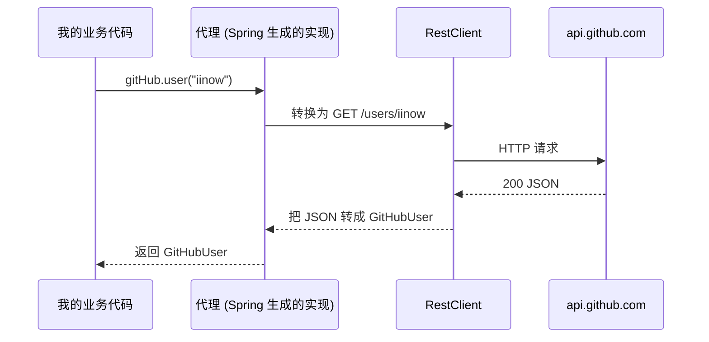
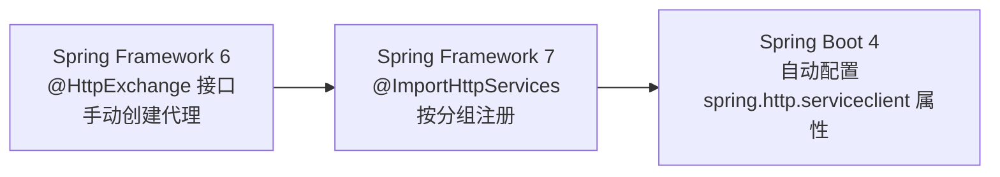
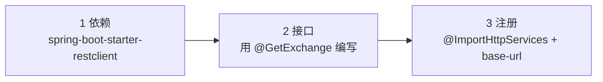
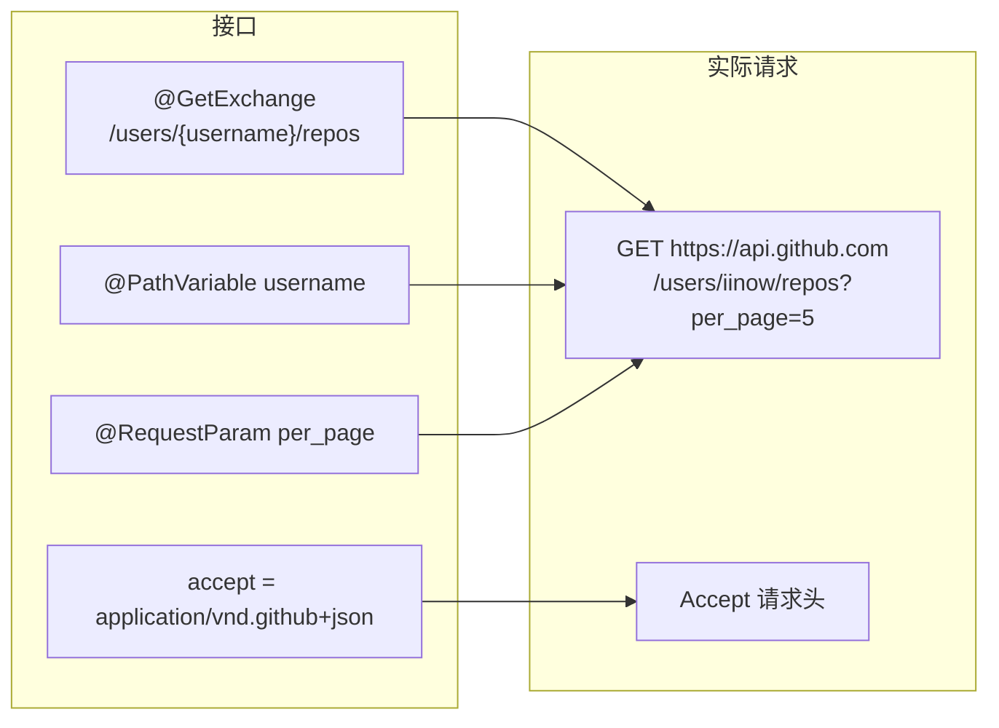
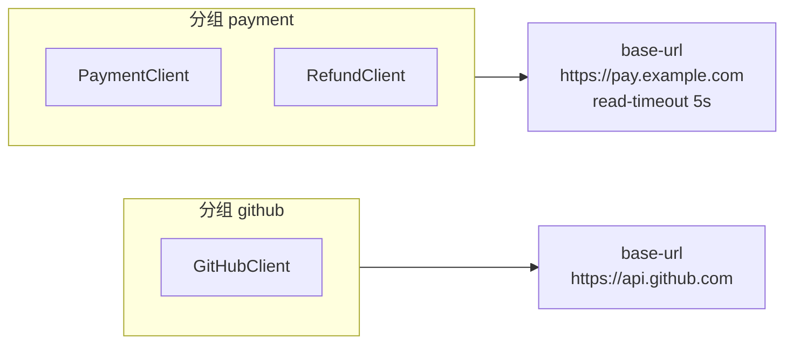
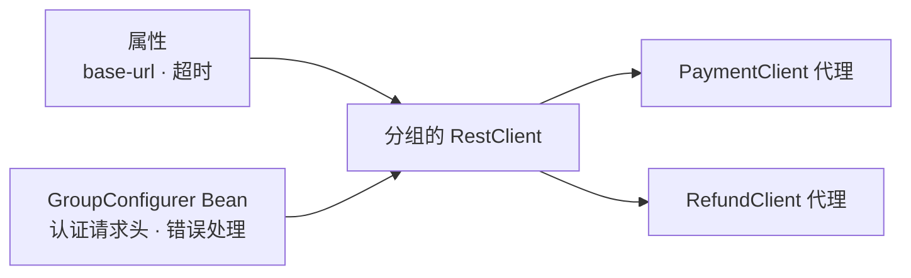
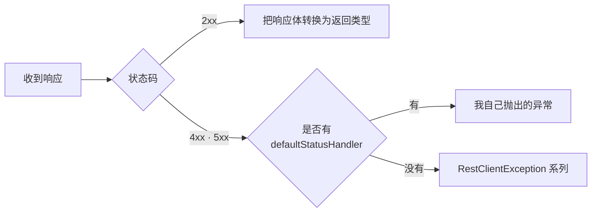
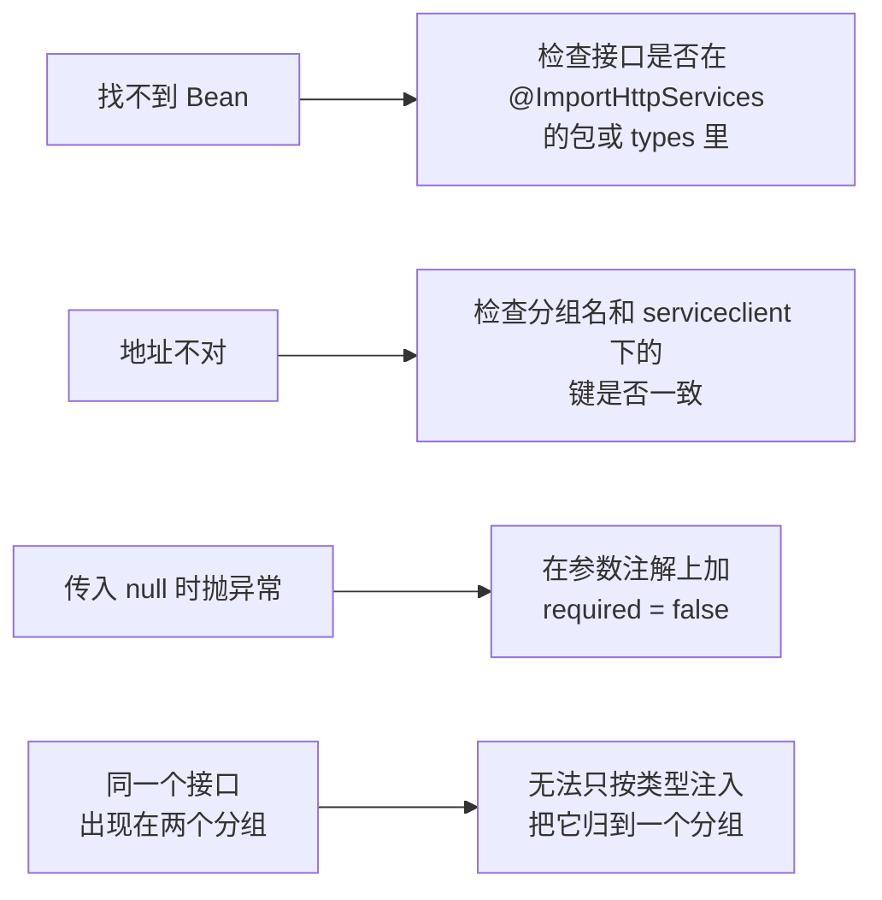
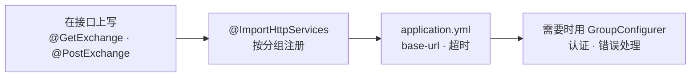

<dl class="facts">
  <div><dt>Spring Boot</dt><dd>4.2.0</dd></div>
  <div><dt>Spring Framework</dt><dd>7.1</dd></div>
  <div><dt>额外的库</dt><dd>0<small>个</small></dd></div>
  <div><dt>接入步骤</dt><dd>3<small>步</small></dd></div>
</dl>

## 只写接口，实现由 Spring 生成

调用其他服务器的 API 时，不必每次都用 `RestClient` 拼地址、转换响应，而是**把想要的调用形式写成接口**。用过 OpenFeign 的话，思路是一样的。区别在于它是 Spring 自带的。



我的代码只是调用一个方法。拼地址、请求头、JSON 转换都交给代理和 `RestClient`。

## 这是这次才有的吗

只对了一半。用接口定义客户端的功能早就有了，**Boot 4 让配置变简单了。**



| | Boot 3 及之前 | Boot 4 起 |
|---|---|---|
| 接口 | `@HttpExchange` | 相同 |
| 注册 Bean | 每个接口都用 `@Bean` 创建代理 | 一行 `@ImportHttpServices` |
| 地址和超时 | 在代码里组装 `RestClient` | `application.yml` 中的属性 |

## 三步接入



### 1. 依赖

Boot 4 的模块拆得很细，`RestClient` 有单独的 starter。

```kotlin
dependencies {
    implementation("org.springframework.boot:spring-boot-starter-webmvc")
    implementation("org.springframework.boot:spring-boot-starter-restclient")
}
```

### 2. 接口

以 GitHub API 为例。响应用 record 接收。

```java
package com.example.clients.github;

public record GitHubUser(String login, String name, String company) {}

public record GitHubRepo(String name, String language, boolean fork) {}
```

```java
package com.example.clients.github;

@HttpExchange(accept = "application/vnd.github+json")
public interface GitHubClient {

    @GetExchange("/users/{username}")
    GitHubUser user(@PathVariable String username);

    @GetExchange("/users/{username}/repos")
    List<GitHubRepo> repos(@PathVariable String username,
                           @RequestParam("per_page") int perPage);
}
```

地址里没有写主机名。主机名在下一步通过属性传入。

### 3. 注册

```java
@SpringBootApplication
@ImportHttpServices(group = "github", basePackages = "com.example.clients.github")
public class Application {
    public static void main(String[] args) {
        SpringApplication.run(Application.class, args);
    }
}
```

```yaml
spring:
  http:
    serviceclient:
      github:
        base-url: "https://api.github.com"
```

接下来像其他 Bean 一样注入使用。

```java
@Service
public class ProfileService {
    private final GitHubClient gitHub;

    public ProfileService(GitHubClient gitHub) {
        this.gitHub = gitHub;
    }

    public String summary(String username) {
        GitHubUser user = gitHub.user(username);
        List<GitHubRepo> repos = gitHub.repos(username, 5);
        return user.name() + " · " + repos.size() + " 个仓库";
    }
}
```

## 一个方法就是一个请求

弄清楚注解和参数分别落在 HTTP 请求的哪个位置，剩下的都是举一反三。



方法注解有 `@GetExchange`、`@PostExchange`、`@PutExchange`、`@PatchExchange`、`@DeleteExchange`，它们都是 `@HttpExchange` 的简写，和 Spring MVC 中 `@GetMapping` 与 `@RequestMapping` 的关系一样。

| 参数 | 落在请求的哪里 |
|---|---|
| `@PathVariable` | 地址中 `{名称}` 的位置 |
| `@RequestParam` | 查询字符串；表单提交（`application/x-www-form-urlencoded`）时放在请求体 |
| `@RequestHeader` | 请求头 |
| `@RequestBody` | 请求体（对象会转换为 JSON） |
| `@CookieValue` | Cookie |
| `@RequestPart`、`MultipartFile` | multipart 的文件和字段 |
| `URI` | 调用时替换整个地址 |

| 返回类型 | 得到的内容 |
|---|---|
| `void` | 只执行，不要响应体 |
| `GitHubUser`、`List<GitHubRepo>` | 响应体转换成的对象 |
| `ResponseEntity<T>` | 状态码、响应头和响应体 |
| `HttpHeaders` | 只要响应头 |

POST 这样写。

```java
@HttpExchange("/v1/payments")
public interface PaymentClient {

    @PostExchange
    PaymentResult pay(@RequestBody PaymentRequest request,
                      @RequestHeader("Idempotency-Key") String key);

    @GetExchange("/{id}")
    ResponseEntity<PaymentResult> find(@PathVariable String id);

    @DeleteExchange("/{id}")
    void cancel(@PathVariable String id);
}
```

## 有多个 API 服务器时按分组划分

分组就是**调用同一个服务器的一组接口**。每个分组可以单独设置地址和超时。



```java
@SpringBootApplication
@ImportHttpServices(group = "github", basePackages = "com.example.clients.github")
@ImportHttpServices(group = "payment", types = {PaymentClient.class, RefundClient.class})
public class Application { }
```

```yaml
spring:
  http:
    clients:
      connect-timeout: 1s          # 所有 HTTP 客户端共用
    serviceclient:
      github:
        base-url: "https://api.github.com"
        read-timeout: 2s
      payment:
        base-url: "https://pay.example.com"
        connect-timeout: 2s
        read-timeout: 5s
        default-header:
          X-Client: order-api
```

| `spring.http.serviceclient.<分组>.` | 含义 |
|---|---|
| `base-url` | 分组的基础地址 |
| `connect-timeout`、`read-timeout` | 连接超时和读取超时 |
| `default-header.<名称>` | 每个请求都带上的请求头 |
| `apiversion.*` | 把 API 版本放进请求头、查询参数等位置的配置 |
| `redirects`、`cookie-handling` | 重定向和 Cookie 的处理方式 |
| `ssl.bundle` | 使用的 SSL bundle |

不写分组时，接口会进入 `default` 分组。

## 认证请求头和错误处理放在一处

属性表达不了的事情（每次计算令牌并放入请求、把错误转换成自己的异常），集中写在一个 `RestClientHttpServiceGroupConfigurer` Bean 里。Boot 会找到这个 Bean，并在创建分组的 `RestClient` 时应用它。



```java
@Configuration
public class HttpClientConfig {

    @Bean
    RestClientHttpServiceGroupConfigurer paymentGroupConfigurer(TokenProvider tokens) {
        return groups -> groups.filterByName("payment").forEachClient((group, builder) -> builder
            // 每个请求都放入最新的令牌
            .requestInterceptor((request, body, execution) -> {
                request.getHeaders().setBearerAuth(tokens.current());
                return execution.execute(request, body);
            })
            // 把 4xx、5xx 转换成自己的异常
            .defaultStatusHandler(HttpStatusCode::isError, (request, response) -> {
                throw new PaymentApiException(response.getStatusCode().value());
            }));
    }
}
```

如果不提供自己的处理器，遇到 4xx、5xx 响应时会抛出 `RestClientException` 系列的异常。



## 与 Boot 3 的写法、OpenFeign 对比

在 Boot 3 中，需要为每个接口手动创建代理。这种写法现在仍然可用，只有一两个客户端、不需要分组时也足够了。

```java
@Bean
GitHubClient gitHubClient(RestClient.Builder builder) {
    RestClient restClient = builder.baseUrl("https://api.github.com").build();
    RestClientAdapter adapter = RestClientAdapter.create(restClient);
    HttpServiceProxyFactory factory = HttpServiceProxyFactory.builderFor(adapter).build();
    return factory.createClient(GitHubClient.class);
}
```

| | OpenFeign | HTTP 服务客户端 |
|---|---|---|
| 依赖 | `spring-cloud-starter-openfeign` | Spring 自带 |
| 接口上的标记 | `@FeignClient(name = "github")` | 接口上不需要。用 `@ImportHttpServices(group = "github")` 注册 |
| 方法 | `@GetMapping`、`@PostMapping` | `@GetExchange`、`@PostExchange` |
| 地址 | `url` 属性或配置属性 | `spring.http.serviceclient.<分组>.base-url` |
| 开启方式 | `@EnableFeignClients` | `@ImportHttpServices` |
| 实际通信 | Feign 客户端 | `RestClient`（或 `WebClient`） |

参数注解（`@PathVariable`、`@RequestParam`、`@RequestBody`）保持不变，所以迁移时只需要改方法注解的名字和注册方式。Spring Cloud OpenFeign 已经不再增加新功能，新项目从这里开始更合适。

## 测试时接上一个假服务器

把 `MockRestServiceServer` 绑定到 `RestClient.Builder`，再用这个 builder 创建代理，就可以在没有网络的情况下验证接口。

```java
class GitHubClientTest {

    @Test
    void user() {
        RestClient.Builder builder = RestClient.builder().baseUrl("https://api.github.com");
        MockRestServiceServer server = MockRestServiceServer.bindTo(builder).build();
        GitHubClient client = HttpServiceProxyFactory
            .builderFor(RestClientAdapter.create(builder.build()))
            .build()
            .createClient(GitHubClient.class);

        server.expect(requestTo("https://api.github.com/users/iinow"))
              .andExpect(header("Accept", "application/vnd.github+json"))
              .andRespond(withSuccess("{\"login\":\"iinow\",\"name\":\"Joonha\"}", MediaType.APPLICATION_JSON));

        assertThat(client.user("iinow").name()).isEqualTo("Joonha");
        server.verify();
    }
}
```

## 实际使用时容易踩的坑



- **不注册就没有 Bean。** 只加 `@HttpExchange` 不会被扫描到，必须在 `@ImportHttpServices` 中写上包或类型。
- **分组名就是属性的键。** `group = "github"` 对应 `spring.http.serviceclient.github`。写错了的话 `base-url` 为空，会用相对地址去调用而失败。
- **参数传 null 会抛异常。** 可以省略的查询参数请写成 `@RequestParam(required = false)`。
- **默认使用 `RestClient`，是同步方式。** 想返回 `Mono` 或 `Flux`，用 `@ImportHttpServices(clientType = HttpServiceGroup.ClientType.WEB_CLIENT)` 选择 `WebClient`，并加入 webclient 的 starter。
- **`RestTemplate` 在 Framework 7 中已被弃用。** 新写的客户端请基于 `RestClient`。

## 总结



- 接口方式从 Framework 6 就有了，**Boot 4 把注册和配置各自缩减到一行。**
- 一个服务器对应一个分组。地址和超时放在属性里，认证和错误处理放在 `RestClientHttpServiceGroupConfigurer` 里。
- 从 OpenFeign 迁移时，只需要改方法注解的名字和注册方式。
