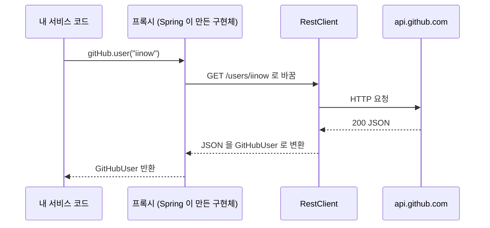
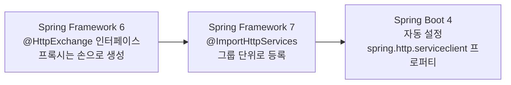
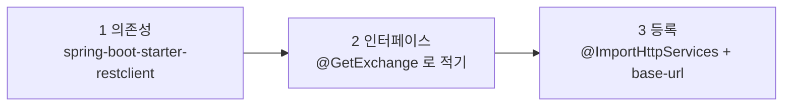
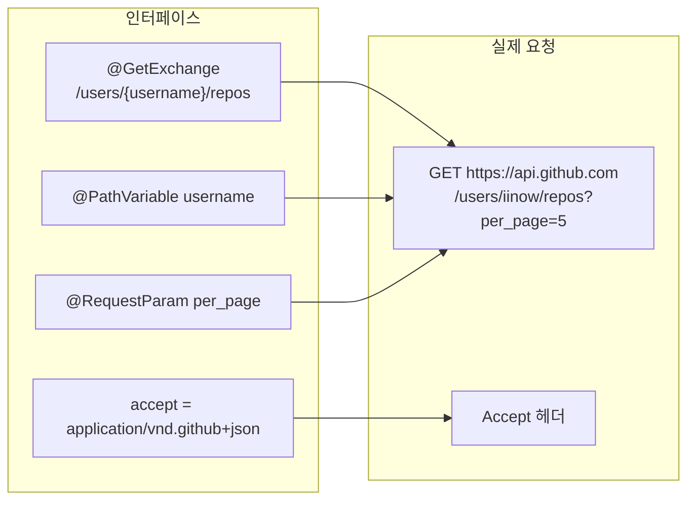
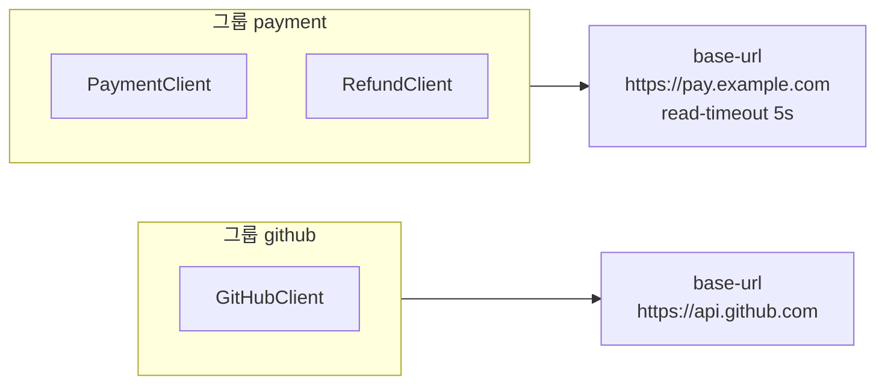
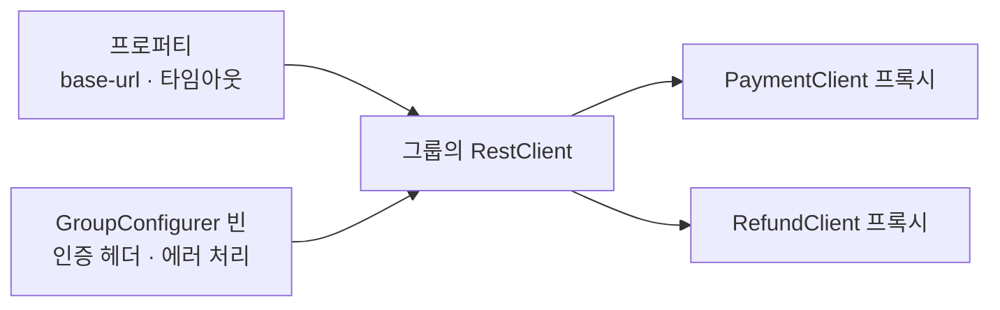
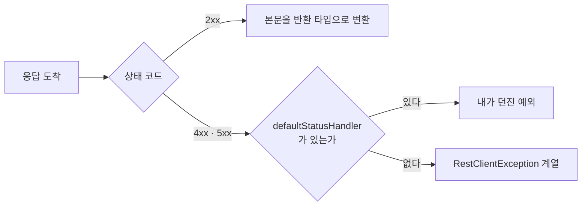
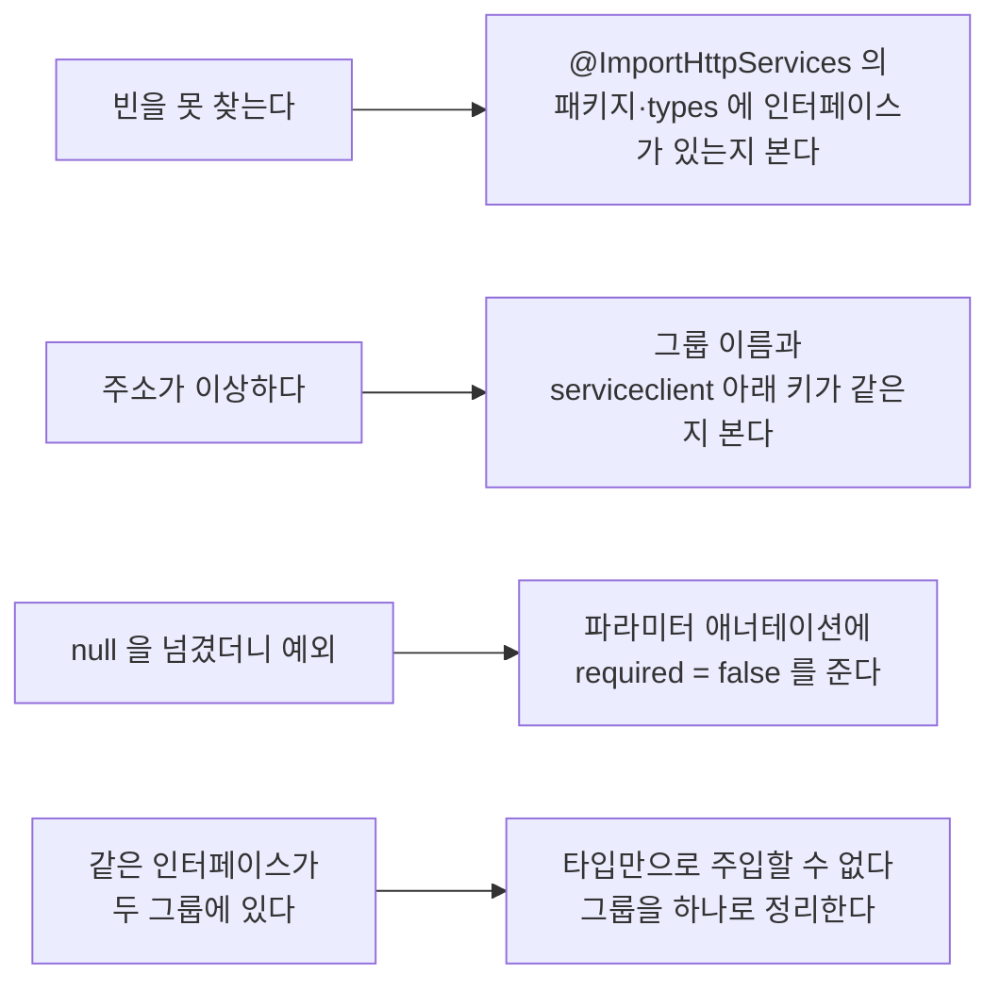
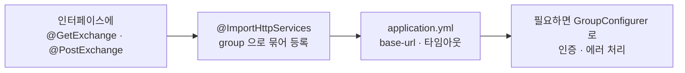

<dl class="facts">
  <div><dt>Spring Boot</dt><dd>4.2.0</dd></div>
  <div><dt>Spring Framework</dt><dd>7.1</dd></div>
  <div><dt>추가 라이브러리</dt><dd>0<small>개</small></dd></div>
  <div><dt>붙이는 단계</dt><dd>3<small>단계</small></dd></div>
</dl>

## 인터페이스만 쓰면 구현은 Spring 이 만든다

다른 서버의 API 를 부를 때 `RestClient` 로 주소를 조립하고 응답을 변환하는 코드를 매번 쓰는 대신, **부르고 싶은 모양을 인터페이스로 적어 두는** 방식입니다. OpenFeign 을 써 봤다면 같은 발상입니다. 차이는 Spring 에 기본으로 들어 있다는 점입니다.



내 코드는 그냥 메서드를 부릅니다. 주소 조립, 헤더, JSON 변환은 프록시와 `RestClient` 가 맡습니다.

## 이번에 나온 건가

절반만 맞습니다. 인터페이스로 클라이언트를 만드는 기능은 예전부터 있었고, **Boot 4 에서 설정이 쉬워졌습니다.**



| | Boot 3 까지 | Boot 4 부터 |
|---|---|---|
| 인터페이스 | `@HttpExchange` | 같음 |
| 빈 등록 | 인터페이스마다 `@Bean` 으로 프록시 생성 | `@ImportHttpServices` 한 줄 |
| 주소·타임아웃 | 코드에서 `RestClient` 를 직접 조립 | `application.yml` 프로퍼티 |

## 세 단계로 붙인다



### 1. 의존성

Boot 4 는 모듈이 잘게 나뉘어서 `RestClient` 가 따로 스타터로 있습니다.

```kotlin
dependencies {
    implementation("org.springframework.boot:spring-boot-starter-webmvc")
    implementation("org.springframework.boot:spring-boot-starter-restclient")
}
```

### 2. 인터페이스

GitHub API 를 예로 듭니다. 응답은 record 로 받습니다.

```java
package com.example.clients.github;

public record GitHubUser(String login, String name, String company) {}

public record GitHubRepo(String name, String language, boolean fork) {}
```

```java
package com.example.clients.github;

@HttpExchange(accept = "application/vnd.github+json")
public interface GitHubClient {

    @GetExchange("/users/{username}")
    GitHubUser user(@PathVariable String username);

    @GetExchange("/users/{username}/repos")
    List<GitHubRepo> repos(@PathVariable String username,
                           @RequestParam("per_page") int perPage);
}
```

주소에 호스트를 적지 않았습니다. 호스트는 다음 단계에서 프로퍼티로 넣습니다.

### 3. 등록

```java
@SpringBootApplication
@ImportHttpServices(group = "github", basePackages = "com.example.clients.github")
public class Application {
    public static void main(String[] args) {
        SpringApplication.run(Application.class, args);
    }
}
```

```yaml
spring:
  http:
    serviceclient:
      github:
        base-url: "https://api.github.com"
```

이제 다른 빈처럼 주입해서 씁니다.

```java
@Service
public class ProfileService {
    private final GitHubClient gitHub;

    public ProfileService(GitHubClient gitHub) {
        this.gitHub = gitHub;
    }

    public String summary(String username) {
        GitHubUser user = gitHub.user(username);
        List<GitHubRepo> repos = gitHub.repos(username, 5);
        return user.name() + " · 저장소 " + repos.size() + "개";
    }
}
```

## 메서드 한 줄이 요청 하나가 된다

애너테이션과 파라미터가 HTTP 요청의 어느 자리로 가는지 보면 나머지는 응용입니다.



메서드 애너테이션은 `@GetExchange`, `@PostExchange`, `@PutExchange`, `@PatchExchange`, `@DeleteExchange` 가 있고, 전부 `@HttpExchange` 의 줄임입니다. Spring MVC 의 `@GetMapping` 과 `@RequestMapping` 관계와 같습니다.

| 파라미터 | 요청의 어디로 가나 |
|---|---|
| `@PathVariable` | 주소의 `{이름}` 자리 |
| `@RequestParam` | 쿼리 스트링. 폼 전송(`application/x-www-form-urlencoded`)이면 본문 |
| `@RequestHeader` | 요청 헤더 |
| `@RequestBody` | 요청 본문 (객체는 JSON 으로 변환) |
| `@CookieValue` | 쿠키 |
| `@RequestPart`, `MultipartFile` | 멀티파트 파일·필드 |
| `URI` | 주소 전체를 호출할 때 바꿈 |

| 반환 타입 | 받는 것 |
|---|---|
| `void` | 본문 없이 실행만 |
| `GitHubUser`, `List<GitHubRepo>` | 본문을 객체로 변환한 값 |
| `ResponseEntity<T>` | 상태 코드·헤더·본문 전부 |
| `HttpHeaders` | 응답 헤더만 |

POST 는 이렇게 씁니다.

```java
@HttpExchange("/v1/payments")
public interface PaymentClient {

    @PostExchange
    PaymentResult pay(@RequestBody PaymentRequest request,
                      @RequestHeader("Idempotency-Key") String key);

    @GetExchange("/{id}")
    ResponseEntity<PaymentResult> find(@PathVariable String id);

    @DeleteExchange("/{id}")
    void cancel(@PathVariable String id);
}
```

## API 서버가 여러 개면 그룹으로 나눈다

그룹은 **같은 서버를 부르는 인터페이스 묶음**입니다. 그룹마다 주소와 타임아웃을 따로 줍니다.



```java
@SpringBootApplication
@ImportHttpServices(group = "github", basePackages = "com.example.clients.github")
@ImportHttpServices(group = "payment", types = {PaymentClient.class, RefundClient.class})
public class Application { }
```

```yaml
spring:
  http:
    clients:
      connect-timeout: 1s          # 모든 HTTP 클라이언트 공통
    serviceclient:
      github:
        base-url: "https://api.github.com"
        read-timeout: 2s
      payment:
        base-url: "https://pay.example.com"
        connect-timeout: 2s
        read-timeout: 5s
        default-header:
          X-Client: order-api
```

| `spring.http.serviceclient.<그룹>.` | 뜻 |
|---|---|
| `base-url` | 그룹의 기본 주소 |
| `connect-timeout`, `read-timeout` | 연결·응답 대기 시간 |
| `default-header.<이름>` | 모든 요청에 붙일 헤더 |
| `apiversion.*` | API 버전을 헤더·쿼리 등에 넣는 설정 |
| `redirects`, `cookie-handling` | 리다이렉트·쿠키 처리 |
| `ssl.bundle` | 사용할 SSL 번들 |

그룹을 적지 않으면 `default` 그룹에 들어갑니다.

## 인증 헤더와 에러 처리는 한곳에서

프로퍼티로 안 되는 것(토큰을 매번 계산해 넣기, 에러를 내 예외로 바꾸기)은 `RestClientHttpServiceGroupConfigurer` 빈 하나에 모읍니다. Boot 가 이 빈을 찾아 그룹의 `RestClient` 를 만들 때 적용합니다.



```java
@Configuration
public class HttpClientConfig {

    @Bean
    RestClientHttpServiceGroupConfigurer paymentGroupConfigurer(TokenProvider tokens) {
        return groups -> groups.filterByName("payment").forEachClient((group, builder) -> builder
            // 요청마다 토큰을 새로 넣는다
            .requestInterceptor((request, body, execution) -> {
                request.getHeaders().setBearerAuth(tokens.current());
                return execution.execute(request, body);
            })
            // 4xx · 5xx 를 내 예외로 바꾼다
            .defaultStatusHandler(HttpStatusCode::isError, (request, response) -> {
                throw new PaymentApiException(response.getStatusCode().value());
            }));
    }
}
```

에러 처리를 따로 두지 않으면 4xx·5xx 응답에서 `RestClientException` 계열 예외가 던져집니다.



## Boot 3 방식, OpenFeign 과 나란히 보면

Boot 3 에서는 인터페이스마다 프록시를 직접 만들었습니다. 지금도 동작하고, 그룹 없이 한두 개만 쓸 때는 이 방식도 충분합니다.

```java
@Bean
GitHubClient gitHubClient(RestClient.Builder builder) {
    RestClient restClient = builder.baseUrl("https://api.github.com").build();
    RestClientAdapter adapter = RestClientAdapter.create(restClient);
    HttpServiceProxyFactory factory = HttpServiceProxyFactory.builderFor(adapter).build();
    return factory.createClient(GitHubClient.class);
}
```

| | OpenFeign | HTTP 서비스 클라이언트 |
|---|---|---|
| 의존성 | `spring-cloud-starter-openfeign` | Spring 에 기본 포함 |
| 인터페이스 표시 | `@FeignClient(name = "github")` | 인터페이스에는 없음. `@ImportHttpServices(group = "github")` 로 등록 |
| 메서드 | `@GetMapping`, `@PostMapping` | `@GetExchange`, `@PostExchange` |
| 주소 | `url` 속성 또는 프로퍼티 | `spring.http.serviceclient.<그룹>.base-url` |
| 켜기 | `@EnableFeignClients` | `@ImportHttpServices` |
| 실제 통신 | Feign 클라이언트 | `RestClient` (또는 `WebClient`) |

파라미터 애너테이션(`@PathVariable`, `@RequestParam`, `@RequestBody`)은 그대로라서, 옮길 때는 메서드 애너테이션 이름과 등록 방식만 바꾸면 됩니다. Spring Cloud OpenFeign 은 기능 추가를 멈춘 상태라 새 프로젝트라면 이쪽으로 시작하는 편이 낫습니다.

## 테스트는 가짜 서버를 물려서

`MockRestServiceServer` 를 `RestClient.Builder` 에 묶고, 그 빌더로 프록시를 만들면 네트워크 없이 인터페이스를 검증할 수 있습니다.

```java
class GitHubClientTest {

    @Test
    void user() {
        RestClient.Builder builder = RestClient.builder().baseUrl("https://api.github.com");
        MockRestServiceServer server = MockRestServiceServer.bindTo(builder).build();
        GitHubClient client = HttpServiceProxyFactory
            .builderFor(RestClientAdapter.create(builder.build()))
            .build()
            .createClient(GitHubClient.class);

        server.expect(requestTo("https://api.github.com/users/iinow"))
              .andExpect(header("Accept", "application/vnd.github+json"))
              .andRespond(withSuccess("{\"login\":\"iinow\",\"name\":\"Joonha\"}", MediaType.APPLICATION_JSON));

        assertThat(client.user("iinow").name()).isEqualTo("Joonha");
        server.verify();
    }
}
```

## 써 보면 걸리는 것들



- **등록하지 않으면 빈이 없습니다.** `@HttpExchange` 를 붙였다고 스캔되지 않습니다. `@ImportHttpServices` 에 패키지나 타입을 적어야 합니다.
- **그룹 이름이 곧 프로퍼티 키입니다.** `group = "github"` 이면 `spring.http.serviceclient.github` 입니다. 오타가 나면 `base-url` 이 비어 상대 주소로 호출하려다 실패합니다.
- **파라미터에 null 을 넘기면 예외입니다.** 생략할 수 있는 쿼리 파라미터는 `@RequestParam(required = false)` 로 둡니다.
- **기본은 `RestClient`, 동기 방식입니다.** `Mono`·`Flux` 를 반환하려면 `@ImportHttpServices(clientType = HttpServiceGroup.ClientType.WEB_CLIENT)` 로 `WebClient` 를 고르고 webclient 스타터를 넣습니다.
- **`RestTemplate` 은 Framework 7 에서 지원 중단 대상이 됐습니다.** 새로 만드는 클라이언트는 `RestClient` 기반으로 둡니다.

## 정리



- 인터페이스 방식은 Framework 6 부터 있었고, **Boot 4 에서 등록과 설정이 한 줄씩으로 줄었습니다.**
- 서버 하나가 그룹 하나입니다. 주소와 타임아웃은 프로퍼티에, 인증과 에러 처리는 `RestClientHttpServiceGroupConfigurer` 에 둡니다.
- OpenFeign 에서 옮길 때는 메서드 애너테이션 이름과 등록 방식만 바꾸면 됩니다.
